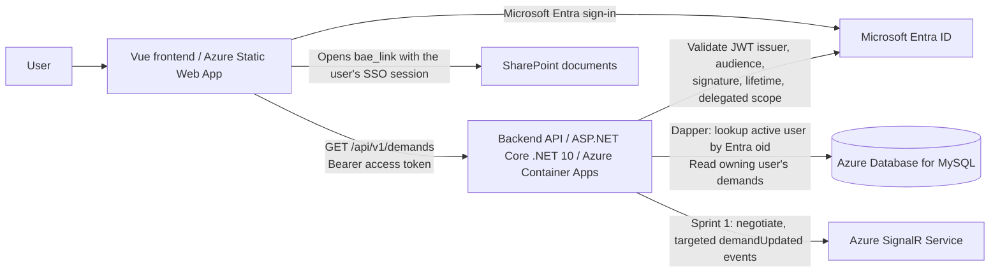
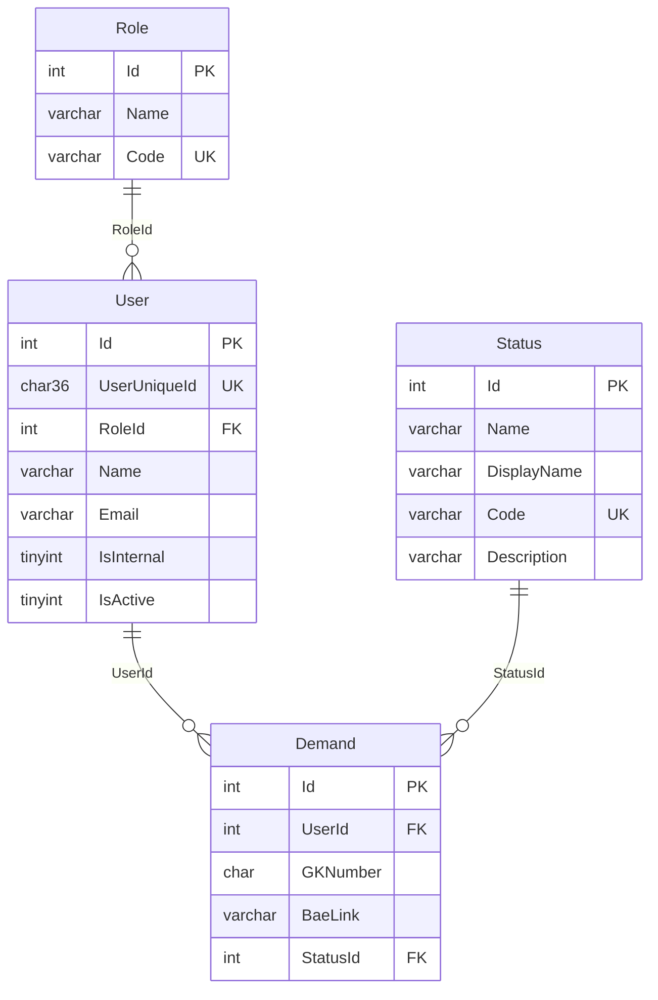

# KLESIA — Backend Functional & Technical Specification

**Document ID:** KLESIA-BE-SPEC  
**Version:** 1.6 (Sprint 1 / Lot 1 baseline, revised; database engine changed to Azure Database for MySQL, DEC-14; hosting changed to Azure Container Apps, DEC-15; SignalR negotiation and the first notification moved into Sprint 1, DEC-16)  
**Date:** 2026-11-12  
**Status:** Implementation-ready for Sprint 1; future contracts recorded separately  
**Language:** English  
**Primary audience:** Backend engineers, database engineers, AI coding agents, QA and infrastructure engineers

> **Purpose.** This document specifies the incremental implementation of the KLESIA backend. Sprint 1 delivers an authenticated, authorized read-only demand-list API and the relational database supporting that view. The SignalR negotiation endpoint and the *demand stored* notification are Sprint 1 work as well (DEC-16). The demand-creation (PDF upload) contract is **adopted** jointly with the frontend **but is not Sprint 1 implementation work**. The machine-readable HTTP contract of all three endpoints is `contracts/openapi.yaml` (workspace root), the single source of truth: this document and the OpenAPI file MUST stay identical on every HTTP detail. Later sprints should extend this document rather than silently changing existing contracts.

> **Terminology.** "Sprint 1" in this document is the delivery called **Lot 1 (LOT1)** by the client. Demand creation (`POST /api/v1/demands`) is **not part of Lot 1**. The SignalR negotiation and the first of the two notifications (*demand stored*, §7.2) **are** part of Lot 1; the second notification (*extraction completed*, OCR) is not.

## 1. Normative language and scope

- **MUST / SHALL**: mandatory for the applicable sprint.
- **SHOULD**: recommended unless there is a documented reason not to follow it.
- **MAY**: optional.
- An explicit **ASSUMPTION** is a proposed implementation choice, not an established client requirement. Agents may use it for Sprint 1 unless an existing repository convention or signed-off decision contradicts it.
- **DEFERRED** requirements are documented interfaces for subsequent sprints; do not create placeholder endpoints that claim to implement them.
- Changes to endpoint semantics, JSON field names, auth requirements, the database schema, or access rules MUST be deliberate and documented.

### 1.1 Sprint 1 deliverables (IN SCOPE)

| ID | Required outcome |
|---|---|
| S1-DB-01 | A buildable database migrator project (DbUp, §3.5) under the already initialized `database/` directory with versioned scripts for exactly the four required business/security tables of Azure Database for MySQL. |
| S1-DB-02 | A migrator that builds with `dotnet build` (`database/Klesia.Database/Klesia.Database.csproj`) and applies the versioned scripts to an Azure Database for MySQL database with `dotnet run`, recording them in the `SchemaVersions` journal. |
| S1-DB-03 | Working reference-data and user seed scripts (`Seeds/01_RefData.sql`, `Seeds/02_User.sql`), safe for repeated execution. |
| S1-AUTH-01 | Entra ID JWT bearer access-token validation for the backend API. |
| S1-AUTH-02 | Database allowlist authorization: only existing, active users can access the protected data. |
| S1-API-01 | `GET /api/v1/demands`, returning the signed-in user's identity details and only their demands. |
| S1-API-02 | Explicit, safe HTTP responses for authentication, authorization, database and other server errors. |
| S1-RT-01 | `POST /api/v1/notifications/negotiate` (§7.1): Entra-protected negotiation of the Azure SignalR connection (Serverless mode, hub `demands`, `userId` = `oid`). |
| S1-RT-02 | The notification publisher (§7.2): an `INotifier` port in `Application` and its Azure SignalR implementation in `Infrastructure`, sending `demandUpdated` to one user, for the notification **N-1 *demand stored***. Nothing calls it in production before Lot 2 (`POST /api/v1/demands`): it is delivered and tested on its own (NOT-05). |
| S1-OPS-01 | Configuration, allowed frontend origins, reproducible local run/build instructions and verification tests. |
| S1-OPS-02 | A production container image definition (`Dockerfile`, `.dockerignore`) for the API and committed deployment instructions and pipeline for Azure Container Apps (DEC-15, §6.3). The migrator is delivered separately (S1-DB-02) and is not part of the image. |

### 1.2 Explicitly OUT OF SCOPE for Sprint 1

- The notification **N-2 *extraction completed*** (OCR) and everything it needs (extraction worker, status mutation, write permission on `Demand.StatusId`): **not specified yet, see OPEN-09**.
- Any production caller of the notifier: it is first called by `POST /api/v1/demands` in Lot 2 (N-1) and later by the extraction step (N-2). No status-changing HTTP endpoint is specified.
- `POST /api/v1/demands` (demand creation with PDF upload, size/content validation and SharePoint storage): **contract adopted in §7.3 and `contracts/openapi.yaml`, implementation deferred; not part of Lot 1**.
- Demand update, delete, status transitions (other than the initial `pending`), pagination, filtering or searching.
- Provisioning new users via API; management of roles/users via API.
- Additional business entities, audit-history tables, or user-role join tables.
- Implementation of the adopted non-Sprint-1 endpoint (demand creation); see **OPEN-01**.

### 1.3 Known gaps, decisions and conflict resolution

| ID | Observation / decision | Handling |
|---|---|---|
| OPEN-01 | **Resolved.** The overall API has **three HTTP endpoints**, all with an adopted contract: `GET /api/v1/demands` (§5.1, Sprint 1), `POST /api/v1/notifications/negotiate` (§7.1, Sprint 1 since DEC-16) and `POST /api/v1/demands` (§7.3, Lot 2). The `demandUpdated` event is **not** HTTP. | The contract of all three is frozen in `contracts/openapi.yaml`. `GET /api/v1/demands`, `POST /api/v1/notifications/negotiate` and `GET /health` are implemented in Sprint 1; do not create a placeholder route for `POST /api/v1/demands`, which is implemented in Lot 2. |
| OPEN-02 | The broad API description includes SignalR, while the first Sprint 1 statement limited functionality to the initial user/demand screen. | **Resolved by DEC-16.** The client decided that the SignalR channel belongs to Lot 1: implement the list route, the negotiate route and the notifier now (§7). |
| OPEN-03 | The precise delegated API scope name, Entra tenant ID and API application ID are absent. | Supplied through configuration (§6.1: `AzureAd:*`); never hard-coded. The API refuses to start while they are missing or still placeholders. |
| OPEN-04 | **Resolved.** The only authorization rule for now is *own data only*: an authenticated, allowlisted, active user receives exclusively the demands whose `Demand.UserId` is their own `sec_User.Id`. | The role codes `admin`, `operational` and `guest` are confirmed as the real codes, but **no role grants or removes any access in Sprint 1**. Do not infer cross-user, administrator or role-based behavior. |
| OPEN-05 | **Resolved.** The PDFs are stored in **SharePoint**. `Demand.BaeLink` holds the absolute HTTPS URL of the document in SharePoint. | The API returns that URL after validating that it is an absolute HTTPS URL. SharePoint permissions are the access gate: the browser opens the link with the user's own Entra single sign-on session, so no bearer header, no SAS-style signature and no anonymous link is involved. The links are **permanent** SharePoint URLs: no time-limited, signed or anonymous sharing links are used, and `IBaeLinkResolver` stays a pass-through. Changing this needs a separate decision (tenant sharing policy, Graph permissions). |
| INT-05 | `maxPdfSizeMb`: 10 MB is illustrative, not confirmed. | The upload endpoint is now specified (§7.3). The limit is the backend setting `Upload:MaxPdfSizeMb`, provisionally 10 (1 MB = 1,048,576 bytes); it MUST equal the webapp's `public/config/app-config.json` value and be confirmed by the operator before production. |
| INT-08 | Exact error-body JSON structure. | **Resolved.** Every error response of an application route is RFC 9457 (7807) `application/problem+json` (§5.2). The HTTP status stays the primary signal; the frontend never renders server text. |
| DEC-01 | Backend target framework. | **.NET 10 (`net10.0`)** from the start (SDK pinned in `global.json`). |
| DEC-02 | Data access technology. | **Dapper** over **`MySqlConnector`** (DEC-14). **Entity Framework Core, `DbContext` and EF migrations MUST NOT be used.** The SQL scripts of the database migrator (`database/Klesia.Database`) are the single owner of the schema; versioned SQL scripts are not EF migrations. |
| DEC-03 | Existing repository files take precedence over earlier draft DDL. | Primary keys are named `Id` (DEC-12, DB-03), constraint names follow the single scheme of DB-06, column sizes and defaults follow the original table definitions, and the `ref` grouping is kept as the `ref_` table prefix. The draft DDL in earlier revisions of this document is superseded by §3.4. |
| DEC-04 | Where configuration values live. | Entra, CORS and SQL settings are configuration-file values (§6.1), never code constants. |
| DEC-05 | Seeded identity. | The seed script creates the project owner's account as an active `admin` user, as explicitly requested. Further identities are added by editing the same script. |
| DEC-06 | Local development against Azure Database for MySQL. | The connection string (`ConnectionStrings:KlesiaDb`, §6.1) carries **no password**. When the `Password` is absent, `Infrastructure` obtains a Microsoft Entra access token for `https://ossrdbms-aad.database.windows.net/.default` through `DefaultAzureCredential` and supplies it as the MySQL password, refreshed periodically (a token lives 5 to 60 minutes): the developer's `az login` / Visual Studio account on a PC, the **user-assigned** managed identity in Azure (`AZURE_CLIENT_ID`; Flexible Server supports only user-assigned identities). **ASSUMPTION:** "no `Password` means Entra token" is the only switch. No password is ever stored in a tracked file. |
| DEC-07 | Hosting topology. | **Superseded by DEC-15** for the backend (it was Azure App Service). Unchanged: backend connected to **Azure Database for MySQL – Flexible Server**; frontend on **Azure Static Web Apps**. |
| DEC-08 | Canonical HTTP contract. | `contracts/openapi.yaml` is the single source of truth for routes, schemas, status codes, headers and CORS. This document explains and constrains it; any conflict is fixed in both files in the same change. |
| DEC-09 | JSON naming convention. | Business payloads (request parts and response bodies) use `snake_case`. The SignalR negotiation response (`url`, `accessToken`) is a protocol payload whose names are fixed by the SignalR client; it is, with `ProblemDetails` (RFC 9457 / ASP.NET Core standard names such as `traceId`), one of the **only two** camelCase exceptions; neither is renamed. |
| DEC-10 | Success status of `POST /api/v1/demands`. | `201 Created` with the created demand as body (same shape as a `demands[]` item). There is no single-demand route, so no `Location` header is sent. The frontend treats any 2xx as success and ignores the body. |
| DEC-11 | Delegated scope name. | The delegated scope is named `access_as_user` (fixed in the contract's OAuth2 security scheme and set in `AzureAd:RequiredScope`). The full scope requested by the SPA is `api://<API client id>/access_as_user`. |
| DEC-12 | Primary-key naming. | Every primary key is named `Id` (`sec_Role.Id`, `sec_User.Id`, `ref_Status.Id`, `Demand.Id`), as in the database project. Foreign keys keep the `{ReferencedTable}Id` form (`RoleId`, `UserId`, `StatusId`). Dapper queries alias keys to the domain names (`d.Id AS DemandId`); the JSON field `demand_id` is `Demand.Id`. This replaces the earlier `{Table}Id` rule. |
| DEC-13 | Copy of the uploaded PDF into SharePoint (demand creation, **not part of Lot 1**). | **Requirement:** the backend MUST copy the PDF received by `POST /api/v1/demands` into the SharePoint document library and MUST store the resulting permanent HTTPS link in `Demand.BaeLink`, so that the user can open the document later from the `bae_link` returned by `GET /api/v1/demands`. The browser never uploads to SharePoint; the database stores the link, never the file; the API server keeps no copy. All SharePoint access is isolated in `IBaeDocumentStore` (Infrastructure). The stored file name is generated by the backend (for example `{GKNumber}/{unique id}.pdf`) and never taken from the client, so repeated submissions of the same GK number cannot overwrite each other. **ASSUMPTION** (to confirm with the Microsoft 365 administrators before that sprint): upload through Microsoft Graph as the container app's user-assigned managed identity with the least-privilege `Sites.Selected` permission on the one target site; site, library and base folder come from configuration (`SharePoint:*`, §6.1), never from code or from the client. Who may open a document stays a SharePoint matter (OPEN-05): the library permissions must let the intended users open it; the API does not manage per-document permissions. |
| OPEN-06 | **Resolved.** How the uploaded BAE PDF reaches SharePoint. | Stated as an explicit requirement in **DEC-13**: copy into SharePoint, store the link in `Demand.BaeLink`. Only deployment settings remain (site, library, folder, permission grant); they are configuration, not an open question about the HTTP contract. Out of Lot 1. |
| DEC-14 | Database engine: **Azure Database for MySQL** (replaces SQL Server / Azure SQL Database). | The customer's DSI requires **Azure Database for MySQL – Flexible Server, MySQL 8.4** (DB-15). Decided consequences: (1) **one database with prefixed tables** `sec_Role`, `sec_User`, `ref_Status`, `Demand`, because MySQL has no schemas inside a database (DB-02); (2) a **DbUp migrator** (`database/Klesia.Database`) replaces the `.sqlproj` / DACPAC / `SqlPackage` chain (§3.5); (3) **`MySqlConnector` 2.4.0** replaces `Microsoft.Data.SqlClient` (version 3.0.0 appeared on the day of this decision and is not adopted yet); (4) **passwordless access with Microsoft Entra**: the access token is the MySQL password (DEC-06); (5) `UserUniqueId` is `CHAR(36)` and `IsActive`/`IsInternal` are `TINYINT(1)`, each with a `CHECK` that keeps the old type guarantee; (6) collation `utf8mb4_0900_ai_ci` (DB-13); (7) `PK_`/`DF_` names are dropped from DB-06 because MySQL cannot name them. The HTTP contract, JSON, authorization rules and API behavior are **unchanged**; the SQL of the repositories is rewritten in MySQL dialect (backtick quoting, `LIMIT`, `LAST_INSERT_ID()`), an implementation detail of `Infrastructure`. |
| DEC-15 | Hosting: **Azure Container Apps** (replaces Azure App Service, DEC-07). | The customer's DSI requires that the API be deployed in **Azure Container Apps**. The frontend stays on Azure Static Web Apps and the database on Azure Database for MySQL (DEC-14). Decided consequences: (1) the API is delivered as a **container image** built from a `Dockerfile` at the repository root (§6.3, HOST-01); (2) the container listens on plain **HTTP port 8080** and runs as a non-root user: **TLS ends at the Container Apps ingress**, never in Kestrel (HOST-02, HOST-03); (3) the ingress is the only entry point, so the API reads `X-Forwarded-For` / `X-Forwarded-Proto` (HOST-04); (4) the Container Apps **probes** replace the App Service health check, `GET /health` is unchanged (§5.3, HOST-05); (5) the identity is a **user-assigned managed identity** attached to the container app and selected with the environment variable `AZURE_CLIENT_ID` (DEC-06, HOST-06); (6) configuration comes from **environment variables** (`Section__Key`) and, if ever needed, Container Apps secrets, never from the image (HOST-07); (7) the API is **stateless** and logs to the console only, collected by Log Analytics (HOST-08, HOST-10); (8) the DbUp migrator is **not** part of the API image: the GitHub Actions pipeline runs it as a step before the new revision is deployed (HOST-12). The HTTP contract, JSON, authorization rules, database schema and the Clean Architecture of the code are **unchanged**. |
| DEC-16 | Real-time notifications and Lot 1. | The client decided (2026-11-12) that the backend notifies the owner through Azure SignalR **at two moments**: **N-1** when a new demand has been stored in the database (the frontend then reloads its list with `GET /api/v1/demands`) and **N-2** when the OCR extraction of the PDF is finished and the demand status changes (the frontend reloads the same way). Both use the same event `demandUpdated` with no payload (§7.2). **Only N-1 is developed in Lot 1**, with the negotiate route it needs. Because `POST /api/v1/demands` is Lot 2, Lot 1 delivers the channel and a tested publisher but **no production caller** (NOT-05). N-2 is not specified yet (OPEN-09). |
| OPEN-07 | **Open: to confirm with the customer's DSI.** Azure Database for MySQL deployment settings. | (a) MySQL version: 8.4 is the target (DB-15). (b) Server name, database `klesia`, region and network access (public access with firewall rules, or private access: the Container Apps environment must reach the server, see OPEN-08). (c) Entra authentication: an Entra administrator on the server, a **user-assigned** managed identity as server identity with the Microsoft Graph permissions (or *Directory Readers* role) granted by a Privileged Role Administrator, and the database users for the runtime and deployment principals. (d) The `lower_case_table_names` setting (DB-04). (e) TLS is mandatory: confirm the CA chain so `SslMode=VerifyFull` can be used. (f) Whether `aad_auth_only` is `ON`. Until confirmed none of this is hard-coded: it is configuration (§6.1). |
| OPEN-08 | **Open: to confirm with the customer's DSI.** Azure Container Apps deployment settings. | (a) The Container Apps environment (type, region) and whether it is integrated in a virtual network. (b) The network path to MySQL (OPEN-07b): the outbound addresses of a Container Apps environment are not a stable firewall allowlist unless the environment sits in a virtual network with fixed egress, so private access is the preferred target. (c) Ingress exposure: external (the browser of the Static Web App calls the API) or behind another entry point, IP restrictions, custom domain and certificate. (d) The container registry (Azure Container Registry name; the managed identity pulls with `AcrPull`), image retention and tag policy. (e) Minimum and maximum replicas (a minimum of 0 means a cold start, whose first request also acquires the Entra token and opens the TLS connection to MySQL), CPU/memory size, the scaling rule and the probe thresholds. (f) The maximum request body size and the request timeout of the ingress (240 s documented) against `Upload:MaxPdfSizeMb`, before the upload sprint. (g) Who owns the infrastructure code (Bicep): the DSI's infrastructure contract or this repository, and the role assignments (`AcrPull`, `Sites.Selected`, SignalR). (h) The Log Analytics workspace and the telemetry backend (§6.2). (i) GitHub Actions to Azure authentication: an OpenID Connect federated credential on a deployment principal (no stored secret), environments and approvals. Until confirmed none of this is hard-coded: it is configuration or infrastructure code. |
| OPEN-09 | **Open: N-2 *extraction completed* is not specified.** | The notification itself is technically simple: Azure SignalR Service in Serverless mode accepts a REST publish addressed to one user id from any process that holds the right identity, so the extraction step can call the same notifier once it has stored its result. What is missing is the extraction design: the OCR engine and where it runs (a worker inside or outside this API, a queue), the status transitions (`pending` to `ok` or `fail`), who may change `Demand.StatusId` (the runtime database identity is `SELECT` only today, §6.2, so a writer identity or permission is needed), retries, and the owner lookup (the worker reads the owner's `oid` from the database, never from the PDF). Specify these in a later sprint section; do not implement N-2 in Lot 1. |

## 2. System context and architectural boundaries



**Technology baseline:**

- Database (**DEC-14**): **Azure Database for MySQL – Flexible Server, MySQL 8.4**, one database (`klesia`) whose schema is created by the DbUp migrator project in `database/Klesia.Database`. **The migrator's SQL scripts are the only owner of the schema.**
- Backend (**DEC-01**): ASP.NET Core Web API in C# on **.NET 10 (`net10.0`)**, following the existing Clean Architecture solution (`Domain`, `Application`, `Infrastructure`, `WebApi`; dependencies point inward only).
- Data access (**DEC-02**): **Dapper** with `MySqlConnector`, implemented in `Infrastructure` behind repository interfaces declared in `Application`. **Entity Framework Core, `DbContext`, EF migrations and EF design-time tooling MUST NOT be used.** Every SQL statement is a parameterized, hand-written query.
- Authentication: Microsoft Entra ID, JWT bearer **access tokens intended for this API**, validated with the ASP.NET Core JWT bearer middleware.
- Authorization: explicit server-side SQL allowlist (`sec_User`) after JWT validation; the only access rule is *own demands only* (OPEN-04).
- Documents: PDFs live in SharePoint; `Demand.BaeLink` stores the document URL (OPEN-05).
- Frontend: existing Vue application hosted in Azure Static Web Apps, with Vite local development at `http://localhost:5173`.
- Hosting (**DEC-15**, which supersedes DEC-07): this API runs as a container in **Azure Container Apps** (connected to Azure Database for MySQL), see §6.3; the frontend runs on **Azure Static Web Apps**.
- Configuration (**DEC-04**): environment-specific; tenant ID, API client ID, delegated scope, allowed origins and the SQL connection string are configuration values, not source code (§6.1).
- Database connection: least-privilege runtime identity; the **user-assigned** managed identity in Azure and the developer's own Entra account on a PC, both through a Microsoft Entra access token used as the password (DEC-06). The credential used by the migrator is a **deployment** concern and must not be copied into frontend settings or application settings.

## 3. Database specification — Sprint 1

> **Engine change (DEC-14).** The customer's DSI requires **Azure Database for MySQL (Flexible Server)**. Version 1.3 of this document targeted Azure SQL Database; every database requirement below replaces it. Business behavior, table and column names, the API contract and the authorization rules are unchanged.

### 3.1 Design requirements

| ID | Requirement |
|---|---|
| DB-01 | Use a separate script file for every table (and, by DB-14, one DDL object per migration script). |
| DB-02 | Exactly four domain tables: `sec_Role`, `sec_User`, `ref_Status`, `Demand`, all in one database (`klesia`). MySQL has no schemas inside a database (a schema *is* a database), so the former `sec`, `ref` and `dbo` schemas are expressed as a **table-name prefix**: `sec_` for security tables, `ref_` for reference/lookup tables (the status lookup), no prefix for business data (DEC-14). |
| DB-03 | Every table has a primary key named `Id`: `Id INT NOT NULL AUTO_INCREMENT` (`sec_Role.Id`, `sec_User.Id`, `ref_Status.Id`, `Demand.Id`). Foreign-key columns are named `{ReferencedTable}Id` with the unprefixed table name (`RoleId`, `UserId`, `StatusId`), see DEC-12. |
| DB-04 | All table (after its prefix) and column identifiers use PascalCase; the prefixes `sec_` and `ref_` are lower case. Every identifier is spelled identically in every statement and quoted with backticks in scripts. The server may store table names in lower case (`lower_case_table_names`, Azure's default; confirm in OPEN-07), so two tables must never differ only by case and no code may rely on case to tell tables apart. |
| DB-05 | Declare every foreign key explicitly and create an index with the foreign-key column as leading key (declared in the same `CREATE TABLE`, so MySQL reuses it instead of generating one). Do not create an index that duplicates the primary key or a unique constraint. |
| DB-06 | Name every foreign key, unique key, check and index with the **single scheme** below. Primary keys and defaults cannot be named in MySQL. |
| DB-07 | Enforce all described mandatory fields through `NOT NULL`; apply only justified checks/uniqueness. |
| DB-08 | Use MySQL-native types (DEC-14 maps each). Do not introduce `FLOAT`/`DOUBLE` for future monetary or percentage data (use `DECIMAL`). No such fields exist in Sprint 1. |
| DB-09 | Do not declare `ON DELETE` / `ON UPDATE` actions and do not add cascade deletes: InnoDB's default (`RESTRICT`) is the equivalent of the former `NO ACTION`. |
| DB-10 | Maintain third-normal-form style associations; do not copy role, status or user names onto `Demand`. |
| DB-11 | Re-running the deployment MUST preserve user-generated and existing business data: migrations are applied once and recorded, seeds are idempotent. Destructive schema changes (drop, narrowing, rename) require explicit review: the migrator has no automatic data-loss blocking. |
| DB-12 | The runtime reads the database exclusively through Dapper with parameterized SQL (see §2). No ORM mapping drives the schema. |
| DB-13 | Engine **InnoDB** (foreign keys, `CHECK`), character set **`utf8mb4`**, collation **`utf8mb4_0900_ai_ci`**, declared explicitly on every table. Comparisons are case- and accent-insensitive (the former model collation was `1033, CI`); no key relies on case or accents, and where case matters (`ref_Status.Code`, `Demand.GKNumber`) the constraint states a case-sensitive match explicitly. |
| DB-14 | MySQL DDL is **not transactional** (each statement commits implicitly). Every migration script holds **one** DDL object, so a failure never leaves a half-applied script. A script applied in any shared environment is **immutable**: corrections are new, higher-numbered scripts. A script must not contain a semicolon inside a comment or string literal (the DbUp splitter cuts on it). |
| DB-15 | The database is **Azure Database for MySQL – Flexible Server running MySQL 8.4**. `CHECK` constraints are only enforced from MySQL 8.0.16, so a server older than that is unsupported. MySQL 8.0 is not targeted (its standard support on Azure ends on 2027-01-31) and 5.7 is out of standard support. |

**Naming scheme (DB-06)** — `{Table}` is the **logical** table name without its prefix (`Role`, `User`, `Status`, `Demand`); the pattern is the same for every table. Foreign-key and check names are unique per database in MySQL, so no two objects may share a name.

| Object | Pattern | Examples |
|---|---|---|
| Primary key | not nameable (MySQL always calls it `PRIMARY`) | — |
| Foreign key | `FK_{Table}_{ReferencedTable}` (the table that holds the column first) | `FK_User_Role`, `FK_Demand_User`, `FK_Demand_Status` |
| Unique (alternate) key | `AK_{Table}_{Column}` (the unique index carries the same name) | `AK_Role_Code`, `AK_User_UserUniqueId`, `AK_Status_Code` |
| Check | `CK_{Table}_{Column}` (or `CK_{Table}_{Rule}` when it spans columns) | `CK_Status_Code`, `CK_User_UserUniqueId`, `CK_User_Flags`, `CK_Demand_GKNumber`, `CK_Demand_BaeLink` |
| Default | not nameable: declared inline with the column | — |
| Non-unique index | `IX_{Table}_{Column}[_{Column}]` | `IX_User_RoleId`, `IX_Demand_UserId`, `IX_Demand_StatusId` |

#### 3.2 Schema and cardinality



The entity names above are the logical names. The physical tables are `sec_Role`, `sec_User`, `ref_Status` and `Demand`.

**Critical identity distinction:** `sec_User.Id` is the internal database identity (`INT`). `sec_User.UserUniqueId` is the Microsoft Entra user's `oid` (a GUID stored as `CHAR(36)`). The API's `user_id` response field refers to **`UserUniqueId`**, never the internal `Id`.

### 3.3 Canonical table contracts

Type mapping from the SQL Server baseline (DEC-14): `INT IDENTITY(1,1)` → `INT NOT NULL AUTO_INCREMENT`; `NVARCHAR(n)` → `VARCHAR(n)` (`utf8mb4`); `UNIQUEIDENTIFIER` → `CHAR(36)`; `BIT` → `TINYINT(1)`; `CHAR(18)` is unchanged.

#### `sec_Role`

| Column | MySQL type | Null | Rules |
|---|---|---|---|
| `Id` | `INT AUTO_INCREMENT` | No | Primary key |
| `Name` | `VARCHAR(300)` | No | Display/human-readable role name |
| `Code` | `VARCHAR(50)` | No | Unique stable role identifier: `AK_Role_Code`. Confirmed codes: `admin`, `operational`, `guest` |

A role can be associated with multiple users; each user has exactly one role. **No role grants any permission in Sprint 1** (OPEN-04).

#### `sec_User`

| Column | MySQL type | Null | Rules |
|---|---|---|---|
| `Id` | `INT AUTO_INCREMENT` | No | Primary key |
| `UserUniqueId` | `CHAR(36)` | No | Entra `oid` in canonical lower-case `8-4-4-4-12` form; `AK_User_UserUniqueId`; `CK_User_UserUniqueId` rejects any other format (it replaces the guarantee `UNIQUEIDENTIFIER` gave) |
| `RoleId` | `INT` | No | `FK_User_Role` → `sec_Role(Id)`; indexed by `IX_User_RoleId`; default `1` |
| `Name` | `VARCHAR(300)` | No | Entire name, returned in API as `user_name` |
| `Email` | `VARCHAR(300)` | No | Informational only; **never** use to identify/authorize users |
| `IsInternal` | `TINYINT(1)` | No | Internal-company flag; default `1`; `CK_User_Flags` restricts it to `0`/`1` |
| `IsActive` | `TINYINT(1)` | No | Required for access; default `1`; `CK_User_Flags` restricts it to `0`/`1` |

> **Defaults note (DEC-03).** The three defaults above come from the original table definitions and are kept on purpose (MySQL cannot name them). They are harmless in Sprint 1 because the API never inserts users and every seeded row states its values explicitly. They are **not** fail-closed (`IsActive` defaults to `1`, `RoleId` defaults to the first role): re-examine them before any user-provisioning feature exists.

The `UserUniqueId` uniqueness is based on the **ASSUMPTION** of a single configured Entra tenant. If multiple tenants are authorized later, the identity model must include a tenant identifier and use a tenant/oid composite authorization key (requires a reviewed schema change). Do not allow arbitrary tenants while keeping an `oid`-only lookup.

`Email` is **not** unique by default: email can change and is not the authoritative identity key.

#### `ref_Status`

| Column | MySQL type | Null | Rules |
|---|---|---|---|
| `Id` | `INT AUTO_INCREMENT` | No | Primary key |
| `Name` | `VARCHAR(100)` | No | Internal name |
| `DisplayName` | `VARCHAR(100)` | No | Human-readable label |
| `Code` | `VARCHAR(20)` | No | Unique: `AK_Status_Code`; allowed `pending`, `ok`, `fail`, matched case-sensitively (`CK_Status_Code`) |
| `Description` | `VARCHAR(500)` | Yes | Explanatory text, optional |

Status `Code` is the source of the API `status` property; do not return the `Name` or `DisplayName` instead. Adding more status values is an explicit API/schema evolution.

#### `Demand`

| Column | MySQL type | Null | Rules |
|---|---|---|---|
| `Id` | `INT AUTO_INCREMENT` | No | Primary key |
| `UserId` | `INT` | No | `FK_Demand_User` → `sec_User(Id)`; indexed by `IX_Demand_UserId` |
| `GKNumber` | `CHAR(18)` | No | GK (Geode Klesia) number: `GK` + six digits (a `YYMMDD` date) + hyphen + nine digits, e.g. `GK260902-144743112` (`CK_Demand_GKNumber`) |
| `BaeLink` | `VARCHAR(2048)` | No | Absolute HTTPS URL of the PDF in SharePoint; checked at least for the HTTPS prefix (`CK_Demand_BaeLink`) |
| `StatusId` | `INT` | No | `FK_Demand_Status` → `ref_Status(Id)`; indexed by `IX_Demand_StatusId` |

**The GK number is a string.** It is stored as text (`CHAR(18)`), carried as a string in the domain (`GKNumber`), in the DTOs and in JSON, exactly as stored (no reformatting). Its format is `GK` + six digits (a date, `YYMMDD`) + a hyphen (`-`) + a number of nine digits, e.g. `GK260902-144743112` (regex `^GK[0-9]{6}-[0-9]{9}$`). The database check enforces this format with `REGEXP_LIKE(GKNumber, '^GK[0-9]{6}-[0-9]{9}$', 'c')` (the `c` match type makes the prefix case-sensitive) and `CHAR_LENGTH(GKNumber) = 18`. MySQL pads `CHAR` values and strips trailing spaces when reading them, so a shorter value padded with spaces can never satisfy the pattern. Validating that the six digits form a real calendar date, or any checksum, is **not** required in this sprint.

`Demand.GKNumber` MUST **NOT** be unique: several demands with the same GK number must remain possible.

`BaeLink` is an application-owned reference to a SharePoint document (OPEN-05). It is returned to the client unchanged once validated as an absolute HTTPS URL. The frontend must not construct document URLs itself.

### 3.4 Normative MySQL DDL baseline

The database project MUST keep every table in its own migration script, as listed in §3.5. These definitions are the baseline that the files in `database/Klesia.Database/Migrations/` implement; formatting and comments may be adjusted without changing semantics. There are no schema scripts: MySQL has no schemas inside a database (DB-02).

**`Migrations/0001_Create_sec_Role.sql`**

```sql
CREATE TABLE `sec_Role`
(
    `Id`   INT          NOT NULL AUTO_INCREMENT,
    `Name` VARCHAR(300) NOT NULL,
    `Code` VARCHAR(50)  NOT NULL,
    PRIMARY KEY (`Id`),
    CONSTRAINT `AK_Role_Code` UNIQUE (`Code`)
) ENGINE = InnoDB DEFAULT CHARSET = utf8mb4 COLLATE = utf8mb4_0900_ai_ci;
```

**`Migrations/0002_Create_ref_Status.sql`**

```sql
CREATE TABLE `ref_Status`
(
    `Id`          INT          NOT NULL AUTO_INCREMENT,
    `Name`        VARCHAR(100) NOT NULL,
    `DisplayName` VARCHAR(100) NOT NULL,
    `Code`        VARCHAR(20)  NOT NULL,
    `Description` VARCHAR(500) NULL,
    PRIMARY KEY (`Id`),
    CONSTRAINT `AK_Status_Code` UNIQUE (`Code`),
    CONSTRAINT `CK_Status_Code` CHECK (`Code` COLLATE utf8mb4_bin IN ('pending', 'ok', 'fail'))
) ENGINE = InnoDB DEFAULT CHARSET = utf8mb4 COLLATE = utf8mb4_0900_ai_ci;
```

**`Migrations/0003_Create_sec_User.sql`**

```sql
CREATE TABLE `sec_User`
(
    `Id`           INT          NOT NULL AUTO_INCREMENT,
    `UserUniqueId` CHAR(36)     NOT NULL,
    `RoleId`       INT          NOT NULL DEFAULT 1,
    `Name`         VARCHAR(300) NOT NULL,
    `Email`        VARCHAR(300) NOT NULL,
    `IsInternal`   TINYINT(1)   NOT NULL DEFAULT 1,
    `IsActive`     TINYINT(1)   NOT NULL DEFAULT 1,
    PRIMARY KEY (`Id`),
    CONSTRAINT `AK_User_UserUniqueId` UNIQUE (`UserUniqueId`),
    KEY `IX_User_RoleId` (`RoleId`),
    CONSTRAINT `FK_User_Role` FOREIGN KEY (`RoleId`) REFERENCES `sec_Role` (`Id`),
    CONSTRAINT `CK_User_UserUniqueId` CHECK
        (REGEXP_LIKE(`UserUniqueId`, '^[0-9a-f]{8}-[0-9a-f]{4}-[0-9a-f]{4}-[0-9a-f]{4}-[0-9a-f]{12}$')),
    CONSTRAINT `CK_User_Flags` CHECK (`IsInternal` IN (0, 1) AND `IsActive` IN (0, 1))
) ENGINE = InnoDB DEFAULT CHARSET = utf8mb4 COLLATE = utf8mb4_0900_ai_ci;
```

The index `IX_User_RoleId` supports the `FK_User_Role` foreign key (DB-05); no index duplicates the primary key.

**`Migrations/0004_Create_Demand.sql`**

```sql
CREATE TABLE `Demand`
(
    `Id`       INT           NOT NULL AUTO_INCREMENT,
    `UserId`   INT           NOT NULL,
    `GKNumber` CHAR(18)      NOT NULL,
    `BaeLink`  VARCHAR(2048) NOT NULL,
    `StatusId` INT           NOT NULL,
    PRIMARY KEY (`Id`),
    KEY `IX_Demand_UserId` (`UserId`, `Id` DESC),
    KEY `IX_Demand_StatusId` (`StatusId`),
    CONSTRAINT `FK_Demand_User` FOREIGN KEY (`UserId`) REFERENCES `sec_User` (`Id`),
    CONSTRAINT `FK_Demand_Status` FOREIGN KEY (`StatusId`) REFERENCES `ref_Status` (`Id`),
    CONSTRAINT `CK_Demand_GKNumber` CHECK
        (REGEXP_LIKE(`GKNumber`, '^GK[0-9]{6}-[0-9]{9}$', 'c') AND CHAR_LENGTH(`GKNumber`) = 18),
    CONSTRAINT `CK_Demand_BaeLink` CHECK (`BaeLink` LIKE 'https://%')
) ENGINE = InnoDB DEFAULT CHARSET = utf8mb4 COLLATE = utf8mb4_0900_ai_ci;
```

**Implementation notes:** `IX_Demand_UserId` leads with the foreign-key column (DB-05) and its descending `Id` serves the API ordering `Id DESC` without a sort. No `ON DELETE CASCADE` clause is permitted. The HTTPS `CHECK` is a simple guard only; code must separately parse and validate URLs. Future `Year`, `Month`, percentages and monetary amounts are not present in this sprint, so no speculative fields/checks are to be added.

### 3.5 Project layout, build and deployment

MySQL has no declarative database project (no DACPAC, no `SqlPackage`). The `database/` folder is therefore a small **.NET migrator** based on DbUp (DEC-14): it embeds versioned SQL scripts and applies them to the target database, recording what it applied in the `SchemaVersions` table. **The migrator's scripts are the only owner of the schema.** The existing `database/` folder and its conventions are preserved. Layout:

```text
database/
├── Directory.Build.props          # intentionally empty: isolates the migrator from the .NET API build settings
└── Klesia.Database/
    ├── Klesia.Database.csproj     # stand-alone console project, net10.0, pinned package versions
    ├── Program.cs                 # DbUp runner (Entra access token as password when none is supplied)
    ├── Migrations/                # versioned DDL, run once, ordered by file name
    │   ├── 0001_Create_sec_Role.sql
    │   ├── 0002_Create_ref_Status.sql
    │   ├── 0003_Create_sec_User.sql
    │   └── 0004_Create_Demand.sql
    └── Seeds/                     # idempotent data, run after the migrations on EVERY run
        ├── 01_RefData.sql
        └── 02_User.sql
```

**Required migrator capabilities:**

- A stand-alone SDK-style console project with **pinned** package versions: `dbup-mysql` (currently `6.1.0`), `MySqlConnector` (`2.4.0`) and `Azure.Identity`.
- `Migrations/*.sql` and `Seeds/*.sql` are embedded resources. Migrations run **once** (`RunOnce`, group 1); seeds run on **every** execution (`RunAlways`, group 2), always after the migrations.
- The deployment connection string comes from the environment variable `KLESIA_DB_DEPLOY_CONNECTION`. When it contains no `Password`, the tool obtains a Microsoft Entra access token for `https://ossrdbms-aad.database.windows.net/.default` (Azure CLI sign-in locally, a managed identity in a pipeline) and uses it as the password.
- TLS is mandatory (`SslMode=Required` at least; `VerifyFull` once the CA chain is confirmed, OPEN-07).
- Do not put deployment credentials in the project, in source control or in shell history.

**Build and apply (PowerShell, substitute a securely supplied connection string):**

```powershell
dotnet build database/Klesia.Database/Klesia.Database.csproj -c Debug

$env:KLESIA_DB_DEPLOY_CONNECTION = "Server=<server>.mysql.database.azure.com;Port=3306;Database=klesia;User ID=<deployment principal>;SslMode=Required"
dotnet run --project database/Klesia.Database -c Debug
```

**Seed scripts (DEC-05).** Both scripts run after **every** execution, so they are idempotent. They contain no `INSERT IGNORE` and no `ON DUPLICATE KEY UPDATE` (they would hide real errors and burn `AUTO_INCREMENT` values): they use an `UPDATE` join plus `INSERT … SELECT … WHERE NOT EXISTS`.

- `01_RefData.sql` matches on the stable `Code`, never on an identity value. It guarantees the three status codes (`pending`, `ok`, `fail`) and the three confirmed roles (`admin`, `operational`, `guest`). Descriptive columns of reference rows are re-aligned by the deployment; nothing is deleted.
- `02_User.sql` is **insert-only**, matched on the Entra `oid` (`UserUniqueId`), with the role resolved by its code. An existing row is never updated, so a user deactivated by an administrator is not reactivated and administrator-edited fields are not overwritten; no user is deleted. It seeds the project owner's account as an active `admin` user. Further authorized identities are added by appending rows to that script, always with a valid, explicitly supplied, lower-case Entra `oid`.

The target is **Azure Database for MySQL**. A disposable MySQL **8.4** instance MAY be used for automated tests; any other major version is not representative. Real secrets remain outside tracked files. The migrator only runs forward scripts and never drops objects, but it has **no** drift detection and **no** data-loss blocking (the DACPAC publish-profile safeguards of version 1.3 have no equivalent), so destructive migrations are caught in code review (DB-11).

### 3.6 Database verification

The following checks are mandatory (the automated ones are in `tests/IntegrationTests/Database` and run when `KLESIA_TEST_DB_CONNECTION` points to a disposable, migrated database; each test runs in a transaction that is rolled back):

1. `dotnet build` of the migrator succeeds without unresolved references.
2. Running the migrator against an **empty** Azure Database for MySQL dev/test database creates the four expected tables, the `SchemaVersions` journal and the seed rows.
3. All `FK_*`, `AK_*`, `CK_*` and `IX_*` objects exist with the names defined by the DB-06 scheme (`information_schema.TABLE_CONSTRAINTS` and `information_schema.STATISTICS`), and every table has its `PRIMARY` key.
4. Foreign keys reject orphan user-role, demand-user and demand-status references.
5. Duplicate `Role.Code`, `Status.Code` and `User.UserUniqueId` values fail; repeated `Demand.GKNumber` values **succeed**.
6. GK values that do not match the `GK######-#########` format (wrong prefix including lower-case `gk`, letters, short, embedded or trailing space, missing hyphen), non-HTTPS `BaeLink`, unsupported status codes (including a wrong-case `OK`), a malformed `UserUniqueId` and `IsActive`/`IsInternal` values other than 0 and 1 all fail with a check-constraint violation (error 3819).
7. Running the migrator again applies no migration twice, creates no duplicate seed data, wipes no business records and reactivates no inactive user.
8. An inactive user and a user without any demands can exist without breaking referential integrity.
9. The server version is 8.4 (or at least 8.0.16): the check constraints in items 5 and 6 are actually enforced, not silently ignored.

## 4. Authentication and authorization — Sprint 1

Evaluation order for every protected request: **authentication** (token validity, `401`) → **delegated scope** (`403`) → **database allowlist** (`403`) → business query. The two `403` outcomes use the same status and an identical body.

### 4.1 Authentication contract (AUTH-01)

All Sprint 1 API routes MUST be protected by Microsoft Entra ID **access-token** authentication; the only anonymous routes are the health probe and, in Development, the OpenAPI document.

1. The frontend authenticates with Microsoft Entra ID and requests an **access token for the backend API** (not an ID token and not a Microsoft Graph access token).
2. The frontend sends `Authorization: Bearer <token>`.
3. The backend validates **signature**, **issuer**, **tenant**, **audience** and **lifetime** (`exp`, `nbf`). Any failure is `401`.
4. The backend then requires the configured **delegated scope** in the `scp` claim. A valid token that lacks it — including an application-only token, which has no `scp` — is `403`.
5. The backend reads the `oid` claim from the validated token and interprets it as the stable Entra user identifier. A missing or non-GUID `oid` is `401`.
6. The backend rejects tokens for other APIs or tenants, expired or unsigned tokens and ID tokens; it never trusts user IDs from query, body or arbitrary headers.
7. Use the established ASP.NET Core JWT bearer middleware; do not implement custom JWT decoding as authorization.

**Implementation decisions (AUTH-IMPL):**

- Package: `Microsoft.AspNetCore.Authentication.JwtBearer` with explicit `TokenValidationParameters`; claim-name mapping is disabled so `oid`, `scp` and `tid` keep their raw names.
- Authority and issuer: `{AzureAd:Instance}/{AzureAd:TenantId}/v2.0` (v2.0 tokens only). The API app registration MUST issue v2.0 access tokens (`requestedAccessTokenVersion = 2` in its manifest).
- Audience: `AzureAd:ClientId` and `api://{ClientId}` (overridable with `AzureAd:Audiences`).
- Tenant: besides the issuer, the `tid` claim MUST equal `AzureAd:TenantId`.
- ID tokens: a token carrying a `nonce` claim is rejected (`401`) even if its audience happened to match.
- Scope: an authorization policy (`DelegatedUser`) requires an authenticated user whose space-separated `scp` contains `AzureAd:RequiredScope`. The same policy is the **fallback policy**, so a new endpoint is protected unless it is explicitly marked anonymous.
- The allowlist check lives in the application layer (`DemandService`), not in the middleware, so token validation stays separate from business queries.

**ASSUMPTION:** single-tenant Entra application. The allowed tenant, authority, API audience and required delegated scope MUST come from configuration (§6.1). `oid` is unique **within** the validated tenant.

### 4.2 Database-based authorization (AUTH-02)

Only **after** successful token authentication and scope validation:

```text
validated access token (signature, iss, tid, aud, exp) ........ else 401
         |
required scope present in scp ................................. else 403
         |
         v
   extract token.oid ..... missing / not a GUID ............... 401
         |
         v
SELECT sec_User WHERE UserUniqueId = oid   (parameterized)
         |
         +-- not found ----------> 403 Forbidden
         +-- IsActive = 0 -------> 403 Forbidden   (identical response)
         +-- found + active -----> authorized user context
                                    (internal SQL User.Id)
```

- A row in `sec_User` is an **allowlist entry**, not a provisioning request.
- `IsActive = 0` means denied, even with a cryptographically valid Entra token.
- **The only authorization rule is *own data only*** (OPEN-04): the authorized user receives exclusively the demands whose `Demand.UserId` equals their own `sec_User.Id`.
- `IsInternal` is **not** an access gate in Sprint 1; it is informational until business rules are defined.
- `RoleId` must reference an existing `sec_Role` but grants **no elevated access and removes none** in Sprint 1.
- Do not create or update `sec_User` automatically during a request.
- Do not authorize using name, email, Entra group membership, frontend claims about roles or client-supplied user IDs.
- 403 responses MUST NOT disclose whether the account is unknown or disabled: same status, same title, same body shape.

### 4.3 HTTP status rules

This table is the single authority for authentication/authorization outcomes; §4.1, §4.2 and §9 follow it.

| Case | HTTP status | Reason |
|---|---:|---|
| Missing or malformed Authorization header | `401` | Not authenticated |
| Invalid signature, wrong issuer, wrong tenant (`iss` or `tid`), wrong audience, expired token, ID token | `401` | Authentication invalid |
| Valid token, `oid` claim missing or not a GUID | `401` | Identity cannot be established; fail closed |
| Valid token without the required delegated scope (including application-only tokens without `scp`) | `403` | Authentication valid, permission insufficient |
| Valid token and scope, user not present in `sec_User` | `403` | Not authorized |
| Valid token and scope, user present with `IsActive = 0` | `403` | Not authorized |
| Valid token and scope, active user present | Continue | Allowed to see **only own demands** |
| SQL dependency failure or other server fault | `5xx` | Service fault; never mislabel as `403` |

## 5. HTTP API — Sprint 1

> **Canonical contract (DEC-08, DEC-09).** The exact routes, schemas, status codes, headers and CORS rules are in `contracts/openapi.yaml`; this section explains them. Business JSON is `snake_case`; the only camelCase payloads are the SignalR negotiation response (§7.1) and `ProblemDetails` (§5.2); the negotiation shape is fixed by the SignalR protocol.

### 5.1 `GET /api/v1/demands` (API-01)

**Purpose:** populate the initial dashboard screen with the authenticated user's display name/identifier and their demand list.

```http
GET /api/v1/demands HTTP/1.1
Authorization: Bearer <Entra access token>
Accept: application/json
```

**Parameters:** none. No user ID in path, query or request body. No role-specific or admin filters.

**Successful response:** `200 OK`, `Content-Type: application/json`

```json
{
  "user_id": "f47ac10b-58cc-4372-a567-0e02b2c3d479",
  "user_name": "John DOE",
  "demands": [
    {
      "demand_id": 1,
      "gk_number": "GK260902-144743112",
      "bae_link": "https://files.example.com/bae-1.pdf",
      "status": "pending"
    }
  ]
}
```

**Response schema:**

| JSON property | Type | Source / rule |
|---|---|---|
| `user_id` | string | Normalized GUID from validated Entra `oid` / matched `sec_User.UserUniqueId`. **Not** `sec_User.Id`. |
| `user_name` | string | `sec_User.Name` from matched active DB row. |
| `demands` | array | All demand rows whose `Demand.UserId` is the matched internal `sec_User.Id` (zero or more). |
| `demands[].demand_id` | integer | `Demand.Id`. |
| `demands[].gk_number` | string | `Demand.GKNumber`, returned unchanged (e.g. `GK260902-144743112`). No formatting is applied. |
| `demands[].bae_link` | string | `Demand.BaeLink`: the **HTTPS URL** of the corresponding PDF in SharePoint, validated by the backend. It opens in the browser with the user's own SharePoint/Entra session, without a frontend-provided bearer Authorization header. |
| `demands[].status` | string enum | `ref_Status.Code`, exclusively `pending`, `ok`, `fail`. |

**Empty list is valid** and still returns `200`:

```json
{
  "user_id": "f47ac10b-58cc-4372-a567-0e02b2c3d479",
  "user_name": "John DOE",
  "demands": []
}
```

**Backend processing rules:**

1. Authenticate bearer token and require the configured delegated scope.
2. Resolve an active `sec_User` using validated `oid`; otherwise return `403`.
3. Read demands only where `Demand.UserId = sec_User.Id`; join `ref_Status` by `StatusId`.
4. Map the response to exactly the specified snake_case field names and types; no database rows or domain objects serialized directly.
5. Return the stored GK number unchanged (no formatting).
6. Return the stored status code verbatim (from the three allowed lowercase codes).
7. Resolve `BaeLink` through the link-resolver abstraction. In Sprint 1 the stored SharePoint URL is returned unchanged after verifying that it is an absolute HTTPS URL; a stored value that is not (data-integrity fault) produces a sanitized `5xx` and is never logged or returned. Never create anonymous links, never expose credentials, and never assume the frontend can attach the API bearer token when opening the PDF.
8. **ASSUMPTION:** order demands by `Demand.Id DESC` for deterministic display until a product ordering requirement is defined. The frontend MUST NOT treat this ordering as a permanent business contract.
9. Do not cap or paginate results in Sprint 1 without explicitly changing the API response contract. Flag performance concerns if volume makes this unsuitable.
10. Prevent cross-user data leakage, including in errors and logs.

**PDF access security note (OPEN-05, resolved):** the documents can contain sensitive personal data and live in SharePoint. The API is the gate to the *list* of links; SharePoint permissions are the gate to each *document*. Therefore the SharePoint library MUST NOT grant anonymous access, and users MUST hold SharePoint permission on the documents they are expected to open. Links are not bearer capabilities in this design, but they still identify documents and SHOULD be kept out of logs.

### 5.2 API errors and CORS (API-02)

- `400`: malformed or invalid request (missing, duplicated or unknown multipart part; invalid `gk_number`). `422`: well-formed request whose file content cannot be processed (the upload is not a valid PDF). Neither applies to the Sprint 1 `GET`, which has no input.
- `401`: missing/invalid bearer authentication.
- `403`: valid but unauthorized caller, including unknown/inactive DB user or insufficient scope.
- `413`: uploaded PDF larger than `Upload:MaxPdfSizeMb` (§7.3); not applicable to the Sprint 1 read-only route. `415`: `POST /api/v1/demands` request that is not `multipart/form-data`.
- `5xx`: service and dependency faults; no exception stack traces, SQL statements, token contents or connection strings in HTTP bodies.
- **Error body (INT-08, resolved).** Every non-2xx response from an application route (`400`, `401`, `403`, `413`, `415`, `422`, `5xx`) is `application/problem+json` (RFC 9457, ASP.NET Core `ProblemDetails`) with `type`, `title`, `status`, optional `detail` (safe, generic text only), `traceId` (equal to the `X-Correlation-Id` response header) and, for `400`/`422` only, optional `errors` (object keyed by request part name — `gk_number`, `bae_file` — with arrays of safe messages). The JWT bearer challenge (`401`) returns this body too, plus a `WWW-Authenticate: Bearer` header. Both `403` outcomes have an identical shape and text. No stack trace, SQL, token content, connection string, document URL or other user's data in any body. The frontend chooses its French wording from the HTTP status (and the `errors` keys); it never renders server `title`/`detail`.
- Configure CORS for **exact approved origins**: the deployed Azure Static Web Apps origin(s) and `http://localhost:5173`. The origins come from configuration (`Cors:AllowedOrigins`, §6.1) and are validated at startup; the API refuses to start if an origin is malformed or is `*`. Never use an unrestricted `*` policy.
- The CORS policy MUST permit, for every route including `POST /api/v1/notifications/negotiate`:
  - methods `GET`, `POST`, `OPTIONS`;
  - request headers `Authorization`, `Content-Type`, `X-Requested-With` and `X-SignalR-User-Agent` (the last two are sent by the official SignalR JavaScript client when it negotiates; omitting them makes the browser preflight fail);
  - exposed response header `X-Correlation-Id`;
  - a preflight cache of 600 seconds (`Access-Control-Max-Age`);
  - **no credentials**: `Access-Control-Allow-Credentials` is not sent. Authentication is the `Authorization` header only, and the frontend creates its SignalR connection with `withCredentials: false`.
- The negotiate request has an empty body and carries the query parameter `negotiateVersion=1` (added by the SignalR client; a query parameter, not a header); the route MUST accept it. The Azure SignalR Service resource has its own CORS settings with the same origins (§7.1).
- Enforce CORS **before** authentication failures prevent browser preflight processing. A successful OPTIONS preflight is not an authorization grant.
- HTTPS is mandatory outside localhost. Behind the Container Apps ingress, which ends TLS, the API trusts `X-Forwarded-*` headers only as specified in HOST-04 (§6.3).

### 5.3 `GET /health` (API-03)

Anonymous liveness/readiness probe, used by the Azure Container Apps startup and readiness probes (HOST-05, §6.3). It is **not** under `/api/v1`, needs no token, returns no user data and reveals no dependency details. No CORS rule applies (the browser never calls it).

- `200 OK`, `application/json`: `{ "status": "ok" }` when the process and its SQL dependency respond.
- `503 Service Unavailable`, `application/json`: `{ "status": "unavailable" }` otherwise.

## 6. Security, configuration, observability and operations

### 6.1 Environment configuration

Backend settings are bound as strongly typed options and validated at startup: the API refuses to start with missing or placeholder values (DEC-04).

| Area | Configuration key(s) and rules |
|---|---|
| Entra ID | `AzureAd:Instance` (default `https://login.microsoftonline.com/`), `AzureAd:TenantId`, `AzureAd:ClientId`, `AzureAd:RequiredScope` (scope name only; fixed to `access_as_user` by the contract, DEC-11), optional `AzureAd:Audiences`. All mandatory; placeholders are rejected at startup. |
| Database | `ConnectionStrings:KlesiaDb`, for example `Server=<server>.mysql.database.azure.com;Port=3306;Database=klesia;User ID=<entra user name>;SslMode=Required;ConnectionTimeout=30` (no `Password`). With no `Password` the API acquires a Microsoft Entra token (DEC-06), so no password is stored: on a developer PC it signs in with the Azure CLI (`az login`) or Visual Studio account, in Azure with the user-assigned managed identity (environment variable `AZURE_CLIENT_ID` of the container app, HOST-06). Prerequisites: the client IP is allowed in the server firewall (or private access is configured), TLS is used, and the Entra identity is a database user created by the Entra administrator (`CREATE AADUSER`, see `docs/local-development.md`) with `SELECT` on the four tables. |
| Frontend | `Cors:AllowedOrigins` — array of exact origins (`http://localhost:5173`, the deployed Static Web App URL). Validated at startup: no path, HTTPS required except loopback, `*` forbidden. Empty means no cross-origin access. |
| Configuration sources | Precedence, lowest to highest: `appsettings.json` (empty values, tracked) → `appsettings.{Environment}.json` (placeholders, tracked) → `appsettings.Local.json` (personal values, **git-ignored**) → environment variables (`AzureAd__TenantId`, `Cors__AllowedOrigins__0`, `ConnectionStrings__KlesiaDb`); in Azure they are set on the container app (HOST-07). |
| Logging | Log level, correlation id (`X-Correlation-Id`, generated when absent or unsafe), telemetry backend if already used. |
| SignalR (Sprint 1, DEC-16) | SignalR endpoint/resource name, managed identity configuration and hub identifier `demands`; the Azure SignalR Service CORS origins equal `Cors:AllowedOrigins`. |
| PDF upload (adopted, implemented after Sprint 1) | `Upload:MaxPdfSizeMb` — maximum PDF size in MB (1 MB = 1,048,576 bytes), provisionally `10`, identical to the webapp's `maxPdfSizeMb`; request-size limits (Kestrel, `FormOptions`) MUST be aligned to it; `SharePoint:SiteId`, `SharePoint:LibraryName` and `SharePoint:BaseFolder` (DEC-13); the managed identity needs `Sites.Selected` on that one site only. Nothing is needed in Sprint 1: SharePoint links are returned as stored. |

Store credentials and connection secrets in environment-specific secret stores or managed identity configuration. Avoid checking credentials into `appsettings.json`, `.env` tracked files, Bicep parameter defaults, migrator connection strings, examples, log files or simulator artifacts.

### 6.2 Logs and operational behavior

- Structured request logs SHOULD include route, outcome/status, duration and correlation ID; do not log raw JWTs, authorization headers, document URLs, GK numbers, uploaded file names, email addresses, document contents or complete connection strings.
- Log exceptions on the server with appropriate access controls; provide generic client errors.
- Fail closed on authentication/authorization failures; fail with `5xx` on actual database outages.
- Parameterize every SQL query through Dapper parameters. Never interpolate or concatenate `oid` or any user input into SQL text.
- Backend SQL credentials/managed identity SHOULD have minimum runtime permissions: `SELECT` on the four necessary tables, plus `INSERT` on `Demand` once `POST /api/v1/demands` ships (read-only until then); database-schema deployment uses a distinct, more privileged principal.
- Test CORS behavior from the frontend origin, including `OPTIONS` preflight and rejected authentication.

### 6.3 Hosting on Azure Container Apps (DEC-15)

The API runs as one **container app** with HTTP ingress in an Azure Container Apps environment, next to Azure Database for MySQL (DEC-14); the frontend stays on Azure Static Web Apps. Items tagged *(OPEN-08)* are decisions of the customer's DSI and are never hard-coded.

| ID | Requirement |
|---|---|
| HOST-01 | **Image.** A multi-stage `Dockerfile` at the repository root: the .NET 10 SDK image restores and publishes `src/WebApi`; the final stage is the ASP.NET Core 10 runtime image. The image holds only the published API: never the migrator, tests, `.claude/`, docs, `appsettings.Local.json`, `bin/`, `obj/` or `.git` (enforced by `.dockerignore`), and **no secret or tenant-specific value**. Base images are pinned to a major.minor tag verified at implementation time. Deployed images are tagged with the commit SHA (immutable); `latest` is never deployed. |
| HOST-02 | **Port and user.** The process listens on plain HTTP `8080` (`ASPNETCORE_HTTP_PORTS=8080`, the default of the ASP.NET Core 8+ images) and runs as a **non-root** user. The ingress target port is `8080`. No certificate, no `UseHttps` and no Kestrel TLS in the container. |
| HOST-03 | **Ingress and TLS.** TLS 1.2/1.3 ends at the Container Apps ingress, and port 80 is redirected to HTTPS by the ingress. Exposure (external or internal), IP restrictions and custom domain are *(OPEN-08c)*. The **ingress CORS policy stays disabled**: the only CORS policy is the API's (§5.2), so two policies can never disagree. |
| HOST-04 | **Forwarded headers.** `UseForwardedHeaders` is registered first in the pipeline with `ForwardedHeaders.XForwardedFor \| ForwardedHeaders.XForwardedProto`. Because the ingress is the only network entry point, `KnownNetworks` and `KnownProxies` are cleared (Microsoft's guidance for Container Apps); this is acceptable only while nothing else can reach port 8080. The client address is the **rightmost** `X-Forwarded-For` value, the others are not trusted. Any HTTPS-redirection or HSTS logic relies on the forwarded protocol, so it never loops. |
| HOST-05 | **Probes.** *Startup* and *readiness*: HTTP GET `/health` on port 8080 (§5.3). *Liveness*: **TCP** on port 8080, not `/health`: `/health` answers `503` when MySQL is down, and restarting a replica does not repair a database outage. Thresholds leave the first request time to acquire the Entra token and open the TLS connection to MySQL *(OPEN-08e)*. No route is added for probes. |
| HOST-06 | **Identity.** One **user-assigned managed identity** is attached to the container app. Its client id is the environment variable `AZURE_CLIENT_ID`, so `DefaultAzureCredential` selects it (DEC-06). The same identity is the MySQL database user (`docs/local-development.md`) and later the Graph identity for SharePoint (`Sites.Selected`, DEC-13) and the SignalR identity (§7.1). A registry, if used, is pulled with `AcrPull` *(OPEN-08d)*. No client secret, certificate or database password exists anywhere. |
| HOST-07 | **Configuration and secrets.** Settings are environment variables of the container app in the `Section__Key` form of §6.1 (`AzureAd__TenantId`, `Cors__AllowedOrigins__0`, `ConnectionStrings__KlesiaDb`, ...). The API needs **no secret** (passwordless database access, public Entra metadata). Should one ever appear, it is a Container Apps secret (optionally a Key Vault reference resolved through the managed identity) exposed as an environment variable: never in the image, the repository, Bicep parameter defaults or logs. |
| HOST-08 | **Stateless replicas.** Any replica can serve any request: no in-memory session, no cache that affects correctness, no file written to the container disk (the PDF is streamed to SharePoint, DEC-13). The JWT bearer API uses no cookies, so no data-protection key ring and no sticky session is needed; SignalR runs on the Azure SignalR Service (§7.1), not inside the container. |
| HOST-09 | **Scaling and resources.** Replica bounds, the scaling rule (HTTP concurrency by default) and CPU/memory are infrastructure settings *(OPEN-08e)*. The API must work with 0 to N replicas and stop cleanly on SIGTERM (host shutdown) so that a revision change drains in-flight requests. Requests stay well under the 240 s ingress timeout *(OPEN-08f)*. |
| HOST-10 | **Logs.** Console only, no file sink; Container Apps ships them to Log Analytics. The rules of §6.2 apply unchanged. |
| HOST-11 | **Network to MySQL.** The container app reaches the MySQL server on port 3306 with TLS (OPEN-07b, OPEN-08b). The firewall-rule approach of local development does not carry over to Azure, because the outbound addresses of the environment are not a stable allowlist. |
| HOST-12 | **Delivery pipeline (GitHub Actions).** On the main branch: restore, build, test, then build the image, push it to the registry, **run the DbUp migrator as a pipeline step** with the deployment principal (`KLESIA_DB_DEPLOY_CONNECTION`, Entra token, DB-11), deploy a new revision with the SHA-tagged image, run a smoke test (`GET /health` answers `200`, AT-22) and keep the previous revision available for rollback. The pipeline signs in to Azure with an **OpenID Connect federated credential** *(OPEN-08i)*. The migrator never runs at API startup and the runtime identity keeps `SELECT` only (§6.2). Because the previous revision keeps serving during the migration and after a rollback, every migration MUST be **backward compatible** with the previous API version (add first, remove in a later release). |

**Running the image on a PC.** `docker run` with the same environment variables starts the API and answers `/health`, but `DefaultAzureCredential` has no Azure CLI inside the container, so database calls fail (`503`) unless a credential is injected. Day-to-day development therefore stays on `dotnet run` (`docs/local-development.md`); the container is verified in CI and in the dev environment (AT-33 to AT-36).

## 7. Real-time notifications (Sprint 1) and adopted contracts (after Sprint 1)

Sections 7.1 and 7.2 (negotiate and the `demandUpdated` event) are **Sprint 1 deliverables** (DEC-16). Section 7.3 (`POST /api/v1/demands`) is **adopted** jointly with the frontend but is **not a Sprint 1 deliverable**: do not implement it, and do not add a placeholder route, until Lot 2 starts. All three are frozen in `contracts/openapi.yaml` and together make up the complete HTTP surface of three endpoints (OPEN-01).

### 7.1 `POST /api/v1/notifications/negotiate` (Sprint 1)

```http
POST /api/v1/notifications/negotiate HTTP/1.1
Authorization: Bearer <Entra access token>
```

Success: `200 OK`:

```json
{
  "url": "<Azure SignalR client endpoint>",
  "accessToken": "<short-lived connection token>"
}
```

- Apply **the same Entra token validation and database allowlist checks** as `GET /api/v1/demands`. A recognized but inactive user cannot negotiate a connection.
- Set the resulting SignalR `userId` to the validated Entra **`oid`**, not the SQL integer primary key, an email address or a frontend-supplied value.
- Use the Azure SignalR Service's `demands` hub.
- Base URL expected by the frontend: `VITE_SIGNALR_HUB_URL=<backend-base>/api/v1/notifications`. The standard SignalR JavaScript client appends `/negotiate` when connecting; **do not** put `/negotiate` inside that variable.
- The returned response is the **SignalR redirect negotiation** shape, not an ordinary arbitrary application JWT. Clients must not skip the negotiation step.
- Use backend managed identity to access Azure SignalR. The supplied infrastructure contract assigns **SignalR Service Owner** in Bicep, which matches a serverless negotiate + REST-publish use case; verify that resource mode and role assignments are consistent at implementation time. Never return the service access key to the browser.
- Explicitly configure API and Azure SignalR allowed frontend origins (Azure resource/Bicep where relevant).
- Do not add a separately exposed, unprotected `/negotiate` endpoint.
- **Response shape (DEC-09).** `200 OK`, `application/json`, exactly `{ "url", "accessToken" }`. These two camelCase names are fixed by the SignalR protocol and are an exception to the `snake_case` rule (the other is `ProblemDetails`, §5.2). Errors: `401`/`403` as for `GET /api/v1/demands`, safe `5xx`; all as `application/problem+json`.
- The request has no body. The SignalR client appends `?negotiateVersion=1` and sends, besides `Authorization`, the headers `X-Requested-With` and `X-SignalR-User-Agent`; the CORS policy (§5.2) MUST allow them. The frontend creates the connection without credentials (`withCredentials: false`).

### 7.2 `demandUpdated` event and the notification publisher (N-1 in Sprint 1)

| Property | Contract |
|---|---|
| SignalR hub | `demands` |
| Client method name | `demandUpdated` (case-sensitive) |
| Payload | **No arguments**; any unexpected payload is ignored by the frontend |
| Recipient | Owning user only, selected by stable Entra `oid` |
| Trigger | Two notifications, same event: **N-1 *demand stored*** (a new demand row has been committed) and **N-2 *extraction completed*** (the OCR extraction finished and the demand status changed). See the catalogue below |
| Delivery | At-most-once, best effort; no replay or durable event history |
| Client recovery | Reload `GET /api/v1/demands` after (re)connection or receiving the event |

| Id | Notification | When | Lot |
|---|---|---|---|
| N-1 | *demand stored* | After the commit of the `Demand` insert (§7.3 step 8) | Channel and publisher in Lot 1; first caller (`POST /api/v1/demands`) in Lot 2 |
| N-2 | *extraction completed* | After the OCR result is stored and `Demand.StatusId` has changed | Not specified (OPEN-09) |

Both send the same event with the same empty payload: the frontend reloads `GET /api/v1/demands` on every event and never reads the payload (webapp RT-03, BE-02). A distinct event name or a payload would be a contract change.

- **NOT-01 Publisher port.** `Application` declares `INotifier` (one operation: tell the user identified by an Entra `oid` that their demands changed). `Infrastructure` implements it with the Azure SignalR Service REST API in Serverless mode (hub `demands`, user-targeted message, managed identity, no access key). Callers never see SignalR types.
- **NOT-02 Recipient.** The `oid` given to the notifier is read from the database (`sec_User.UserUniqueId` of the demand's owner) or taken from the validated token of the request that created the demand, never from client input. The message goes to that user only; demand activity is **never broadcast**. Future status-update integrations must establish the owner from the database or a trusted business event.
- **NOT-03 Best effort, after the commit.** The notifier is called only after the database change is committed. A failure (SignalR unavailable, timeout) is logged without user data and **never** changes the HTTP result or rolls the change back; the frontend recovers by reloading on every (re)connection. The call has a short timeout.
- **NOT-04 No data.** No GK number, status or link is sent. Logs never contain an `oid` together with a GK number or a link.
- **NOT-05 Lot 1 delivery.** Lot 1 delivers the negotiate route, the notifier and AT-31, AT-32, AT-37, AT-38. The notifier is registered in the container but nothing calls it yet: do not invent a caller or a trigger route; tests call it directly.

### 7.3 `POST /api/v1/demands` — create a demand with its BAE PDF (ADOPTED — implemented after Sprint 1)

```http
POST /api/v1/demands HTTP/1.1
Authorization: Bearer <Entra access token>
Content-Type: multipart/form-data; boundary=<generated by the client>
```

**Request parts** (exactly these two; the part names are the contract):

| Part | Type | Rule |
|---|---|---|
| `gk_number` | text | GK number matching `^GK[0-9]{6}-[0-9]{9}$` (e.g. `GK260902-144743112`): `GK`, six digits, a hyphen, nine digits. No surrounding or embedded spaces. No date-validity or checksum rule. |
| `bae_file` | file | Exactly one PDF (`application/pdf`), at most `Upload:MaxPdfSizeMb` MB. |

There is **no `user_id` part** and none is read: the owner is always the user of the validated token.

**Processing rules:**

1. Same evaluation order as §4 (token → scope → active allowlisted user); failures give the same `401`/`403` as the `GET` and store nothing.
2. Reject a non-multipart request (`415`); a missing, duplicated or unknown part or an invalid GK number (`400`); an oversized file (`413`); a file that is not a real PDF (`422`: the content starts with `%PDF-` and the declared type is `application/pdf`; the file extension and the client MIME type are never trusted alone).
3. **Copy the PDF into SharePoint (DEC-13).** The backend uploads the received file into the configured SharePoint document library through `IBaeDocumentStore` and obtains the permanent HTTPS link of that stored copy. The file is not kept on the API server and never stored in the database. If SharePoint is unavailable, answer `503` and store nothing.
4. **Store the link.** Insert one `Demand` row: `UserId` = the matched user, `GKNumber` = the submitted GK number, `BaeLink` = the SharePoint link obtained in step 3, `StatusId` = the status whose code is `pending`. This link is what `GET /api/v1/demands` later returns as `bae_link`, so that the user can load the document whenever needed. If the insert fails after the copy, remove the SharePoint copy on a best-effort basis and return `5xx`.
5. Respond `201 Created` (DEC-10) with the created demand as JSON, shaped like a `demands[]` item of §5.1 (`demand_id`, `gk_number`, `bae_link`, `status: "pending"`). No `Location` header (no single-demand route exists).
6. **Read-after-write:** the row is committed before `201` is sent, so the next `GET /api/v1/demands` already contains the demand.
7. **Duplicates allowed (INT-09):** the same GK number or document may be submitted again; each call creates a new demand. The operation is not idempotent and the frontend never retries it automatically.
8. After the commit the backend publishes `demandUpdated` to the owner (notification N-1 through `INotifier`, §7.2, NOT-01 to NOT-03).
9. Never log the file name, file content, GK number or document URL.
10. Request-size limits (Kestrel, the Container Apps ingress with its 240 s request timeout and its body-size limit to confirm in OPEN-08f, `FormOptions.MultipartBodyLengthLimit`) MUST be aligned with `Upload:MaxPdfSizeMb` plus multipart overhead, so that an oversized file yields `413` and not a transport error.

**Status codes:** `201`, `400`, `401`, `403`, `413`, `415`, `422`, `500`, `503`; error bodies per §5.2.

### 7.4 Local simulator

The frontend repository provides the dev-only simulator (`klesia_webapp/tools/dev-simulator/`, webapp specification §2.2) that mimics these routes. This repository does not need one, and the simulator is never proof that the real backend conforms: conformity is checked against `contracts/openapi.yaml`.

## 8. Implementation structure

The database migrator location is required. The backend follows the Clean Architecture solution already in the repository (`Klesia.sln`); dependencies point inward only (`WebApi → Infrastructure → Application → Domain`).

```text
src/
  Domain/            Users/ApplicationUser, Demands/Demand, Demands/GKNumber
  Application/       Abstractions/ (IUserRepository, IDemandRepository, IBaeLinkResolver, INotifier)
                     Demands/ (DemandService, DemandDto, UserDemandsDto)
                     Common/Exceptions/ (ForbiddenException, NotFoundException)
  Infrastructure/    Persistence/ (IDbConnectionFactory, repositories written with Dapper)
                     Documents/ (HttpsBaeLinkResolver)   Notifications/ (AzureSignalRNotifier)   Options/   DependencyInjection.cs
  WebApi/            Authentication/ (Entra options, validation, scope policy)
                     Cors/   Logging/   Contracts/ (snake_case response records)
                     Controllers/DemandsController, NotificationsController   Infrastructure/GlobalExceptionHandler   Program.cs
tests/
  UnitTests/         domain and application behavior (NSubstitute)
  IntegrationTests/  real HTTP pipeline with signed test tokens and in-memory repositories;
                     opt-in database constraint tests (Database/)

database/
  Klesia.Database/   authoritative database migrator (scripts own the schema)
```

**Container and delivery files (DEC-15)**, created in the implementation sprint at the repository root: `Dockerfile`, `.dockerignore` and the GitHub Actions workflow under `.github/workflows/` (S1-OPS-02, HOST-01, HOST-12). The deployment guide is `docs/deployment-container-apps.md`. They add no code to the four projects.

Keep token validation separate from business query logic. Avoid introducing unrequested frameworks, microservices, event buses or CQRS infrastructure solely for Sprint 1. Keep DTO naming/JSON serialization independent from SQL table/column casing: JSON names are declared explicitly on the `WebApi` contract records.

## 9. Sprint 1 acceptance scenarios / test matrix

| ID | Given | When | Expected |
|---|---|---|---|
| AT-01 | No bearer token | GET `/api/v1/demands` | `401` |
| AT-02 | Expired, forged or wrong-audience token | GET | `401` |
| AT-03 | Token for Microsoft Graph or ID token instead of backend API access token | GET | `401` |
| AT-04 | Valid user access token missing required API scope | GET | `403` |
| AT-05 | Valid scoped token from unsupported Entra tenant | GET | Rejected (`401`) |
| AT-06 | Valid scoped token, `oid` not in `sec_User` | GET | `403` |
| AT-07 | Valid scoped token, matching `sec_User.IsActive = 0` | GET | `403` |
| AT-08 | Valid scoped token, active row, no demands | GET | `200`, correct `user_id` / `user_name`, `demands: []` |
| AT-09 | Valid scoped token, active row, multiple demands | GET | `200`; correct snake_case JSON, integer `demand_id`, GK number, HTTPS PDF link, allowed status code |
| AT-10 | Two authorized users with separate demands | Each GET | Each user receives only their own records; no cross-user leakage |
| AT-11 | Attacker sends `user_id` query/header matching another user | GET | Ignored for filtering; identity always from validated token |
| AT-12 | The MySQL database is unavailable | GET | `5xx`, sanitized response, logged server fault |
| AT-13 | Browser preflight from approved Vite/SWA origin | OPTIONS | Allowed CORS origin, methods and requested headers |
| AT-14 | Browser preflight from unapproved origin | OPTIONS | No permissive CORS authorization |
| AT-15 | Invalid SQL foreign key or invalid status/GK number/link value | INSERT in test DB | Constraint rejection |
| AT-16 | Same GK number on distinct demands | INSERT | Allowed; no uniqueness on `Demand.GKNumber` |
| AT-17 | Migrator run again against a database with existing records | `dotnet run --project database/Klesia.Database` | No migration re-applied, no records deleted, idempotent seeds |
| AT-18 | Unauthorized user requests the negotiation route | POST | Same `401`/`403` policy; **not an S1 test until the route is implemented** |
| AT-19 | Valid scoped token, active user, a stored `BaeLink` that is not an absolute HTTPS URL | GET | `5xx`, sanitized body; the stored value is not disclosed |
| AT-20 | Valid access token without an `oid` claim | GET | `401` |
| AT-21 | Any `401`, `403` or `5xx` from an application route | GET | `application/problem+json` body with `title`, `status`, `traceId`; no internal detail; `X-Correlation-Id` header present |
| AT-22 | `GET /health` without a token | GET | `200` `{"status":"ok"}`; `503` `{"status":"unavailable"}` when the database is unreachable |
| AT-23 | **(post-Sprint 1)** Active user, valid `gk_number` and PDF `bae_file` | POST `/api/v1/demands` | `201`; body is the demand with `status: pending` and the GK number; the next GET lists it first; `bae_link` is HTTPS |
| AT-24 | **(post-Sprint 1)** `gk_number` not matching `GK######-#########` (wrong prefix, letters, missing hyphen, too short) | POST `/api/v1/demands` | `400` problem+json with `errors.gk_number`; nothing stored |
| AT-25 | **(post-Sprint 1)** Missing or duplicated `bae_file`, or an extra part such as `user_id` | POST `/api/v1/demands` | `400`; nothing stored |
| AT-26 | **(post-Sprint 1)** File that is not a PDF (wrong magic bytes or declared type) | POST `/api/v1/demands` | `422`; nothing stored |
| AT-27 | **(post-Sprint 1)** PDF larger than `Upload:MaxPdfSizeMb` | POST `/api/v1/demands` | `413`; nothing stored |
| AT-28 | **(post-Sprint 1)** Body is not `multipart/form-data` | POST `/api/v1/demands` | `415` |
| AT-29 | **(post-Sprint 1)** No token, missing scope, unknown or inactive user | POST `/api/v1/demands` | Same `401`/`403` policy as GET; nothing stored |
| AT-30 | **(post-Sprint 1)** Same GK number submitted twice | POST `/api/v1/demands` | Both `201`; two distinct demands |
| AT-31 | Active user, valid token | POST `/api/v1/notifications/negotiate` | `200` `{url, accessToken}`; SignalR `userId` = `oid` |
| AT-32 | Preflight from an approved origin asking for `Authorization`, `X-Requested-With`, `X-SignalR-User-Agent` | OPTIONS negotiate | Allowed; no `Access-Control-Allow-Credentials`; unapproved origin gets no CORS grant |
| AT-33 | `docker build` from the repository root | build | Succeeds; the image runs as a non-root user and listens on `8080`; it holds no `appsettings.Local.json`, migrator, tests or secret (HOST-01, HOST-02) |
| AT-34 | Container started with valid settings but MySQL unreachable | GET `/health` | `503` `{"status":"unavailable"}`; the process stays up and the TCP liveness check still succeeds (HOST-05) |
| AT-35 | Request over plain HTTP carrying `X-Forwarded-Proto: https` and `X-Forwarded-For` (as the ingress sends it) | GET | No redirect loop; the request is treated as HTTPS and the client address is the rightmost forwarded value (HOST-04); integration test on the test host |
| AT-36 | Deployed revision in the dev environment, user-assigned managed identity | GET `/health`, then `GET /api/v1/demands` with a valid token | `200` and `200`; the database is reached with the Entra token and no password (DEC-06, HOST-06); the pipeline ran the migrator before the revision was activated (HOST-12) |
| AT-37 | Notifier called for an owner `oid` (SignalR REST client replaced by a test double) | `INotifier`, N-1 | One message: hub `demands`, method `demandUpdated`, no arguments, addressed to that `oid` only; no broadcast (NOT-01, NOT-02) |
| AT-38 | SignalR REST client times out or answers `5xx` | `INotifier`, N-1 | The call returns to its caller without throwing, the failure is logged without user data, and the caller is not blocked beyond the short timeout (NOT-03) |

**Definition of Done — Sprint 1**

- [ ] The migrator compiles and its scripts create the four-table schema on Azure Database for MySQL 8.4.
- [ ] Migrator execution and repeat execution are verified in a safe dev/test Azure Database for MySQL environment.
- [ ] All declared relationships, checks, named constraints and FK indexes are in place.
- [ ] Existing reference-data scripts are reused rather than deleted/replaced blindly; they are idempotent and respect inactive accounts.
- [ ] Entra authentication rejects missing, malformed, expired, wrong-tenant, wrong-audience, and wrong-type tokens.
- [ ] The required delegated API scope is validated and the DB allowlist/active gate is enforced.
- [ ] `GET /api/v1/demands` matches the exact response JSON and does not leak other users' records.
- [ ] Local Vite and deployed SWA CORS are configured with explicit allowed origins.
- [ ] Safe errors, structured logs and no-credential-in-source checks are verified.
- [ ] Automated coverage exists for the Sprint 1 acceptance matrix; instructions to run/build/test/deploy are committed to the repository.
- [ ] Data access uses Dapper only: no Entity Framework Core package, `DbContext` or migration exists in the solution.
- [ ] The solution targets `net10.0`; AT-15, AT-16 and AT-17 are runnable against a disposable MySQL 8.4 database (`KLESIA_TEST_DB_CONNECTION`).
- [ ] The API image builds from the root `Dockerfile`, runs non-root on port 8080, honours `X-Forwarded-*`, and AT-33, AT-34 and AT-35 pass (DEC-15).
- [ ] Deployment to Azure Container Apps is documented (`docs/deployment-container-apps.md`), the GitHub Actions pipeline (migrator step, SHA-tagged image, health smoke test) is committed and AT-36 is run; the DSI items of OPEN-08 are answered or reported as unverified.
- [ ] `POST /api/v1/notifications/negotiate` and the `INotifier` publisher are implemented, AT-31, AT-32, AT-37 and AT-38 pass, and the Azure SignalR resource, role assignment and CORS origins are configured or reported as unverified (DEC-16).
- [ ] The adopted post-Sprint-1 route `POST /api/v1/demands` is **not presented as delivered**, the notifier has no production caller until then (NOT-05) and N-2 is not implemented (OPEN-09); the SharePoint settings of DEC-13 (site, library, folder, permission grant) remain to be confirmed before that sprint.

## 10. Implementation instructions for coding agents

1. **Inspect before changing:** inspect the existing repository tree, the database migrator (`Migrations/`, `Seeds/`), current frontend integration contracts and infrastructure conventions. Do not overwrite initialized files unnecessarily.
2. **Implement only Sprint 1:** deliver the database, `GET /api/v1/demands` (Entra access-token authentication and SQL allowlist authorization) `POST /api/v1/notifications/negotiate`, the notifier (§7.1, §7.2) and `GET /health`. Preserve, but do not implement, the adopted §7.3 contract, and keep `contracts/openapi.yaml` identical to this document.
3. **Avoid speculative features:** do not add any route beyond the three of `contracts/openapi.yaml` and `/health` (and, in Sprint 1, only `GET /api/v1/demands`, `POST /api/v1/notifications/negotiate` and `/health`), a status mutation API, user-admin CRUD, role hierarchies, additional tables or SignalR stubs that return fake production data.
4. **Follow contracts verbatim:** preserve table names (with their `sec_`/`ref_` prefixes), the constraint-naming scheme of DB-06, JSON field names, HTTP statuses and identity mapping.
5. **Dapper only (DEC-02):** do not add Entity Framework Core packages, a `DbContext`, entity configurations or migrations. Write parameterized **MySQL-dialect** SQL (not T-SQL) in `Infrastructure` repositories; schema changes go through a new, higher-numbered migration script (DB-14), never through an edit of an applied one.
6. **Keep credentials external:** do not use illustrative server names/passwords as executable defaults, and do not include real Entra access tokens or real document URLs in tests/logs. Personal configuration goes into the git-ignored `appsettings.Local.json` or environment variables.
7. **Validate correctness:** run builds/tests, and run the migrator twice against a disposable/dev MySQL 8.4 database when access is available. If Azure access is unavailable, report the unverified deployment step explicitly rather than claiming completion.
8. **Report changes:** at the end, provide changed-file list, build/test results, configuration values required from the client, unresolved decisions and any deviations from this specification.
9. **Container-ready (DEC-15):** write nothing to the container file system, add no Kestrel HTTPS or certificate, put no secret or tenant value in the image, keep `UseForwardedHeaders` first in the pipeline (HOST-04), log to the console only, add no route for probes and never run the migrator from the API.

## 11. External technical references

These are implementation references, not new business requirements:

- Azure Database for MySQL – Flexible Server, supported versions: https://learn.microsoft.com/azure/mysql/flexible-server/concepts-supported-versions
- Microsoft Entra authentication for Azure Database for MySQL: https://learn.microsoft.com/azure/mysql/flexible-server/concepts-azure-ad-authentication
- Set up Entra authentication (users, access tokens, clear-text plugin): https://learn.microsoft.com/en-us/azure/mysql/security/security-how-to-entra
- MySqlConnector `UsePeriodicPasswordProvider`: https://mysqlconnector.net/api/MySqlConnector/MySqlDataSourceBuilder/UsePeriodicPasswordProvider/
- DbUp for MySQL: https://github.com/DbUp/dbup-mysql
- Entra access token validation: https://learn.microsoft.com/en-us/entra/identity-platform/access-tokens
- Entra claim validation / tenant-scoped identity: https://learn.microsoft.com/en-us/entra/identity-platform/claims-validation
- API scope authorization (`Microsoft.Identity.Web`): https://learn.microsoft.com/en-us/entra/msidweb/authentication/authorization
- Azure SignalR negotiate: https://learn.microsoft.com/en-us/azure/azure-signalr/signalr-concept-client-negotiation
- Azure SignalR managed identity and RBAC: https://learn.microsoft.com/en-us/azure/azure-signalr/signalr-howto-authorize-managed-identity
- Azure Container Apps ingress (TLS termination, `X-Forwarded-*`, 240 s timeout, target port): https://learn.microsoft.com/azure/container-apps/ingress-overview
- ASP.NET Core on Azure Container Apps (port 8080, forwarded headers, scaling and state): https://learn.microsoft.com/azure/container-apps/dotnet-overview
- Azure Container Apps health probes: https://learn.microsoft.com/azure/container-apps/health-probes
- Azure Container Apps managed identity: https://learn.microsoft.com/azure/container-apps/managed-identity
- ASP.NET Core behind proxies and load balancers: https://learn.microsoft.com/aspnet/core/host-and-deploy/proxy-load-balancer

---

**Change policy for Sprint 2+:** Add a sprint section with new requirements and tests. Modify prior contracts only through an explicit compatibility/versioning decision. Do not retroactively recast deferred endpoints as Sprint 1 completed work.
