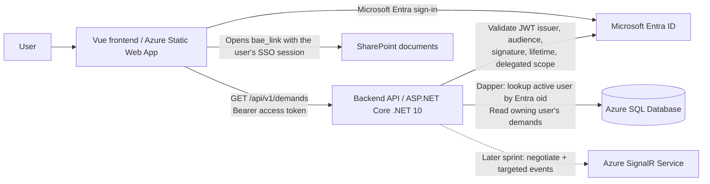

# KLESIA — Backend Functional & Technical Specification

**Document ID:** KLESIA-BE-SPEC  
**Version:** 1.3 (Sprint 1 / Lot 1 baseline, revised; GK number, `Id` primary keys, SharePoint copy requirement)  
**Date:** 2026-11-11  
**Status:** Implementation-ready for Sprint 1; future contracts recorded separately  
**Language:** English  
**Primary audience:** Backend engineers, database engineers, AI coding agents, QA and infrastructure engineers

> **Purpose.** This document specifies the incremental implementation of the KLESIA backend. Sprint 1 delivers an authenticated, authorized read-only demand-list API and the relational database supporting that view. The SignalR negotiation and demand-creation (PDF upload) contracts are **adopted** jointly with the frontend **but are not Sprint 1 implementation work**. The machine-readable HTTP contract of all three endpoints is `contracts/openapi.yaml` (workspace root), the single source of truth: this document and the OpenAPI file MUST stay identical on every HTTP detail. Later sprints should extend this document rather than silently changing existing contracts.

> **Terminology.** "Sprint 1" in this document is the delivery called **Lot 1 (LOT1)** by the client. Demand creation (`POST /api/v1/demands`) and the SignalR negotiation are **not part of Lot 1**.

## 1. Normative language and scope

- **MUST / SHALL**: mandatory for the applicable sprint.
- **SHOULD**: recommended unless there is a documented reason not to follow it.
- **MAY**: optional.
- An explicit **ASSUMPTION** is a proposed implementation choice, not an established client requirement. Agents may use it for Sprint 1 unless an existing repository convention or signed-off decision contradicts it.
- **DEFERRED** requirements are documented interfaces for subsequent sprints; do not create placeholder endpoints that claim to implement them.
- Changes to endpoint semantics, JSON field names, auth requirements, the SQL schema, or access rules MUST be deliberate and documented.

### 1.1 Sprint 1 deliverables (IN SCOPE)

| ID | Required outcome |
|---|---|
| S1-DB-01 | A buildable SQL database project under the already initialized `database/` directory with exactly the four required business/security tables. |
| S1-DB-02 | Database artifacts that build into `database/Klesia.Database/bin/Debug/Klesia.Database.dacpac` and can be published to Azure SQL Database through `SqlPackage`. |
| S1-DB-03 | Working post-deployment reference-data scripts incorporating the existing `01_RefData.sql` and `02_User.sql`, made safe for repeated deployment. |
| S1-AUTH-01 | Entra ID JWT bearer access-token validation for the backend API. |
| S1-AUTH-02 | Database allowlist authorization: only existing, active users can access the protected data. |
| S1-API-01 | `GET /api/v1/demands`, returning the signed-in user's identity details and only their demands. |
| S1-API-02 | Explicit, safe HTTP responses for authentication, authorization, database and other server errors. |
| S1-OPS-01 | Configuration, allowed frontend origins, reproducible local run/build instructions and verification tests. |

### 1.2 Explicitly OUT OF SCOPE for Sprint 1

- `POST /api/v1/notifications/negotiate` and the Azure SignalR `demands` notification channel: **contract adopted in §7.1 and `contracts/openapi.yaml`, implementation deferred**.
- `demandUpdated` publication and demand-status mutation: deferred; no status-changing HTTP endpoint is specified.
- `POST /api/v1/demands` (demand creation with PDF upload, size/content validation and SharePoint storage): **contract adopted in §7.3 and `contracts/openapi.yaml`, implementation deferred; not part of Lot 1**.
- Demand update, delete, status transitions (other than the initial `pending`), pagination, filtering or searching.
- Provisioning new users via API; management of roles/users via API.
- Additional business entities, audit-history tables, or user-role join tables.
- Implementation of the two adopted non-Sprint-1 endpoints (negotiate, demand creation); see **OPEN-01**.

### 1.3 Known gaps, decisions and conflict resolution

| ID | Observation / decision | Handling |
|---|---|---|
| OPEN-01 | **Resolved.** The overall API has **three HTTP endpoints**, all with an adopted contract: `GET /api/v1/demands` (§5.1, Sprint 1), `POST /api/v1/notifications/negotiate` (§7.1) and `POST /api/v1/demands` (§7.3). The `demandUpdated` event is **not** HTTP. | The contract of all three is frozen in `contracts/openapi.yaml`. Only `GET /api/v1/demands` (plus `GET /health`) is implemented in Sprint 1; do not create placeholder routes for the other two. They are implemented in later sprints. |
| OPEN-02 | The broad API description includes SignalR, while the final Sprint 1 statement limits functionality to the initial user/demand screen. | The final Sprint 1 restriction takes precedence for **implementation**. Implement the list route now; the SignalR negotiation contract is adopted (§7.1) and implemented later. |
| OPEN-03 | The precise delegated API scope name, Entra tenant ID and API application ID are absent. | Supplied through configuration (§6.1: `AzureAd:*`); never hard-coded. The API refuses to start while they are missing or still placeholders. |
| OPEN-04 | **Resolved.** The only authorization rule for now is *own data only*: an authenticated, allowlisted, active user receives exclusively the demands whose `Demand.UserId` is their own `sec.User.Id`. | The role codes `admin`, `operational` and `guest` are confirmed as the real codes, but **no role grants or removes any access in Sprint 1**. Do not infer cross-user, administrator or role-based behavior. |
| OPEN-05 | **Resolved.** The PDFs are stored in **SharePoint**. `Demand.BaeLink` holds the absolute HTTPS URL of the document in SharePoint. | The API returns that URL after validating that it is an absolute HTTPS URL. SharePoint permissions are the access gate: the browser opens the link with the user's own Entra single sign-on session, so no bearer header, no SAS-style signature and no anonymous link is involved. The links are **permanent** SharePoint URLs: no time-limited, signed or anonymous sharing links are used, and `IBaeLinkResolver` stays a pass-through. Changing this needs a separate decision (tenant sharing policy, Graph permissions). |
| INT-05 | `maxPdfSizeMb`: 10 MB is illustrative, not confirmed. | The upload endpoint is now specified (§7.3). The limit is the backend setting `Upload:MaxPdfSizeMb`, provisionally 10 (1 MB = 1,048,576 bytes); it MUST equal the webapp's `public/config/app-config.json` value and be confirmed by the operator before production. |
| INT-08 | Exact error-body JSON structure. | **Resolved.** Every error response of an application route is RFC 9457 (7807) `application/problem+json` (§5.2). The HTTP status stays the primary signal; the frontend never renders server text. |
| DEC-01 | Backend target framework. | **.NET 10 (`net10.0`)** from the start (SDK pinned in `global.json`). |
| DEC-02 | Data access technology. | **Dapper** over `Microsoft.Data.SqlClient`. **Entity Framework Core, `DbContext` and EF migrations MUST NOT be used.** The SQL database project is the single owner of the schema. |
| DEC-03 | Existing repository files take precedence over earlier draft DDL. | Primary keys are named `Id` (DEC-12, DB-03), constraint names follow the single scheme of DB-06, column sizes and defaults follow the files already present in `database/`, and the `ref` schema is kept. The draft DDL in earlier revisions of this document is superseded by §3.4. |
| DEC-04 | Where configuration values live. | Entra, CORS and SQL settings are configuration-file values (§6.1), never code constants. |
| DEC-05 | Seeded identity. | The seed script creates the project owner's account as an active `admin` user, as explicitly requested. Further identities are added by editing the same script. |
| DEC-06 | Local development against Azure SQL Database. | One connection string works on a developer PC and in Azure: `Authentication=Active Directory Default` (see §6.1). No password is ever stored. |
| DEC-07 | Hosting topology. | Backend: **Azure App Service** connected to Azure SQL Database. Frontend: **Azure Static Web Apps**. |
| DEC-08 | Canonical HTTP contract. | `contracts/openapi.yaml` is the single source of truth for routes, schemas, status codes, headers and CORS. This document explains and constrains it; any conflict is fixed in both files in the same change. |
| DEC-09 | JSON naming convention. | Business payloads (request parts and response bodies) use `snake_case`. The SignalR negotiation response (`url`, `accessToken`) is a protocol payload whose names are fixed by the SignalR client; it is, with `ProblemDetails` (RFC 9457 / ASP.NET Core standard names such as `traceId`), one of the **only two** camelCase exceptions; neither is renamed. |
| DEC-10 | Success status of `POST /api/v1/demands`. | `201 Created` with the created demand as body (same shape as a `demands[]` item). There is no single-demand route, so no `Location` header is sent. The frontend treats any 2xx as success and ignores the body. |
| DEC-11 | Delegated scope name. | The delegated scope is named `access_as_user` (fixed in the contract's OAuth2 security scheme and set in `AzureAd:RequiredScope`). The full scope requested by the SPA is `api://<API client id>/access_as_user`. |
| DEC-12 | Primary-key naming. | Every primary key is named `Id` (`sec.Role.Id`, `sec.User.Id`, `ref.Status.Id`, `dbo.Demand.Id`), as in the database project. Foreign keys keep the `{ReferencedTable}Id` form (`RoleId`, `UserId`, `StatusId`). Dapper queries alias keys to the domain names (`d.Id AS DemandId`); the JSON field `demand_id` is `dbo.Demand.Id`. This replaces the earlier `{Table}Id` rule. |
| DEC-13 | Copy of the uploaded PDF into SharePoint (demand creation, **not part of Lot 1**). | **Requirement:** the backend MUST copy the PDF received by `POST /api/v1/demands` into the SharePoint document library and MUST store the resulting permanent HTTPS link in `Demand.BaeLink`, so that the user can open the document later from the `bae_link` returned by `GET /api/v1/demands`. The browser never uploads to SharePoint; the database stores the link, never the file; the API server keeps no copy. All SharePoint access is isolated in `IBaeDocumentStore` (Infrastructure). The stored file name is generated by the backend (for example `{GKNumber}/{unique id}.pdf`) and never taken from the client, so repeated submissions of the same GK number cannot overwrite each other. **ASSUMPTION** (to confirm with the Microsoft 365 administrators before that sprint): upload through Microsoft Graph as the App Service managed identity with the least-privilege `Sites.Selected` permission on the one target site; site, library and base folder come from configuration (`SharePoint:*`, §6.1), never from code or from the client. Who may open a document stays a SharePoint matter (OPEN-05): the library permissions must let the intended users open it; the API does not manage per-document permissions. |
| OPEN-06 | **Resolved.** How the uploaded BAE PDF reaches SharePoint. | Stated as an explicit requirement in **DEC-13**: copy into SharePoint, store the link in `Demand.BaeLink`. Only deployment settings remain (site, library, folder, permission grant); they are configuration, not an open question about the HTTP contract. Out of Lot 1. |

## 2. System context and architectural boundaries



**Technology baseline:**

- Database: Microsoft SQL Server / Azure SQL Database, modeled through a `.sqlproj` SQL database project (`Microsoft.Build.Sql`). **The SQL project is the only owner of the schema.**
- Backend (**DEC-01**): ASP.NET Core Web API in C# on **.NET 10 (`net10.0`)**, following the existing Clean Architecture solution (`Domain`, `Application`, `Infrastructure`, `WebApi`; dependencies point inward only).
- Data access (**DEC-02**): **Dapper** with `Microsoft.Data.SqlClient`, implemented in `Infrastructure` behind repository interfaces declared in `Application`. **Entity Framework Core, `DbContext`, EF migrations and EF design-time tooling MUST NOT be used.** Every SQL statement is a parameterized, hand-written query.
- Authentication: Microsoft Entra ID, JWT bearer **access tokens intended for this API**, validated with the ASP.NET Core JWT bearer middleware.
- Authorization: explicit server-side SQL allowlist (`sec.User`) after JWT validation; the only access rule is *own demands only* (OPEN-04).
- Documents: PDFs live in SharePoint; `Demand.BaeLink` stores the document URL (OPEN-05).
- Frontend: existing Vue application hosted in Azure Static Web Apps, with Vite local development at `http://localhost:5173`.
- Hosting (**DEC-07**): this API runs on **Azure App Service** (connected to Azure SQL Database); the frontend runs on **Azure Static Web Apps**.
- Configuration (**DEC-04**): environment-specific; tenant ID, API client ID, delegated scope, allowed origins and the SQL connection string are configuration values, not source code (§6.1).
- Database connection: least-privilege runtime identity; Azure-managed identity in Azure and the developer's own Entra account on a PC, both through `Authentication=Active Directory Default`. The SQL credential used by `SqlPackage` is a **deployment** concern and must not be copied into frontend settings or application settings.

## 3. Database specification — Sprint 1

### 3.1 Design requirements

| ID | Requirement |
|---|---|
| DB-01 | Use separate files for SQL schemas and every table definition. |
| DB-02 | Exactly four domain tables: `sec.Role`, `sec.User`, `ref.Status`, `dbo.Demand`. Schema usage: `sec` for security tables, `ref` for reference/lookup tables (the status lookup), `dbo` for business data. |
| DB-03 | Every table has a primary key named `Id`: `Id INT IDENTITY(1,1)` (`sec.Role.Id`, `sec.User.Id`, `ref.Status.Id`, `dbo.Demand.Id`). Foreign-key columns are named `{ReferencedTable}Id` (`RoleId`, `UserId`, `StatusId`), see DEC-12. |
| DB-04 | All schema, table and column identifiers use PascalCase, except the schema identifiers `sec`, `dbo` and `ref`. |
| DB-05 | Declare every foreign key explicitly and create an index with the foreign-key column as leading key. Do not create an index that duplicates the primary key or a unique constraint. |
| DB-06 | Name every constraint and index with the **single scheme** below. |
| DB-07 | Enforce all described mandatory fields through `NOT NULL`; apply only justified checks/uniqueness. |
| DB-08 | Use SQL Server-native types. Do not introduce `FLOAT` for future monetary or percentage data. No such fields exist in Sprint 1. |
| DB-09 | Use `NO ACTION` behavior for deletes; do not add cascade deletes. |
| DB-10 | Maintain third-normal-form style associations; do not copy role, status or user names onto `Demand`. |
| DB-11 | A re-publish MUST preserve user-generated and existing business data; destructive schema changes require explicit review. |
| DB-12 | The runtime reads the database exclusively through Dapper with parameterized SQL (see §2). No ORM mapping drives the schema. |

**Naming scheme (DB-06)** — `{Table}` is the unqualified table name; the pattern is the same for every table:

| Object | Pattern | Examples |
|---|---|---|
| Primary key | `PK_{Table}` | `PK_Role`, `PK_Demand` |
| Foreign key | `FK_{Table}_{ReferencedTable}` (the table that holds the column first) | `FK_User_Role`, `FK_Demand_User`, `FK_Demand_Status` |
| Unique (alternate) key | `AK_{Table}_{Column}` | `AK_Role_Code`, `AK_User_UserUniqueId`, `AK_Status_Code` |
| Check | `CK_{Table}_{Column}` (or `{Rule}` when it spans columns) | `CK_Status_Code`, `CK_Demand_GKNumber`, `CK_Demand_BaeLink` |
| Default | `DF_{Table}_{Column}` | `DF_User_RoleId`, `DF_User_IsActive` |
| Non-unique index | `IX_{Table}_{Column}[_{Column}]` | `IX_User_RoleId`, `IX_Demand_UserId`, `IX_Demand_StatusId` |

#### 3.2 Schema and cardinality


**Critical identity distinction:** `sec.User.Id` is the internal SQL identity (`INT`). `sec.User.UserUniqueId` is the Microsoft Entra user's `oid` (`UNIQUEIDENTIFIER`). The API's `user_id` response field refers to **`UserUniqueId`**, never the internal `Id`.

### 3.3 Canonical table contracts

#### `sec.Role`

| Column | SQL type | Null | Rules |
|---|---|---|---|
| `Id` | `INT IDENTITY(1,1)` | No | `PK_Role` |
| `Name` | `NVARCHAR(300)` | No | Display/human-readable role name |
| `Code` | `NVARCHAR(50)` | No | Unique stable role identifier: `AK_Role_Code`. Confirmed codes: `admin`, `operational`, `guest` |

A role can be associated with multiple users; each user has exactly one role. **No role grants any permission in Sprint 1** (OPEN-04).

#### `sec.User`

| Column | SQL type | Null | Rules |
|---|---|---|---|
| `Id` | `INT IDENTITY(1,1)` | No | `PK_User` |
| `UserUniqueId` | `UNIQUEIDENTIFIER` | No | Entra `oid`; `AK_User_UserUniqueId` |
| `RoleId` | `INT` | No | `FK_User_Role` → `sec.Role(Id)`; indexed by `IX_User_RoleId`; default `1` (`DF_User_RoleId`) |
| `Name` | `NVARCHAR(300)` | No | Entire name, returned in API as `user_name` |
| `Email` | `NVARCHAR(300)` | No | Informational only; **never** use to identify/authorize users |
| `IsInternal` | `BIT` | No | Internal-company flag; default `1` (`DF_User_IsInternal`) |
| `IsActive` | `BIT` | No | Required for access; default `1` (`DF_User_IsActive`) |

> **Defaults note (DEC-03).** The three defaults above come from the table definitions already present in the repository and are kept on purpose. They are harmless in Sprint 1 because the API never inserts users and every seeded row states its values explicitly. They are **not** fail-closed (`IsActive` defaults to `1`, `RoleId` defaults to the first role): re-examine them before any user-provisioning feature exists.

The `UserUniqueId` uniqueness is based on the **ASSUMPTION** of a single configured Entra tenant. If multiple tenants are authorized later, the identity model must include a tenant identifier and use a tenant/oid composite authorization key (requires a reviewed schema change). Do not allow arbitrary tenants while keeping an `oid`-only lookup.

`Email` is **not** unique by default: email can change and is not the authoritative identity key.

#### `ref.Status`

| Column | SQL type | Null | Rules |
|---|---|---|---|
| `Id` | `INT IDENTITY(1,1)` | No | `PK_Status` |
| `Name` | `NVARCHAR(100)` | No | Internal name |
| `DisplayName` | `NVARCHAR(100)` | No | Human-readable label |
| `Code` | `NVARCHAR(20)` | No | Unique: `AK_Status_Code`; allowed `pending`, `ok`, `fail` (`CK_Status_Code`) |
| `Description` | `NVARCHAR(500)` | Yes | Explanatory text, optional |

Status `Code` is the source of the API `status` property; do not return the `Name` or `DisplayName` instead. Adding more status values is an explicit API/schema evolution.

#### `dbo.Demand`

| Column | SQL type | Null | Rules |
|---|---|---|---|
| `Id` | `INT IDENTITY(1,1)` | No | `PK_Demand` |
| `UserId` | `INT` | No | `FK_Demand_User` → `sec.User(Id)`; indexed by `IX_Demand_UserId` |
| `GKNumber` | `CHAR(18)` | No | GK (Geode Klesia) number: `GK` + six digits (a `YYMMDD` date) + hyphen + nine digits, e.g. `GK260902-144743112` (`CK_Demand_GKNumber`) |
| `BaeLink` | `NVARCHAR(2048)` | No | Absolute HTTPS URL of the PDF in SharePoint; checked at least for the HTTPS prefix (`CK_Demand_BaeLink`) |
| `StatusId` | `INT` | No | `FK_Demand_Status` → `ref.Status(Id)`; indexed by `IX_Demand_StatusId` |

**The GK number is a string.** It is stored as text (`CHAR(18)`), carried as a string in the domain (`GKNumber`), in the DTOs and in JSON, exactly as stored (no reformatting). Its format is `GK` + six digits (a date, `YYMMDD`) + a hyphen (`-`) + a number of nine digits, e.g. `GK260902-144743112` (regex `^GK[0-9]{6}-[0-9]{9}$`). The database check enforces this format with a literal pattern and a binary collation (so that the prefix is case-sensitive and a shorter value padded with spaces is rejected). Validating that the six digits form a real calendar date, or any checksum, is **not** required in this sprint.

`Demand.GKNumber` MUST **NOT** be unique: several demands with the same GK number must remain possible.

`BaeLink` is an application-owned reference to a SharePoint document (OPEN-05). It is returned to the client unchanged once validated as an absolute HTTPS URL. The frontend must not construct document URLs itself.

### 3.4 Normative SQL DDL baseline

The SQL project MUST keep schemas and tables in separate files, as listed in §3.5. These definitions are the baseline that the files in `database/Klesia.Database/` implement; formatting may be adjusted without changing semantics.

**`Schemas/sec.sql`** and **`Schemas/ref.sql`**

```sql
CREATE SCHEMA [sec] AUTHORIZATION [dbo]
GO
```

```sql
CREATE SCHEMA [ref] AUTHORIZATION [dbo]
```

**`Tables/sec/Role.sql`**

```sql
CREATE TABLE [sec].[Role]
(
    [Id] INT IDENTITY(1,1) NOT NULL,
    [Name] NVARCHAR(300) NOT NULL,
    [Code] NVARCHAR(50) NOT NULL,
    CONSTRAINT [PK_Role] PRIMARY KEY CLUSTERED ([Id]),
    CONSTRAINT [AK_Role_Code] UNIQUE ([Code])
);
```

**`Tables/sec/User.sql`**

```sql
CREATE TABLE [sec].[User]
(
    [Id] INT IDENTITY(1,1) NOT NULL,
    [UserUniqueId] UNIQUEIDENTIFIER NOT NULL,
    [RoleId] INT NOT NULL CONSTRAINT [DF_User_RoleId] DEFAULT 1,
    [Name] NVARCHAR(300) NOT NULL,
    [Email] NVARCHAR(300) NOT NULL,
    [IsInternal] BIT NOT NULL CONSTRAINT [DF_User_IsInternal] DEFAULT 1,
    [IsActive] BIT NOT NULL CONSTRAINT [DF_User_IsActive] DEFAULT 1,
    CONSTRAINT [PK_User] PRIMARY KEY CLUSTERED ([Id]),
    CONSTRAINT [AK_User_UserUniqueId] UNIQUE ([UserUniqueId]),
    CONSTRAINT [FK_User_Role] FOREIGN KEY ([RoleId]) REFERENCES [sec].[Role] ([Id])
);
GO

CREATE NONCLUSTERED INDEX [IX_User_RoleId]
    ON [sec].[User] ([RoleId]);
GO
```

The index `IX_User` that existed on `Id` (the primary key) was removed as redundant and replaced by `IX_User_RoleId`, which supports the `FK_User_Role` foreign key (DB-05).

**`Tables/ref/Status.sql`**

```sql
CREATE TABLE [ref].[Status]
(
    [Id] INT IDENTITY(1,1) NOT NULL,
    [Name] NVARCHAR(100) NOT NULL,
    [DisplayName] NVARCHAR(100) NOT NULL,
    [Code] NVARCHAR(20) NOT NULL,
    [Description] NVARCHAR(500) NULL,
    CONSTRAINT [PK_Status] PRIMARY KEY CLUSTERED ([Id]),
    CONSTRAINT [AK_Status_Code] UNIQUE ([Code]),
    CONSTRAINT [CK_Status_Code] CHECK
        ([Code] COLLATE Latin1_General_100_BIN2 IN (N'pending', N'ok', N'fail'))
);
GO
```

**`Tables/dbo/Demand.sql`**

```sql
CREATE TABLE [dbo].[Demand]
(
    [Id] INT IDENTITY(1,1) NOT NULL,
    [UserId] INT NOT NULL,
    [GKNumber] CHAR(18) NOT NULL,
    [BaeLink] NVARCHAR(2048) NOT NULL,
    [StatusId] INT NOT NULL,
    CONSTRAINT [PK_Demand] PRIMARY KEY CLUSTERED ([Id]),
    CONSTRAINT [FK_Demand_User] FOREIGN KEY ([UserId]) REFERENCES [sec].[User] ([Id]),
    CONSTRAINT [FK_Demand_Status] FOREIGN KEY ([StatusId]) REFERENCES [ref].[Status] ([Id]),
    CONSTRAINT [CK_Demand_GKNumber] CHECK
        ([GKNumber] COLLATE Latin1_General_100_BIN2 LIKE 'GK[0-9][0-9][0-9][0-9][0-9][0-9]-[0-9][0-9][0-9][0-9][0-9][0-9][0-9][0-9][0-9]'),
    CONSTRAINT [CK_Demand_BaeLink] CHECK ([BaeLink] LIKE N'https://%')
);
GO

CREATE NONCLUSTERED INDEX [IX_Demand_UserId]
    ON [dbo].[Demand] ([UserId], [Id] DESC);
GO

CREATE NONCLUSTERED INDEX [IX_Demand_StatusId]
    ON [dbo].[Demand] ([StatusId]);
GO
```

**Implementation notes:** `IX_Demand_UserId` leads with the foreign-key column (DB-05) and its descending `Id` serves the API ordering `Id DESC` without a sort. No `ON DELETE CASCADE` clause is permitted. The HTTPS `CHECK` is a simple guard only; code must separately parse and validate URLs. Future `Year`, `Month`, percentages and monetary amounts are not present in this sprint, so no speculative fields/checks are to be added.

### 3.5 Project layout, build and deployment

The existing `database/` folder and its conventions are preserved. Layout:

```text
database/
├── Directory.Build.props          # intentionally empty: isolates the SQL project from the .NET build settings
└── Klesia.Database/
    ├── Klesia.Database.sqlproj
    ├── PostDeployment.sql         # single aggregate post-deployment entry (project root)
    ├── Schemas/
    │   ├── sec.sql
    │   └── ref.sql
    ├── Tables/
    │   ├── sec/
    │   │   ├── Role.sql
    │   │   └── User.sql
    │   ├── ref/
    │   │   └── Status.sql
    │   └── dbo/
    │       └── Demand.sql
    ├── Scripts/
    │   ├── 01_RefData.sql
    │   └── 02_User.sql
    └── Properties/
        └── Azure.publish.xml
```

**Required `.sqlproj` capabilities:**

- Use an SDK-style project with a **pinned** `Microsoft.Build.Sql` version (currently `2.3.0`).
- Target Azure SQL Database explicitly through `Microsoft.Data.Tools.Schema.Sql.SqlAzureV12DatabaseSchemaProvider`.
- Build all table/schema definitions into the DACPAC as schema-model files.
- Include only one aggregate post-deployment entry, `PostDeployment.sql`, which references `01_RefData.sql` before `02_User.sql`.
- Exclude data scripts included by `:r` from the schema model (`Build Remove`) so they do not cause build errors or run twice.
- Do not put deployment credentials in `.sqlproj`, `.publish.xml`, source control or shell history.

```xml
<Project DefaultTargets="Build">
  <Sdk Name="Microsoft.Build.Sql" Version="2.3.0" />
  <PropertyGroup>
    <Name>Klesia.Database</Name>
    <DSP>Microsoft.Data.Tools.Schema.Sql.SqlAzureV12DatabaseSchemaProvider</DSP>
    <ModelCollation>1033, CI</ModelCollation>
  </PropertyGroup>
  <ItemGroup>
    <Build Remove="Scripts/**/*.sql" />
    <Build Remove="PostDeployment.sql" />
    <PostDeploy Include="PostDeployment.sql" />
  </ItemGroup>
</Project>
```

**`PostDeployment.sql`**

```sql
:r .\Scripts\01_RefData.sql
:r .\Scripts\02_User.sql
```

**Seed scripts (DEC-05).** Both scripts run after **every** successful publish, so they are idempotent:

- `01_RefData.sql` merges on the stable `Code`, never on an identity value. It guarantees the three status codes (`pending`, `ok`, `fail`) and the three confirmed roles (`admin`, `operational`, `guest`). Descriptive columns of reference rows are re-aligned by the deployment; nothing is deleted.
- `02_User.sql` is **insert-only**, matched on the Entra `oid` (`UserUniqueId`), with the role resolved by its code. An existing row is never updated, so a user deactivated by an administrator is not reactivated and administrator-edited fields are not overwritten; no user is deleted. It seeds the project owner's account as an active `admin` user. Further authorized identities are added by appending rows to that script, always with a valid, explicitly supplied Entra `oid`.

**Build:**

```powershell
dotnet build database/Klesia.Database/Klesia.Database.sqlproj -c Debug
```

**Publish (illustrative PowerShell; substitute a securely supplied connection string):**

```powershell
SqlPackage `
  /Action:Publish `
  /SourceFile:"database/Klesia.Database/bin/Debug/Klesia.Database.dacpac" `
  /Profile:"database/Klesia.Database/Properties/Azure.publish.xml" `
  /TargetConnectionString:$env:KLESIA_SQL_DEPLOY_CONNECTION
```

The target is Azure SQL Database, **not** SQL Server LocalDB. Real secrets remain outside tracked files. The publish profile keeps data-loss blocking enabled and never drops objects that are not in the source; review the generated script before applying it.

### 3.6 Database verification

The following checks are mandatory (the automated ones are in `tests/IntegrationTests/Database` and run when `KLESIA_TEST_SQL_CONNECTION` points to a disposable published database):

1. `dotnet build` produces the `.dacpac` at the documented path without unresolved references.
2. Publish to an **empty** Azure SQL dev/test database creates the `sec` and `ref` schemas and the four expected tables.
3. All `PK_*`, `FK_*`, `AK_*`, `CK_*`, `DF_*` and `IX_*` objects exist with the names defined by the DB-06 scheme.
4. Foreign keys reject orphan user-role, demand-user and demand-status references.
5. Duplicate `Role.Code`, `Status.Code` and `User.UserUniqueId` values fail; repeated `Demand.GKNumber` values **succeed**.
6. GK values that do not match the `GK######-#########` format (wrong prefix, letters, short, embedded space, missing hyphen), non-HTTPS `BaeLink` and unsupported status codes fail.
7. Re-running the publish and reference scripts does not create duplicate seed data, wipe business records or reactivate inactive users.
8. An inactive user and a user without any demands can exist without breaking referential integrity.

## 4. Authentication and authorization — Sprint 1

Evaluation order for every protected request: **authentication** (token validity, `401`) → **delegated scope** (`403`) → **database allowlist** (`403`) → business query. The two `403` outcomes use the same status and an identical body.

### 4.1 Authentication contract (AUTH-01)

All Sprint 1 API routes MUST be protected by Microsoft Entra ID **access-token** authentication; the only anonymous routes are the health probe and, in Development, the OpenAPI document.

1. The frontend authenticates with Microsoft Entra ID and requests an **access token for the backend API** (not an ID token and not a Microsoft Graph access token).
2. The frontend sends `Authorization: Bearer <token>`.
3. The backend validates **signature**, **issuer**, **tenant**, **audience** and **lifetime** (`exp`, `nbf`). Any failure is `401`.
4. The backend then requires the configured **delegated scope** in the `scp` claim. A valid token that lacks it — including an application-only token, which has no `scp` — is `403`.
5. The backend reads the `oid` claim from the validated token and interprets it as the stable Entra user identifier. A missing or non-GUID `oid` is `401`.
6. The backend rejects tokens for other APIs or tenants, expired or unsigned tokens and ID tokens; it never trusts user IDs from query, body or arbitrary headers.
7. Use the established ASP.NET Core JWT bearer middleware; do not implement custom JWT decoding as authorization.

**Implementation decisions (AUTH-IMPL):**

- Package: `Microsoft.AspNetCore.Authentication.JwtBearer` with explicit `TokenValidationParameters`; claim-name mapping is disabled so `oid`, `scp` and `tid` keep their raw names.
- Authority and issuer: `{AzureAd:Instance}/{AzureAd:TenantId}/v2.0` (v2.0 tokens only). The API app registration MUST issue v2.0 access tokens (`requestedAccessTokenVersion = 2` in its manifest).
- Audience: `AzureAd:ClientId` and `api://{ClientId}` (overridable with `AzureAd:Audiences`).
- Tenant: besides the issuer, the `tid` claim MUST equal `AzureAd:TenantId`.
- ID tokens: a token carrying a `nonce` claim is rejected (`401`) even if its audience happened to match.
- Scope: an authorization policy (`DelegatedUser`) requires an authenticated user whose space-separated `scp` contains `AzureAd:RequiredScope`. The same policy is the **fallback policy**, so a new endpoint is protected unless it is explicitly marked anonymous.
- The allowlist check lives in the application layer (`DemandService`), not in the middleware, so token validation stays separate from business queries.

**ASSUMPTION:** single-tenant Entra application. The allowed tenant, authority, API audience and required delegated scope MUST come from configuration (§6.1). `oid` is unique **within** the validated tenant.

### 4.2 Database-based authorization (AUTH-02)

Only **after** successful token authentication and scope validation:

```text
validated access token (signature, iss, tid, aud, exp) ........ else 401
         |
required scope present in scp ................................. else 403
         |
         v
   extract token.oid ..... missing / not a GUID ............... 401
         |
         v
SELECT sec.User WHERE UserUniqueId = oid   (parameterized)
         |
         +-- not found ----------> 403 Forbidden
         +-- IsActive = 0 -------> 403 Forbidden   (identical response)
         +-- found + active -----> authorized user context
                                    (internal SQL User.Id)
```

- A row in `sec.User` is an **allowlist entry**, not a provisioning request.
- `IsActive = 0` means denied, even with a cryptographically valid Entra token.
- **The only authorization rule is *own data only*** (OPEN-04): the authorized user receives exclusively the demands whose `Demand.UserId` equals their own `sec.User.Id`.
- `IsInternal` is **not** an access gate in Sprint 1; it is informational until business rules are defined.
- `RoleId` must reference an existing `sec.Role` but grants **no elevated access and removes none** in Sprint 1.
- Do not create or update `sec.User` automatically during a request.
- Do not authorize using name, email, Entra group membership, frontend claims about roles or client-supplied user IDs.
- 403 responses MUST NOT disclose whether the account is unknown or disabled: same status, same title, same body shape.

### 4.3 HTTP status rules

This table is the single authority for authentication/authorization outcomes; §4.1, §4.2 and §9 follow it.

| Case | HTTP status | Reason |
|---|---:|---|
| Missing or malformed Authorization header | `401` | Not authenticated |
| Invalid signature, wrong issuer, wrong tenant (`iss` or `tid`), wrong audience, expired token, ID token | `401` | Authentication invalid |
| Valid token, `oid` claim missing or not a GUID | `401` | Identity cannot be established; fail closed |
| Valid token without the required delegated scope (including application-only tokens without `scp`) | `403` | Authentication valid, permission insufficient |
| Valid token and scope, user not present in `sec.User` | `403` | Not authorized |
| Valid token and scope, user present with `IsActive = 0` | `403` | Not authorized |
| Valid token and scope, active user present | Continue | Allowed to see **only own demands** |
| SQL dependency failure or other server fault | `5xx` | Service fault; never mislabel as `403` |

## 5. HTTP API — Sprint 1

> **Canonical contract (DEC-08, DEC-09).** The exact routes, schemas, status codes, headers and CORS rules are in `contracts/openapi.yaml`; this section explains them. Business JSON is `snake_case`; the only camelCase payloads are the SignalR negotiation response (§7.1) and `ProblemDetails` (§5.2); the negotiation shape is fixed by the SignalR protocol.

### 5.1 `GET /api/v1/demands` (API-01)

**Purpose:** populate the initial dashboard screen with the authenticated user's display name/identifier and their demand list.

```http
GET /api/v1/demands HTTP/1.1
Authorization: Bearer <Entra access token>
Accept: application/json
```

**Parameters:** none. No user ID in path, query or request body. No role-specific or admin filters.

**Successful response:** `200 OK`, `Content-Type: application/json`

```json
{
  "user_id": "f47ac10b-58cc-4372-a567-0e02b2c3d479",
  "user_name": "John DOE",
  "demands": [
    {
      "demand_id": 1,
      "gk_number": "GK260902-144743112",
      "bae_link": "https://files.example.com/bae-1.pdf",
      "status": "pending"
    }
  ]
}
```

**Response schema:**

| JSON property | Type | Source / rule |
|---|---|---|
| `user_id` | string | Normalized GUID from validated Entra `oid` / matched `sec.User.UserUniqueId`. **Not** `sec.User.Id`. |
| `user_name` | string | `sec.User.Name` from matched active DB row. |
| `demands` | array | All demand rows whose `Demand.UserId` is the matched internal `sec.User.Id` (zero or more). |
| `demands[].demand_id` | integer | `dbo.Demand.Id`. |
| `demands[].gk_number` | string | `dbo.Demand.GKNumber`, returned unchanged (e.g. `GK260902-144743112`). No formatting is applied. |
| `demands[].bae_link` | string | `dbo.Demand.BaeLink`: the **HTTPS URL** of the corresponding PDF in SharePoint, validated by the backend. It opens in the browser with the user's own SharePoint/Entra session, without a frontend-provided bearer Authorization header. |
| `demands[].status` | string enum | `ref.Status.Code`, exclusively `pending`, `ok`, `fail`. |

**Empty list is valid** and still returns `200`:

```json
{
  "user_id": "f47ac10b-58cc-4372-a567-0e02b2c3d479",
  "user_name": "John DOE",
  "demands": []
}
```

**Backend processing rules:**

1. Authenticate bearer token and require the configured delegated scope.
2. Resolve an active `sec.User` using validated `oid`; otherwise return `403`.
3. Read demands only where `dbo.Demand.UserId = sec.User.Id`; join `ref.Status` by `StatusId`.
4. Map the response to exactly the specified snake_case field names and types; no database rows or domain objects serialized directly.
5. Return the stored GK number unchanged (no formatting).
6. Return the stored status code verbatim (from the three allowed lowercase codes).
7. Resolve `BaeLink` through the link-resolver abstraction. In Sprint 1 the stored SharePoint URL is returned unchanged after verifying that it is an absolute HTTPS URL; a stored value that is not (data-integrity fault) produces a sanitized `5xx` and is never logged or returned. Never create anonymous links, never expose credentials, and never assume the frontend can attach the API bearer token when opening the PDF.
8. **ASSUMPTION:** order demands by `Demand.Id DESC` for deterministic display until a product ordering requirement is defined. The frontend MUST NOT treat this ordering as a permanent business contract.
9. Do not cap or paginate results in Sprint 1 without explicitly changing the API response contract. Flag performance concerns if volume makes this unsuitable.
10. Prevent cross-user data leakage, including in errors and logs.

**PDF access security note (OPEN-05, resolved):** the documents can contain sensitive personal data and live in SharePoint. The API is the gate to the *list* of links; SharePoint permissions are the gate to each *document*. Therefore the SharePoint library MUST NOT grant anonymous access, and users MUST hold SharePoint permission on the documents they are expected to open. Links are not bearer capabilities in this design, but they still identify documents and SHOULD be kept out of logs.

### 5.2 API errors and CORS (API-02)

- `400`: malformed or invalid request (missing, duplicated or unknown multipart part; invalid `gk_number`). `422`: well-formed request whose file content cannot be processed (the upload is not a valid PDF). Neither applies to the Sprint 1 `GET`, which has no input.
- `401`: missing/invalid bearer authentication.
- `403`: valid but unauthorized caller, including unknown/inactive DB user or insufficient scope.
- `413`: uploaded PDF larger than `Upload:MaxPdfSizeMb` (§7.3); not applicable to the Sprint 1 read-only route. `415`: `POST /api/v1/demands` request that is not `multipart/form-data`.
- `5xx`: service and dependency faults; no exception stack traces, SQL statements, token contents or connection strings in HTTP bodies.
- **Error body (INT-08, resolved).** Every non-2xx response from an application route (`400`, `401`, `403`, `413`, `415`, `422`, `5xx`) is `application/problem+json` (RFC 9457, ASP.NET Core `ProblemDetails`) with `type`, `title`, `status`, optional `detail` (safe, generic text only), `traceId` (equal to the `X-Correlation-Id` response header) and, for `400`/`422` only, optional `errors` (object keyed by request part name — `gk_number`, `bae_file` — with arrays of safe messages). The JWT bearer challenge (`401`) returns this body too, plus a `WWW-Authenticate: Bearer` header. Both `403` outcomes have an identical shape and text. No stack trace, SQL, token content, connection string, document URL or other user's data in any body. The frontend chooses its French wording from the HTTP status (and the `errors` keys); it never renders server `title`/`detail`.
- Configure CORS for **exact approved origins**: the deployed Azure Static Web Apps origin(s) and `http://localhost:5173`. The origins come from configuration (`Cors:AllowedOrigins`, §6.1) and are validated at startup; the API refuses to start if an origin is malformed or is `*`. Never use an unrestricted `*` policy.
- The CORS policy MUST permit, for every route including `POST /api/v1/notifications/negotiate`:
  - methods `GET`, `POST`, `OPTIONS`;
  - request headers `Authorization`, `Content-Type`, `X-Requested-With` and `X-SignalR-User-Agent` (the last two are sent by the official SignalR JavaScript client when it negotiates; omitting them makes the browser preflight fail);
  - exposed response header `X-Correlation-Id`;
  - a preflight cache of 600 seconds (`Access-Control-Max-Age`);
  - **no credentials**: `Access-Control-Allow-Credentials` is not sent. Authentication is the `Authorization` header only, and the frontend creates its SignalR connection with `withCredentials: false`.
- The negotiate request has an empty body and carries the query parameter `negotiateVersion=1` (added by the SignalR client; a query parameter, not a header); the route MUST accept it. The Azure SignalR Service resource has its own CORS settings with the same origins (§7.1).
- Enforce CORS **before** authentication failures prevent browser preflight processing. A successful OPTIONS preflight is not an authorization grant.
- HTTPS is mandatory outside localhost. Validate proxy/forwarded-header settings only for trusted infrastructure.

### 5.3 `GET /health` (API-03)

Anonymous liveness/readiness probe, used by the Azure App Service health check. It is **not** under `/api/v1`, needs no token, returns no user data and reveals no dependency details. No CORS rule applies (the browser never calls it).

- `200 OK`, `application/json`: `{ "status": "ok" }` when the process and its SQL dependency respond.
- `503 Service Unavailable`, `application/json`: `{ "status": "unavailable" }` otherwise.

## 6. Security, configuration, observability and operations

### 6.1 Environment configuration

Backend settings are bound as strongly typed options and validated at startup: the API refuses to start with missing or placeholder values (DEC-04).

| Area | Configuration key(s) and rules |
|---|---|
| Entra ID | `AzureAd:Instance` (default `https://login.microsoftonline.com/`), `AzureAd:TenantId`, `AzureAd:ClientId`, `AzureAd:RequiredScope` (scope name only; fixed to `access_as_user` by the contract, DEC-11), optional `AzureAd:Audiences`. All mandatory; placeholders are rejected at startup. |
| SQL | `ConnectionStrings:KlesiaDb`. Use `Authentication=Active Directory Default;Encrypt=True` so no password is stored: on a developer PC it signs in with the Azure CLI (`az login`) or Visual Studio account, in Azure with the managed identity. Prerequisites: the client IP is allowed in the Azure SQL firewall, and the Entra identity is a database user with read access (`CREATE USER [name] FROM EXTERNAL PROVIDER; ALTER ROLE db_datareader ADD MEMBER [name];`). |
| Frontend | `Cors:AllowedOrigins` — array of exact origins (`http://localhost:5173`, the deployed Static Web App URL). Validated at startup: no path, HTTPS required except loopback, `*` forbidden. Empty means no cross-origin access. |
| Configuration sources | Precedence, lowest to highest: `appsettings.json` (empty values, tracked) → `appsettings.{Environment}.json` (placeholders, tracked) → `appsettings.Local.json` (personal values, **git-ignored**) → environment variables (`AzureAd__TenantId`, `Cors__AllowedOrigins__0`, `ConnectionStrings__KlesiaDb`). |
| Logging | Log level, correlation id (`X-Correlation-Id`, generated when absent or unsafe), telemetry backend if already used. |
| SignalR (adopted, implemented after Sprint 1) | SignalR endpoint/resource name, managed identity configuration and hub identifier `demands`; the Azure SignalR Service CORS origins equal `Cors:AllowedOrigins`. |
| PDF upload (adopted, implemented after Sprint 1) | `Upload:MaxPdfSizeMb` — maximum PDF size in MB (1 MB = 1,048,576 bytes), provisionally `10`, identical to the webapp's `maxPdfSizeMb`; request-size limits (Kestrel, `FormOptions`) MUST be aligned to it; `SharePoint:SiteId`, `SharePoint:LibraryName` and `SharePoint:BaseFolder` (DEC-13); the managed identity needs `Sites.Selected` on that one site only. Nothing is needed in Sprint 1: SharePoint links are returned as stored. |

Store credentials and connection secrets in environment-specific secret stores or managed identity configuration. Avoid checking credentials into `appsettings.json`, `.env` tracked files, Bicep parameter defaults, `Azure.publish.xml`, examples, log files or simulator artifacts.

### 6.2 Logs and operational behavior

- Structured request logs SHOULD include route, outcome/status, duration and correlation ID; do not log raw JWTs, authorization headers, document URLs, GK numbers, uploaded file names, email addresses, document contents or complete connection strings.
- Log exceptions on the server with appropriate access controls; provide generic client errors.
- Fail closed on authentication/authorization failures; fail with `5xx` on actual database outages.
- Parameterize every SQL query through Dapper parameters. Never interpolate or concatenate `oid` or any user input into SQL text.
- Backend SQL credentials/managed identity SHOULD have minimum runtime permissions: read access to the four necessary tables, plus `INSERT` on `dbo.Demand` once `POST /api/v1/demands` ships (read-only until then); database-schema deployment uses a distinct, more privileged principal.
- Test CORS behavior from the frontend origin, including `OPTIONS` preflight and rejected authentication.

## 7. Adopted contracts — implemented after Sprint 1

These contracts are **adopted** jointly with the frontend and are frozen in `contracts/openapi.yaml`. They are **not Sprint 1 deliverables**: do not implement them, and do not add placeholder routes, until their sprint starts. Together with `GET /api/v1/demands` they make up the complete HTTP surface of three endpoints (OPEN-01).

### 7.1 `POST /api/v1/notifications/negotiate` (ADOPTED — implemented after Sprint 1)

```http
POST /api/v1/notifications/negotiate HTTP/1.1
Authorization: Bearer <Entra access token>
```

Success: `200 OK`:

```json
{
  "url": "<Azure SignalR client endpoint>",
  "accessToken": "<short-lived connection token>"
}
```

- Apply **the same Entra token validation and database allowlist checks** as `GET /api/v1/demands`. A recognized but inactive user cannot negotiate a connection.
- Set the resulting SignalR `userId` to the validated Entra **`oid`**, not the SQL integer primary key, an email address or a frontend-supplied value.
- Use the Azure SignalR Service's `demands` hub.
- Base URL expected by the frontend: `VITE_SIGNALR_HUB_URL=<backend-base>/api/v1/notifications`. The standard SignalR JavaScript client appends `/negotiate` when connecting; **do not** put `/negotiate` inside that variable.
- The returned response is the **SignalR redirect negotiation** shape, not an ordinary arbitrary application JWT. Clients must not skip the negotiation step.
- Use backend managed identity to access Azure SignalR. The supplied infrastructure contract assigns **SignalR Service Owner** in Bicep, which matches a serverless negotiate + REST-publish use case; verify that resource mode and role assignments are consistent at implementation time. Never return the service access key to the browser.
- Explicitly configure API and Azure SignalR allowed frontend origins (Azure resource/Bicep where relevant).
- Do not add a separately exposed, unprotected `/negotiate` endpoint.
- **Response shape (DEC-09).** `200 OK`, `application/json`, exactly `{ "url", "accessToken" }`. These two camelCase names are fixed by the SignalR protocol and are an exception to the `snake_case` rule (the other is `ProblemDetails`, §5.2). Errors: `401`/`403` as for `GET /api/v1/demands`, safe `5xx`; all as `application/problem+json`.
- The request has no body. The SignalR client appends `?negotiateVersion=1` and sends, besides `Authorization`, the headers `X-Requested-With` and `X-SignalR-User-Agent`; the CORS policy (§5.2) MUST allow them. The frontend creates the connection without credentials (`withCredentials: false`).

### 7.2 `demandUpdated` server-to-client event (ADOPTED — implemented after Sprint 1)

| Property | Contract |
|---|---|
| SignalR hub | `demands` |
| Client method name | `demandUpdated` (case-sensitive) |
| Payload | **No arguments**; any unexpected payload is ignored by the frontend |
| Recipient | Owning user only, selected by stable Entra `oid` |
| Trigger | Demand status change, and a newly created demand becoming visible (after `POST /api/v1/demands`) |
| Delivery | At-most-once, best effort; no replay or durable event history |
| Client recovery | Reload `GET /api/v1/demands` after (re)connection or receiving the event |

Do **not** broadcast demand activity to all connections. Future status-update integrations must establish the correct owner from the database or trusted business event, never from an untrusted client-supplied owner claim. No producer or status mutation endpoint has been specified yet.

### 7.3 `POST /api/v1/demands` — create a demand with its BAE PDF (ADOPTED — implemented after Sprint 1)

```http
POST /api/v1/demands HTTP/1.1
Authorization: Bearer <Entra access token>
Content-Type: multipart/form-data; boundary=<generated by the client>
```

**Request parts** (exactly these two; the part names are the contract):

| Part | Type | Rule |
|---|---|---|
| `gk_number` | text | GK number matching `^GK[0-9]{6}-[0-9]{9}$` (e.g. `GK260902-144743112`): `GK`, six digits, a hyphen, nine digits. No surrounding or embedded spaces. No date-validity or checksum rule. |
| `bae_file` | file | Exactly one PDF (`application/pdf`), at most `Upload:MaxPdfSizeMb` MB. |

There is **no `user_id` part** and none is read: the owner is always the user of the validated token.

**Processing rules:**

1. Same evaluation order as §4 (token → scope → active allowlisted user); failures give the same `401`/`403` as the `GET` and store nothing.
2. Reject a non-multipart request (`415`); a missing, duplicated or unknown part or an invalid GK number (`400`); an oversized file (`413`); a file that is not a real PDF (`422`: the content starts with `%PDF-` and the declared type is `application/pdf`; the file extension and the client MIME type are never trusted alone).
3. **Copy the PDF into SharePoint (DEC-13).** The backend uploads the received file into the configured SharePoint document library through `IBaeDocumentStore` and obtains the permanent HTTPS link of that stored copy. The file is not kept on the API server and never stored in the database. If SharePoint is unavailable, answer `503` and store nothing.
4. **Store the link.** Insert one `dbo.Demand` row: `UserId` = the matched user, `GKNumber` = the submitted GK number, `BaeLink` = the SharePoint link obtained in step 3, `StatusId` = the status whose code is `pending`. This link is what `GET /api/v1/demands` later returns as `bae_link`, so that the user can load the document whenever needed. If the insert fails after the copy, remove the SharePoint copy on a best-effort basis and return `5xx`.
5. Respond `201 Created` (DEC-10) with the created demand as JSON, shaped like a `demands[]` item of §5.1 (`demand_id`, `gk_number`, `bae_link`, `status: "pending"`). No `Location` header (no single-demand route exists).
6. **Read-after-write:** the row is committed before `201` is sent, so the next `GET /api/v1/demands` already contains the demand.
7. **Duplicates allowed (INT-09):** the same GK number or document may be submitted again; each call creates a new demand. The operation is not idempotent and the frontend never retries it automatically.
8. After the commit the backend publishes `demandUpdated` to the owner (§7.2).
9. Never log the file name, file content, GK number or document URL.
10. Request-size limits (Kestrel, App Service, `FormOptions.MultipartBodyLengthLimit`) MUST be aligned with `Upload:MaxPdfSizeMb` plus multipart overhead, so that an oversized file yields `413` and not a transport error.

**Status codes:** `201`, `400`, `401`, `403`, `413`, `415`, `422`, `500`, `503`; error bodies per §5.2.

### 7.4 Local simulator

The frontend repository provides the dev-only simulator (`klesia_webapp/tools/dev-simulator/`, webapp specification §2.2) that mimics these routes. This repository does not need one, and the simulator is never proof that the real backend conforms: conformity is checked against `contracts/openapi.yaml`.

## 8. Implementation structure

The SQL database project location is required. The backend follows the Clean Architecture solution already in the repository (`Klesia.sln`); dependencies point inward only (`WebApi → Infrastructure → Application → Domain`).

```text
src/
  Domain/            Users/ApplicationUser, Demands/Demand, Demands/GKNumber
  Application/       Abstractions/ (IUserRepository, IDemandRepository, IBaeLinkResolver)
                     Demands/ (DemandService, DemandDto, UserDemandsDto)
                     Common/Exceptions/ (ForbiddenException, NotFoundException)
  Infrastructure/    Persistence/ (ISqlConnectionFactory, repositories written with Dapper)
                     Documents/ (HttpsBaeLinkResolver)   Options/   DependencyInjection.cs
  WebApi/            Authentication/ (Entra options, validation, scope policy)
                     Cors/   Logging/   Contracts/ (snake_case response records)
                     Controllers/DemandsController   Infrastructure/GlobalExceptionHandler   Program.cs
tests/
  UnitTests/         domain and application behavior (NSubstitute)
  IntegrationTests/  real HTTP pipeline with signed test tokens and in-memory repositories;
                     opt-in SQL constraint tests (Database/)

database/
  Klesia.Database/   authoritative SQL project
```

Keep token validation separate from business query logic. Avoid introducing unrequested frameworks, microservices, event buses or CQRS infrastructure solely for Sprint 1. Keep DTO naming/JSON serialization independent from SQL table/column casing: JSON names are declared explicitly on the `WebApi` contract records.

## 9. Sprint 1 acceptance scenarios / test matrix

| ID | Given | When | Expected |
|---|---|---|---|
| AT-01 | No bearer token | GET `/api/v1/demands` | `401` |
| AT-02 | Expired, forged or wrong-audience token | GET | `401` |
| AT-03 | Token for Microsoft Graph or ID token instead of backend API access token | GET | `401` |
| AT-04 | Valid user access token missing required API scope | GET | `403` |
| AT-05 | Valid scoped token from unsupported Entra tenant | GET | Rejected (`401`) |
| AT-06 | Valid scoped token, `oid` not in `sec.User` | GET | `403` |
| AT-07 | Valid scoped token, matching `sec.User.IsActive = 0` | GET | `403` |
| AT-08 | Valid scoped token, active row, no demands | GET | `200`, correct `user_id` / `user_name`, `demands: []` |
| AT-09 | Valid scoped token, active row, multiple demands | GET | `200`; correct snake_case JSON, integer `demand_id`, GK number, HTTPS PDF link, allowed status code |
| AT-10 | Two authorized users with separate demands | Each GET | Each user receives only their own records; no cross-user leakage |
| AT-11 | Attacker sends `user_id` query/header matching another user | GET | Ignored for filtering; identity always from validated token |
| AT-12 | SQL database is unavailable | GET | `5xx`, sanitized response, logged server fault |
| AT-13 | Browser preflight from approved Vite/SWA origin | OPTIONS | Allowed CORS origin, methods and requested headers |
| AT-14 | Browser preflight from unapproved origin | OPTIONS | No permissive CORS authorization |
| AT-15 | Invalid SQL foreign key or invalid status/GK number/link value | INSERT in test DB | Constraint rejection |
| AT-16 | Same GK number on distinct demands | INSERT | Allowed; no uniqueness on `Demand.GKNumber` |
| AT-17 | SQL project republished with existing records | `SqlPackage /Action:Publish` | No unintended records deleted; idempotent seeds |
| AT-18 | Unauthorized user requests the negotiation route | POST | Same `401`/`403` policy; **not an S1 test until the route is implemented** |
| AT-19 | Valid scoped token, active user, a stored `BaeLink` that is not an absolute HTTPS URL | GET | `5xx`, sanitized body; the stored value is not disclosed |
| AT-20 | Valid access token without an `oid` claim | GET | `401` |
| AT-21 | Any `401`, `403` or `5xx` from an application route | GET | `application/problem+json` body with `title`, `status`, `traceId`; no internal detail; `X-Correlation-Id` header present |
| AT-22 | `GET /health` without a token | GET | `200` `{"status":"ok"}`; `503` `{"status":"unavailable"}` when SQL is unreachable |
| AT-23 | **(post-Sprint 1)** Active user, valid `gk_number` and PDF `bae_file` | POST `/api/v1/demands` | `201`; body is the demand with `status: pending` and the GK number; the next GET lists it first; `bae_link` is HTTPS |
| AT-24 | **(post-Sprint 1)** `gk_number` not matching `GK######-#########` (wrong prefix, letters, missing hyphen, too short) | POST `/api/v1/demands` | `400` problem+json with `errors.gk_number`; nothing stored |
| AT-25 | **(post-Sprint 1)** Missing or duplicated `bae_file`, or an extra part such as `user_id` | POST `/api/v1/demands` | `400`; nothing stored |
| AT-26 | **(post-Sprint 1)** File that is not a PDF (wrong magic bytes or declared type) | POST `/api/v1/demands` | `422`; nothing stored |
| AT-27 | **(post-Sprint 1)** PDF larger than `Upload:MaxPdfSizeMb` | POST `/api/v1/demands` | `413`; nothing stored |
| AT-28 | **(post-Sprint 1)** Body is not `multipart/form-data` | POST `/api/v1/demands` | `415` |
| AT-29 | **(post-Sprint 1)** No token, missing scope, unknown or inactive user | POST `/api/v1/demands` | Same `401`/`403` policy as GET; nothing stored |
| AT-30 | **(post-Sprint 1)** Same GK number submitted twice | POST `/api/v1/demands` | Both `201`; two distinct demands |
| AT-31 | **(post-Sprint 1)** Active user, valid token | POST `/api/v1/notifications/negotiate` | `200` `{url, accessToken}`; SignalR `userId` = `oid` |
| AT-32 | **(post-Sprint 1)** Preflight from an approved origin asking for `Authorization`, `X-Requested-With`, `X-SignalR-User-Agent` | OPTIONS negotiate | Allowed; no `Access-Control-Allow-Credentials`; unapproved origin gets no CORS grant |

**Definition of Done — Sprint 1**

- [ ] Four-table SQL project compiles to the specified `.dacpac`.
- [ ] Azure SQL publish procedure and repeat publish are verified in a safe dev/test environment.
- [ ] All declared relationships, checks, named constraints and FK indexes are in place.
- [ ] Existing reference-data scripts are reused rather than deleted/replaced blindly; they are idempotent and respect inactive accounts.
- [ ] Entra authentication rejects missing, malformed, expired, wrong-tenant, wrong-audience, and wrong-type tokens.
- [ ] The required delegated API scope is validated and the DB allowlist/active gate is enforced.
- [ ] `GET /api/v1/demands` matches the exact response JSON and does not leak other users' records.
- [ ] Local Vite and deployed SWA CORS are configured with explicit allowed origins.
- [ ] Safe errors, structured logs and no-credential-in-source checks are verified.
- [ ] Automated coverage exists for the Sprint 1 acceptance matrix; instructions to run/build/test/deploy are committed to the repository.
- [ ] Data access uses Dapper only: no Entity Framework Core package, `DbContext` or migration exists in the solution.
- [ ] The solution targets `net10.0`; AT-15, AT-16 and AT-17 are runnable against a disposable Azure SQL database (`KLESIA_TEST_SQL_CONNECTION`).
- [ ] The adopted post-Sprint-1 routes (negotiate, `POST /api/v1/demands`) are **not presented as delivered**; the SharePoint settings of DEC-13 (site, library, folder, permission grant) remain to be confirmed before that sprint.

## 10. Implementation instructions for coding agents

1. **Inspect before changing:** inspect the existing repository tree, the SQL project, `01_RefData.sql`, `02_User.sql`, current frontend integration contracts, `.publish.xml` and infrastructure conventions. Do not overwrite initialized files unnecessarily.
2. **Implement only Sprint 1:** deliver the database, `GET /api/v1/demands` (Entra access-token authentication and SQL allowlist authorization) and `GET /health`. Preserve, but do not implement, the adopted §7 contracts, and keep `contracts/openapi.yaml` identical to this document.
3. **Avoid speculative features:** do not add any route beyond the three of `contracts/openapi.yaml` and `/health` (and, in Sprint 1, only `GET /api/v1/demands` and `/health`), a status mutation API, user-admin CRUD, role hierarchies, additional tables or SignalR stubs that return fake production data.
4. **Follow contracts verbatim:** preserve table names, schema names, the constraint-naming scheme of DB-06, JSON field names, HTTP statuses and identity mapping.
5. **Dapper only (DEC-02):** do not add Entity Framework Core packages, a `DbContext`, entity configurations or migrations. Write parameterized SQL in `Infrastructure` repositories; schema changes go through the SQL project.
6. **Keep credentials external:** do not use illustrative server names/passwords as executable defaults, and do not include real Entra access tokens or real document URLs in tests/logs. Personal configuration goes into the git-ignored `appsettings.Local.json` or environment variables.
7. **Validate correctness:** run builds/tests, inspect the generated DACPAC, and verify a repeat publish on a disposable/dev SQL database when access is available. If Azure access is unavailable, report the unverified deployment step explicitly rather than claiming completion.
8. **Report changes:** at the end, provide changed-file list, build/test results, configuration values required from the client, unresolved decisions and any deviations from this specification.

## 11. External technical references

These are implementation references, not new business requirements:

- SQL database projects and `Microsoft.Build.Sql`: https://learn.microsoft.com/en-us/sql/tools/sql-database-projects/sql-database-projects
- SQL-project Azure SQL target platform (`DSP`): https://learn.microsoft.com/en-us/sql/tools/sql-database-projects/concepts/target-platform
- SQL pre/post-deployment script handling: https://learn.microsoft.com/en-us/sql/tools/sql-database-projects/concepts/pre-post-deployment-scripts
- Entra access token validation: https://learn.microsoft.com/en-us/entra/identity-platform/access-tokens
- Entra claim validation / tenant-scoped identity: https://learn.microsoft.com/en-us/entra/identity-platform/claims-validation
- API scope authorization (`Microsoft.Identity.Web`): https://learn.microsoft.com/en-us/entra/msidweb/authentication/authorization
- Azure SignalR negotiate: https://learn.microsoft.com/en-us/azure/azure-signalr/signalr-concept-client-negotiation
- Azure SignalR managed identity and RBAC: https://learn.microsoft.com/en-us/azure/azure-signalr/signalr-howto-authorize-managed-identity

---

**Change policy for Sprint 2+:** Add a sprint section with new requirements and tests. Modify prior contracts only through an explicit compatibility/versioning decision. Do not retroactively recast deferred endpoints as Sprint 1 completed work.
