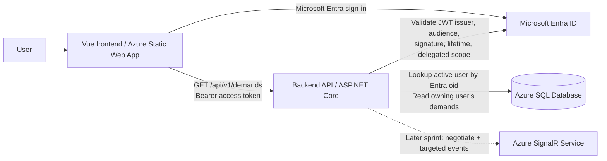
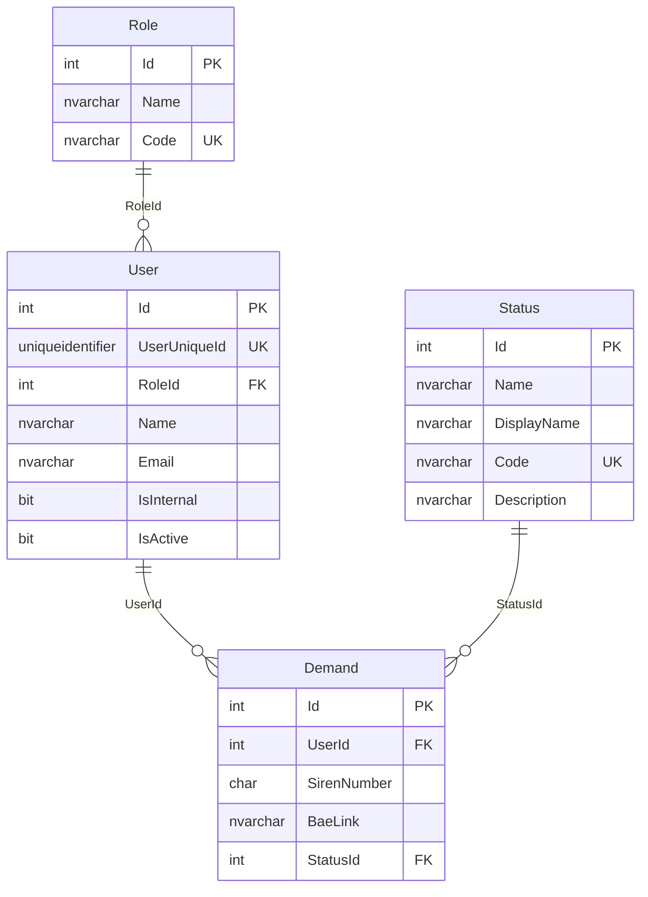

# KLESIA — Backend Functional & Technical Specification

**Document ID:** KLESIA-BE-SPEC  
**Version:** 1.0 (Sprint 1 baseline)  
**Date:** 2026-11-08  
**Status:** Implementation-ready for Sprint 1; future contracts recorded separately  
**Language:** English  
**Primary audience:** Backend engineers, database engineers, AI coding agents, QA and infrastructure engineers

> **Purpose.** This document specifies the incremental implementation of the KLESIA backend. Sprint 1 delivers an authenticated, authorized read-only demand-list API and the relational database supporting that view. The future SignalR and document-related contracts are retained here for compatibility **but are not Sprint 1 implementation work**. Later sprints should extend this document rather than silently changing existing contracts.

## 1. Normative language and scope

- **MUST / SHALL**: mandatory for the applicable sprint.
- **SHOULD**: recommended unless there is a documented reason not to follow it.
- **MAY**: optional.
- An explicit **ASSUMPTION** is a proposed implementation choice, not an established client requirement. Agents may use it for Sprint 1 unless an existing repository convention or signed-off decision contradicts it.
- **DEFERRED** requirements are documented interfaces for subsequent sprints; do not create placeholder endpoints that claim to implement them.
- Changes to endpoint semantics, JSON field names, auth requirements, the SQL schema, or access rules MUST be deliberate and documented.

### 1.1 Sprint 1 deliverables (IN SCOPE)

| ID | Required outcome |
|---|---|
| S1-DB-01 | A buildable SQL database project under the already initialized `database/` directory with exactly the four required business/security tables. |
| S1-DB-02 | Database artifacts that build into `database/Klesia.Database/bin/Debug/Klesia.Database.dacpac` and can be published to Azure SQL Database through `SqlPackage`. |
| S1-DB-03 | Working post-deployment reference-data scripts incorporating the existing `01_RefData.sql` and `02_User.sql`, made safe for repeated deployment. |
| S1-AUTH-01 | Entra ID JWT bearer access-token validation for the backend API. |
| S1-AUTH-02 | Database allowlist authorization: only existing, active users can access the protected data. |
| S1-API-01 | `GET /api/v1/demands`, returning the signed-in user's identity details and only their demands. |
| S1-API-02 | Explicit, safe HTTP responses for authentication, authorization, database and other server errors. |
| S1-OPS-01 | Configuration, allowed frontend origins, reproducible local run/build instructions and verification tests. |

### 1.2 Explicitly OUT OF SCOPE for Sprint 1

- `POST /api/v1/notifications/negotiate` and the Azure SignalR `demands` notification channel: **contract defined in §7, implementation deferred**.
- `demandUpdated` publication and demand-status mutation: deferred; no status-changing HTTP endpoint is specified.
- PDF upload, size-validation, ingestion or storage workflows: deferred; **no upload route is defined**.
- Demand creation, update, delete, status transitions, pagination, filtering or searching.
- Provisioning new users via API; management of roles/users via API.
- Additional business entities, audit-history tables, or user-role join tables.
- A third HTTP endpoint: not identifiable from the supplied contract; see **OPEN-01**.

### 1.3 Known gaps and conflict resolution

| ID | Observation / decision | Handling |
|---|---|---|
| OPEN-01 | The input says **three HTTP endpoints**, but specifies only **two**: `GET /api/v1/demands` and `POST /api/v1/notifications/negotiate`. The `demandUpdated` event is **not** HTTP. | Do **not** invent a third route. Record it as unspecified for a later sprint. |
| OPEN-02 | The broad API description includes SignalR, while the final Sprint 1 statement limits functionality to the initial user/demand screen. | The final Sprint 1 restriction takes precedence. Implement the list route now; preserve SignalR as a future contract. |
| OPEN-03 | The precise delegated API scope name, Entra tenant ID and API application ID are absent. | Configure these via environment settings; do not hard-code guessed values. |
| OPEN-04 | The specific role codes and elevated privileges are not defined. | Every active row in `sec.User` with a valid role may view **their own** demands; do not infer cross-user or administrator access from role names. |
| INT-05 | `maxPdfSizeMb`: 10 MB is illustrative, not confirmed. | Deferred until an upload endpoint is specified. |
| INT-08 | Exact error-body JSON structure is unconfirmed. | Keep status codes stable; return safe, generic bodies, without relying on a frontend-specific error schema. |
| OPEN-05 | Whether PDF links are permanent direct URLs or generated signed URLs is not specified. | Backend must return a usable, authorized HTTPS URL. Prefer short-lived signed URLs for protected PDFs; verify expiry strategy before production. |

## 2. System context and architectural boundaries



**Technology baseline:**

- Database: Microsoft SQL Server / Azure SQL Database, modeled through a `.sqlproj` SQL database project (`Microsoft.Build.Sql`).
- Backend: **ASSUMPTION:** ASP.NET Core Web API in C#, following any existing .NET solution structure in the repository. Do not change the application's established target framework solely because of this document.
- Authentication: Microsoft Entra ID, JWT bearer **access tokens intended for this API**.
- Authorization: explicit server-side SQL allowlist (`sec.User`) after JWT validation.
- Frontend: existing Vue application hosted in Azure Static Web Apps, with Vite local development at `http://localhost:5173`.
- Configuration: environment-specific; do not embed tenant IDs, API client IDs, credentials or production domains in source code.
- Database connection: use a least-privilege runtime identity; Azure-managed identity is preferred in Azure when the necessary SQL access is configured. The SQL credential used by `SqlPackage` is a **deployment** concern and must not be copied into frontend settings.

## 3. Database specification — Sprint 1

### 3.1 Design requirements

| ID | Requirement |
|---|---|
| DB-01 | Use separate files for SQL schemas and every table definition. |
| DB-02 | Exactly four domain tables: `sec.Role`, `sec.User`, `dbo.Status`, `dbo.Demand`. |
| DB-03 | Every table has `Id INT IDENTITY(1,1)` as primary key. |
| DB-04 | All schema, table and column identifiers use PascalCase, except the required schema identifiers `sec` and `dbo`. |
| DB-05 | Declare every foreign key explicitly and create an index with the foreign-key column as leading key. |
| DB-06 | Give primary keys, foreign keys, checks, unique constraints, default constraints and indexes readable, explicit names. |
| DB-07 | Enforce all described mandatory fields through `NOT NULL`; apply only justified checks/uniqueness. |
| DB-08 | Use SQL Server-native types. Do not introduce `FLOAT` for future monetary or percentage data. No such fields exist in Sprint 1. |
| DB-09 | Use `NO ACTION` behavior for deletes; do not add cascade deletes. |
| DB-10 | Maintain third-normal-form style associations; do not copy role, status or user names onto `Demand`. |
| DB-11 | A re-publish MUST preserve user-generated and existing business data; destructive schema changes require explicit review. |

#### 3.2 Schema and cardinality



**Critical identity distinction:** `sec.User.Id` is the internal SQL identity (`INT`). `sec.User.UserUniqueId` is the Microsoft Entra user's `oid` (`UNIQUEIDENTIFIER`). The API's `user_id` response field refers to **`UserUniqueId`**, never the internal `Id`.

### 3.3 Canonical table contracts

#### `sec.Role`

| Column | SQL type | Null | Rules |
|---|---|---|---|
| `Id` | `INT IDENTITY(1,1)` | No | `PK_Role` |
| `Name` | `NVARCHAR(100)` | No | Display/human-readable role name |
| `Code` | `NVARCHAR(50)` | No | Unique stable role identifier: `UQ_Role_Code` |

A role can be associated with multiple users; each user has exactly one role. No role permissions or hierarchy are defined yet.

#### `sec.User`

| Column | SQL type | Null | Rules |
|---|---|---|---|
| `Id` | `INT IDENTITY(1,1)` | No | `PK_User` |
| `UserUniqueId` | `UNIQUEIDENTIFIER` | No | Entra `oid`; `UQ_User_UserUniqueId` |
| `RoleId` | `INT` | No | `FK_Role_User` → `sec.Role(Id)`; indexed |
| `Name` | `NVARCHAR(200)` | No | Entire name, returned in API as `user_name` |
| `Email` | `NVARCHAR(320)` | No | Informational only; **never** use to identify/authorize users |
| `IsInternal` | `BIT` | No | Internal-company flag; default `0` |
| `IsActive` | `BIT` | No | Required for access; fail-closed default `0` |

The `UserUniqueId` uniqueness is based on the **ASSUMPTION** of a single configured Entra tenant. If multiple tenants are authorized later, the identity model must include a tenant identifier and use a tenant/oid composite authorization key (requires a reviewed schema change). Do not allow arbitrary tenants while keeping an `oid`-only lookup.

`Email` is **not** unique by default: email can change and is not the authoritative identity key.

#### `dbo.Status`

| Column | SQL type | Null | Rules |
|---|---|---|---|
| `Id` | `INT IDENTITY(1,1)` | No | `PK_Status` |
| `Name` | `NVARCHAR(100)` | No | Internal name |
| `DisplayName` | `NVARCHAR(100)` | No | Human-readable label |
| `Code` | `NVARCHAR(20)` | No | Unique: `UQ_Status_Code`; allowed `pending`, `ok`, `fail` |
| `Description` | `NVARCHAR(500)` | Yes | Explanatory text, optional |

Status `Code` is the source of the API `status` property; do not return the `Name` or `DisplayName` instead. Adding more status values is an explicit API/schema evolution.

#### `dbo.Demand`

| Column | SQL type | Null | Rules |
|---|---|---|---|
| `Id` | `INT IDENTITY(1,1)` | No | `PK_Demand` |
| `UserId` | `INT` | No | `FK_User_Demand` → `sec.User(Id)`; indexed |
| `SirenNumber` | `CHAR(9)` | No | Store 9 **digits only**; no punctuation; check format |
| `BaeLink` | `NVARCHAR(2048)` | No | Absolute HTTPS reference for the PDF; checked at least for HTTPS prefix |
| `StatusId` | `INT` | No | `FK_Status_Demand` → `dbo.Status(Id)`; indexed |

**Important:** The SIREN uniquely identifies a *company*, but `Demand.SirenNumber` MUST **NOT** be unique: multiple demands concerning the same company must remain possible. Store SIREN as text, not `INT`, to retain any leading zero and keep formatting separate from identity. A 9-digit pattern check is mandatory; a SIREN checksum rule is **not** required in this sprint.

`BaeLink` is an application-owned reference. If it holds a stable protected-object URI, the backend must transform it into a temporarily accessible signed HTTPS link before returning it. If it already holds a permitted direct HTTPS URL, it may be returned unchanged. The frontend must not construct a storage URL or SAS signature.

### 3.4 Normative SQL DDL baseline

The implementing agent MUST place the following schema objects and tables into separate SQL files, not into one monolithic script. These definitions specify the expected constraints; formatting may be adjusted without changing semantics.

**`Schemas/sec.sql`**

```sql
CREATE SCHEMA [sec];
```

**`Tables/sec.Role.sql`**

```sql
CREATE TABLE [sec].[Role] (
    [Id]   INT IDENTITY(1,1) NOT NULL,
    [Name] NVARCHAR(100) NOT NULL,
    [Code] NVARCHAR(50) NOT NULL,
    CONSTRAINT [PK_Role] PRIMARY KEY CLUSTERED ([Id]),
    CONSTRAINT [UQ_Role_Code] UNIQUE ([Code])
);
```

**`Tables/sec.User.sql`**

```sql
CREATE TABLE [sec].[User] (
    [Id]           INT IDENTITY(1,1) NOT NULL,
    [UserUniqueId] UNIQUEIDENTIFIER NOT NULL,
    [RoleId]       INT NOT NULL,
    [Name]         NVARCHAR(200) NOT NULL,
    [Email]        NVARCHAR(320) NOT NULL,
    [IsInternal]   BIT NOT NULL CONSTRAINT [DF_User_IsInternal] DEFAULT (0),
    [IsActive]     BIT NOT NULL CONSTRAINT [DF_User_IsActive] DEFAULT (0),
    CONSTRAINT [PK_User] PRIMARY KEY CLUSTERED ([Id]),
    CONSTRAINT [UQ_User_UserUniqueId] UNIQUE ([UserUniqueId]),
    CONSTRAINT [FK_Role_User] FOREIGN KEY ([RoleId])
        REFERENCES [sec].[Role] ([Id])
);
GO
CREATE INDEX [IX_User_RoleId] ON [sec].[User] ([RoleId]);
```

**`Tables/dbo.Status.sql`**

```sql
CREATE TABLE [dbo].[Status] (
    [Id]          INT IDENTITY(1,1) NOT NULL,
    [Name]        NVARCHAR(100) NOT NULL,
    [DisplayName] NVARCHAR(100) NOT NULL,
    [Code]        NVARCHAR(20) NOT NULL,
    [Description] NVARCHAR(500) NULL,
    CONSTRAINT [PK_Status] PRIMARY KEY CLUSTERED ([Id]),
    CONSTRAINT [UQ_Status_Code] UNIQUE ([Code]),
    CONSTRAINT [CK_Status_Code] CHECK
        ([Code] COLLATE Latin1_General_100_BIN2 IN
            (N'pending', N'ok', N'fail'))
);
```

**`Tables/dbo.Demand.sql`**

```sql
CREATE TABLE [dbo].[Demand] (
    [Id]          INT IDENTITY(1,1) NOT NULL,
    [UserId]      INT NOT NULL,
    [SirenNumber] CHAR(9) NOT NULL,
    [BaeLink]     NVARCHAR(2048) NOT NULL,
    [StatusId]    INT NOT NULL,
    CONSTRAINT [PK_Demand] PRIMARY KEY CLUSTERED ([Id]),
    CONSTRAINT [FK_User_Demand] FOREIGN KEY ([UserId])
        REFERENCES [sec].[User] ([Id]),
    CONSTRAINT [FK_Status_Demand] FOREIGN KEY ([StatusId])
        REFERENCES [dbo].[Status] ([Id]),
    CONSTRAINT [CK_Demand_SirenNumber] CHECK
        ([SirenNumber] COLLATE Latin1_General_100_BIN2 NOT LIKE '%[^0-9]%'),
    CONSTRAINT [CK_Demand_BaeLinkHttps] CHECK
        ([BaeLink] LIKE N'https://%')
);
GO
CREATE INDEX [IX_Demand_UserId] ON [dbo].[Demand] ([UserId], [Id] DESC);
GO
CREATE INDEX [IX_Demand_StatusId] ON [dbo].[Demand] ([StatusId]);
```

**Implementation notes:** SQL Server `CHAR(9)` plus the digit-pattern check enforce nine digits (including leading zeros). The HTTPS `CHECK` is a simple guard only; code must separately parse and validate URLs and avoid exposing private or expired resources. No `ON DELETE CASCADE` clause is permitted. Future `Year`, `Month`, percentages and monetary amounts are not present in this sprint, so no speculative fields/checks are to be added.

### 3.5 Project layout, build and deployment

**Preserve the existing `database/` folder and any repository conventions**; adapt this illustrative layout rather than deleting existing assets:

```text
database/
└── Klesia.Database/
    ├── Klesia.Database.sqlproj
    ├── Schemas/
    │   └── sec.sql
    ├── Tables/
    │   ├── sec.Role.sql
    │   ├── sec.User.sql
    │   ├── dbo.Status.sql
    │   └── dbo.Demand.sql
    ├── Scripts/
    │   ├── 01_RefData.sql         # preserve/adapt existing file
    │   ├── 02_User.sql            # preserve/adapt existing file
    │   └── PostDeployment.sql
    └── Properties/
        └── Azure.publish.xml
```

**Required `.sqlproj` capabilities:**

- Use an SDK-style project with a **pinned**, compatible `Microsoft.Build.Sql` version.
- Target Azure SQL Database explicitly through `Microsoft.Data.Tools.Schema.Sql.SqlAzureV12DatabaseSchemaProvider`.
- Build all table/schema definitions into the DACPAC as schema-model files.
- Include only one aggregate post-deployment entry, `Scripts/PostDeployment.sql`, which references `01_RefData.sql` before `02_User.sql`.
- Exclude data scripts included by `:r` from the schema model (`Build Remove`) so they do not cause build errors or run twice.
- Do not put deployment credentials in `.sqlproj`, `.publish.xml`, source control or shell history.

**Illustrative `.sqlproj` relevant elements** (merge into existing project as appropriate):

```xml
<Project>
  <Sdk Name="Microsoft.Build.Sql" Version="2.3.0" />
  <PropertyGroup>
    <Name>Klesia.Database</Name>
    <DSP>Microsoft.Data.Tools.Schema.Sql.SqlAzureV12DatabaseSchemaProvider</DSP>
  </PropertyGroup>
  <ItemGroup>
    <Build Remove="Scripts/01_RefData.sql" />
    <Build Remove="Scripts/02_User.sql" />
    <PostDeploy Include="Scripts/PostDeployment.sql" />
  </ItemGroup>
</Project>
```

**`Scripts/PostDeployment.sql`** (paths may be adapted to the real repository):

```sql
:r .\Scripts\01_RefData.sql
:r .\Scripts\02_User.sql
```

Before editing, inspect the actual `01_RefData.sql` and `02_User.sql`. Keep useful content, fix schema/table names, and make them idempotent. `01_RefData.sql` MUST ensure all three status codes (`pending`, `ok`, `fail`) exist; any role codes MUST come from actual product rules or existing reference data, not invented role names. `02_User.sql` MUST use valid, explicitly supplied Entra `oid` GUIDs and role associations; no fictitious user should be granted access to a real environment. If authorized test identities are unavailable, document how to supply them and leave the production seed empty rather than inserting arbitrary users.

Scripts execute **after every successful publish**. They MUST NOT duplicate rows, delete unknown users, reactivate disabled users inadvertently or overwrite administrator-controlled fields without a stated reason. Lookup of identity/reference records must use stable codes and GUIDs, not identity integer values.

**Build:**

```powershell
dotnet build database/Klesia.Database/Klesia.Database.sqlproj -c Debug
```

**Publish (illustrative PowerShell; substitute a securely supplied connection string):**

```powershell
SqlPackage `
  /Action:Publish `
  /SourceFile:"database/Klesia.Database/bin/Debug/Klesia.Database.dacpac" `
  /Profile:"database/Klesia.Database/Properties/Azure.publish.xml" `
  /TargetConnectionString:$env:KLESIA_SQL_DEPLOY_CONNECTION
```

The intended dev target is Azure SQL Database (e.g., the provided development server/database), **not** SQL Server LocalDB. Real secrets remain outside tracked files. The deployment should not allow destructive changes by default; review generated publish scripts and keep data-loss blocking enabled.

### 3.6 Database verification

The following checks are mandatory:

1. `dotnet build` produces the `.dacpac` at the documented path without unresolved references.
2. Publish to an **empty** Azure SQL dev/test database creates the `sec` schema and four expected tables.
3. All `PK_*`, `FK_*`, `UQ_*`, `CK_*`, `DF_*` and `IX_*` objects exist with the documented names.
4. Foreign keys reject orphan user-role, demand-user and demand-status references.
5. Duplicate `Role.Code`, `Status.Code` and `User.UserUniqueId` values fail; repeated `Demand.SirenNumber` values **succeed**.
6. Bad SIREN characters/length, non-HTTPS `BaeLink` and unsupported status codes fail.
7. Re-running the publish and reference scripts does not create duplicate seed data, wipe business records or reactivate inactive users.
8. An inactive user and a user without any demands can exist without breaking referential integrity.

## 4. Authentication and authorization — Sprint 1

### 4.1 Authentication contract (AUTH-01)

All Sprint 1 API routes MUST be protected by Microsoft Entra ID **access-token** authentication.

1. The frontend authenticates with Microsoft Entra ID and requests an **access token for the backend API** (not an ID token and not a Microsoft Graph access token).
2. The frontend sends `Authorization: Bearer <token>`.
3. The backend validates **signature**, **issuer**, **tenant**, **audience**, **lifetime** (`exp` and relevant standard token checks), and **required delegated scope** (`scp`).
4. The backend reads the `oid` claim from the validated token and interprets it as the stable Entra user identifier.
5. The backend rejects tokens for other APIs/tenants, expired or unsigned tokens, ID tokens, and tokens without the required delegated scope; it must not trust user IDs from query, body or arbitrary headers.
6. Require a **delegated user** token for this API: do not silently accept application-only tokens without a user `scp` claim.
7. Use established ASP.NET Core JWT bearer middleware (such as `Microsoft.Identity.Web`); do not implement custom JWT decoding as authorization.

**ASSUMPTION:** single-tenant Entra application. The allowed tenant, authority, API audience and required delegated scope MUST come from environment configuration. `oid` is unique **within** the validated tenant.

### 4.2 Database-based authorization (AUTH-02)

Only **after** successful token authentication:

```text
validated access token
         |
         v
   extract token.oid
         |
         v
SELECT sec.User WHERE UserUniqueId == oid
         |
         +-- not found ----------> 403 Forbidden
         +-- IsActive = 0 -------> 403 Forbidden
         +-- found + active -----> authorized user context
                                    (internal SQL User.Id)
```

- A row in `sec.User` is an **allowlist entry**, not a provisioning request.
- `IsActive = 0` means denied, even with a cryptographically valid Entra token.
- `IsInternal` is **not** an access gate in Sprint 1; it is informational until business rules are defined.
- `RoleId` must reference an existing `sec.Role` but grants **no elevated access** in Sprint 1.
- Do not create or update `sec.User` automatically during a request.
- Do not authorize using name, email, Entra group membership, frontend claims about roles or client-supplied user IDs.
- 403 responses should not disclose whether the account is unknown versus disabled.

### 4.3 HTTP status rules

| Case | HTTP status | Reason |
|---|---:|---|
| Missing or malformed Authorization header | `401` | Not authenticated |
| Invalid signature, wrong issuer/tenant/audience, expired token, ID token | `401` | Authentication invalid |
| Valid token without required delegated permission / scope | `403` | Authentication valid, permission insufficient |
| Valid token, `oid` missing or not representing a supported user | `401` or `403` | Fail closed; use documented consistent behavior (`401` recommended for missing identity claim) |
| Valid token, user not present in `sec.User` | `403` | Not authorized |
| Valid token, user present with `IsActive = 0` | `403` | Not authorized |
| Valid token, active user present | Continue | Allowed to see **only own demands** |
| SQL dependency failure | `5xx` | Service fault; never mislabel as `403` |

## 5. HTTP API — Sprint 1

### 5.1 `GET /api/v1/demands` (API-01)

**Purpose:** populate the initial dashboard screen with the authenticated user's display name/identifier and their demand list.

```http
GET /api/v1/demands HTTP/1.1
Authorization: Bearer <Entra access token>
Accept: application/json
```

**Parameters:** none. No user ID in path, query or request body. No role-specific or admin filters.

**Successful response:** `200 OK`, `Content-Type: application/json`

```json
{
  "user_id": "f47ac10b-58cc-4372-a567-0e02b2c3d479",
  "user_name": "John DOE",
  "demands": [
    {
      "demand_id": 1,
      "siren_number": "732-829-320",
      "bae_link": "https://files.example.com/bae-1.pdf",
      "status": "pending"
    }
  ]
}
```

**Response schema:**

| JSON property | Type | Source / rule |
|---|---|---|
| `user_id` | string | Normalized GUID from validated Entra `oid` / matched `sec.User.UserUniqueId`. **Not** `sec.User.Id`. |
| `user_name` | string | `sec.User.Name` from matched active DB row. |
| `demands` | array | All demand rows whose `Demand.UserId` is the matched internal `sec.User.Id` (zero or more). |
| `demands[].demand_id` | integer | `dbo.Demand.Id`. |
| `demands[].siren_number` | string | `dbo.Demand.SirenNumber`, presented as `XXX-XXX-XXX`. The backend performs formatting. |
| `demands[].bae_link` | string | Backend-provided **HTTPS URL** that opens the corresponding PDF without a frontend-provided bearer Authorization header. |
| `demands[].status` | string enum | `dbo.Status.Code`, exclusively `pending`, `ok`, `fail`. |

**Empty list is valid** and still returns `200`:

```json
{
  "user_id": "f47ac10b-58cc-4372-a567-0e02b2c3d479",
  "user_name": "John DOE",
  "demands": []
}
```

**Backend processing rules:**

1. Authenticate bearer token and require the configured delegated scope.
2. Resolve an active `sec.User` using validated `oid`; otherwise return `403`.
3. Read demands only where `dbo.Demand.UserId = sec.User.Id`; join `dbo.Status` by `StatusId`.
4. Map the response to exactly the specified snake_case field names and types; no database or EF entities serialized directly.
5. Convert stored 9-digit SIREN to three groups separated by hyphens.
6. Return the stored status code verbatim (from the three allowed lowercase codes).
7. Resolve `BaeLink` to a currently usable HTTPS URL, including signing on the server if needed. Never expose Azure storage credentials or assume the frontend can attach the API bearer token when opening the PDF.
8. **ASSUMPTION:** order demands by `Demand.Id DESC` for deterministic display until a product ordering requirement is defined. The frontend MUST NOT treat this ordering as a permanent business contract.
9. Do not cap or paginate results in Sprint 1 without explicitly changing the API response contract. Flag performance concerns if volume makes this unsuitable.
10. Prevent cross-user data leakage, including in errors and logs.

**PDF access security note:** Because these documents can contain sensitive personal data, production should use authorized, time-limited signed URLs rather than public anonymous blobs. The API itself is the access gate; a signed PDF URL is a bearer capability and must be redacted from logs. URL TTL and storage integration are **OPEN-05**, to verify before connecting real documents.

### 5.2 API errors and CORS (API-02)

- `400` / `422`: malformed input or applicable request validation, with only safe optional text. (The current GET has no input body and normally requires neither.)
- `401`: missing/invalid bearer authentication.
- `403`: valid but unauthorized caller, including unknown/inactive DB user or insufficient scope.
- `413`: reserved for a **future** PDF-upload endpoint; not applicable to the Sprint 1 read-only route.
- `5xx`: service and dependency faults; no exception stack traces, SQL statements, token contents or connection strings in HTTP bodies.
- **INT-08:** no fixed frontend-consumed error JSON contract yet. `ProblemDetails` MAY be used as a backend convention, but frontend correctness must depend on HTTP status rather than a mandatory `message` field.
- Configure CORS for **exact approved origins**, including deployed Azure Static Web App origin(s) and `http://localhost:5173`. Permit the needed `GET`, `POST`, `OPTIONS` methods and `Authorization`/`Content-Type` headers. Do not use an unrestricted `*` origin policy.
- Enforce CORS **before** authentication failures prevent browser preflight processing. A successful OPTIONS preflight is not an authorization grant.
- HTTPS is mandatory outside localhost. Validate proxy/forwarded-header settings only for trusted infrastructure.

## 6. Security, configuration, observability and operations

### 6.1 Environment configuration

Use existing config conventions where present; the following names are illustrative **backend** settings, not required literal names:

| Area | Config values required |
|---|---|
| Entra ID | Tenant ID, API application/client ID (or accepted audience), authority, required delegated API scope |
| SQL | Azure SQL hostname/database and secure runtime authentication configuration |
| Frontend | Allowed CORS origins, including Vite development and deployed Static Web App URLs |
| Logging | Log level, correlation/tracing settings, telemetry backend if already used |
| Future SignalR | SignalR endpoint/resource name, managed identity configuration and hub identifier `demands` |
| Future PDF | Blob/document URL resolution and signing configuration, link expiry, `maxPdfSizeMb` pending confirmation |

Store credentials and connection secrets in environment-specific secret stores or managed identity configuration. Avoid checking credentials into `appsettings.json`, `.env` tracked files, Bicep parameter defaults, `Azure.publish.xml`, examples, log files or simulator artifacts.

### 6.2 Logs and operational behavior

- Structured request logs SHOULD include route, outcome/status, duration and correlation ID; do not log raw JWTs, authorization headers, PDF signed URLs, email addresses, document contents or complete connection strings.
- Log exceptions on the server with appropriate access controls; provide generic client errors.
- Fail closed on authentication/authorization failures; fail with `5xx` on actual database outages.
- Parameterize SQL queries (or use a safe ORM). Never interpolate `oid` or user input into SQL.
- Backend SQL credentials/managed identity SHOULD have minimum runtime permissions: read access to the four necessary tables; database-schema deployment uses a distinct, more privileged principal.
- Test CORS behavior from the frontend origin, including `OPTIONS` preflight and rejected authentication.

## 7. Preserved future API contracts — NOT to be implemented in Sprint 1

These requirements are frozen as intended integration interfaces for future sprints. They are not additional Sprint 1 deliverables, and their inclusion does not authorize inventing new routes.

### 7.1 `POST /api/v1/notifications/negotiate` (DEFERRED)

```http
POST /api/v1/notifications/negotiate HTTP/1.1
Authorization: Bearer <Entra access token>
```

Success: `200 OK`:

```json
{
  "url": "<Azure SignalR client endpoint>",
  "accessToken": "<short-lived connection token>"
}
```

- Apply **the same Entra token validation and database allowlist checks** as `GET /api/v1/demands`. A recognized but inactive user cannot negotiate a connection.
- Set the resulting SignalR `userId` to the validated Entra **`oid`**, not the SQL integer primary key, an email address or a frontend-supplied value.
- Use the Azure SignalR Service's `demands` hub.
- Base URL expected by the frontend: `VITE_SIGNALR_HUB_URL=<backend-base>/api/v1/notifications`. The standard SignalR JavaScript client appends `/negotiate` when connecting; **do not** put `/negotiate` inside that variable.
- The returned response is the **SignalR redirect negotiation** shape, not an ordinary arbitrary application JWT. Clients must not skip the negotiation step.
- Use backend managed identity to access Azure SignalR. The supplied infrastructure contract assigns **SignalR Service Owner** in Bicep, which matches a serverless negotiate + REST-publish use case; verify that resource mode and role assignments are consistent at implementation time. Never return the service access key to the browser.
- Explicitly configure API and Azure SignalR allowed frontend origins (Azure resource/Bicep where relevant).
- Do not add a separately exposed, unprotected `/negotiate` endpoint.

### 7.2 `demandUpdated` server-to-client event (DEFERRED)

| Property | Contract |
|---|---|
| SignalR hub | `demands` |
| Client method name | `demandUpdated` (case-sensitive) |
| Payload | **No arguments**; any unexpected payload is ignored by the frontend |
| Recipient | Owning user only, selected by stable Entra `oid` |
| Trigger | Demand status change; optionally a newly visible demand |
| Delivery | At-most-once, best effort; no replay or durable event history |
| Client recovery | Reload `GET /api/v1/demands` after (re)connection or receiving the event |

Do **not** broadcast demand activity to all connections. Future status-update integrations must establish the correct owner from the database or trusted business event, never from an untrusted client-supplied owner claim. No producer or status mutation endpoint has been specified yet.

### 7.3 Future upload and local simulator (DEFERRED)

- Upload request validation and gateway/backend payload size limits MUST eventually use the same confirmed `maxPdfSizeMb` value. The illustrative 10 MB is **not** a definitive acceptance criterion.
- No PDF-upload endpoint, multipart contract, request parameters or response shape have been provided; do not invent any in Sprint 1.
- `tools/dev-simulator/`, when implemented, should emulate the **specified** real routes and event behavior with the same response types, error codes and identity protections. At present the simulator is not implemented; do not count it as an existing dependency or Sprint 1 deliverable.

## 8. Suggested implementation structure

The SQL database project location is required. Backend layout is guidance, subject to the existing repository:

```text
backend/                         # adapt to existing API solution path
  Klesia.Api/
    Controllers/ or Endpoints/   # HTTP transport, DTO mapping
    Authentication/             # Entra token validation / authorization
    Services/                   # Demand query / PDF link resolution
    Data/                       # SQL access
    Contracts/                  # Response DTOs
  Klesia.Api.Tests/              # unit and integration tests

database/
  Klesia.Database/               # authoritative SQL project
```

Keep token validation separate from business query logic. Avoid introducing unrequested frameworks, microservices, event buses or CQRS infrastructure solely for Sprint 1. Keep DTO naming/JSON serialization independent from SQL table/column casing.

## 9. Sprint 1 acceptance scenarios / test matrix

| ID | Given | When | Expected |
|---|---|---|---|
| AT-01 | No bearer token | GET `/api/v1/demands` | `401` |
| AT-02 | Expired, forged or wrong-audience token | GET | `401` |
| AT-03 | Token for Microsoft Graph or ID token instead of backend API access token | GET | `401` |
| AT-04 | Valid user access token missing required API scope | GET | `403` |
| AT-05 | Valid scoped token from unsupported Entra tenant | GET | Rejected (`401`) |
| AT-06 | Valid scoped token, `oid` not in `sec.User` | GET | `403` |
| AT-07 | Valid scoped token, matching `sec.User.IsActive = 0` | GET | `403` |
| AT-08 | Valid scoped token, active row, no demands | GET | `200`, correct `user_id` / `user_name`, `demands: []` |
| AT-09 | Valid scoped token, active row, multiple demands | GET | `200`; correct snake_case JSON, integer `demand_id`, formatted SIREN, HTTPS PDF link, allowed status code |
| AT-10 | Two authorized users with separate demands | Each GET | Each user receives only their own records; no cross-user leakage |
| AT-11 | Attacker sends `user_id` query/header matching another user | GET | Ignored for filtering; identity always from validated token |
| AT-12 | SQL database is unavailable | GET | `5xx`, sanitized response, logged server fault |
| AT-13 | Browser preflight from approved Vite/SWA origin | OPTIONS | Allowed CORS origin, methods and requested headers |
| AT-14 | Browser preflight from unapproved origin | OPTIONS | No permissive CORS authorization |
| AT-15 | Invalid SQL foreign key or invalid status/SIREN/link value | INSERT in test DB | Constraint rejection |
| AT-16 | Same company SIREN on distinct demands | INSERT | Allowed; no uniqueness on `Demand.SirenNumber` |
| AT-17 | SQL project republished with existing records | `SqlPackage /Action:Publish` | No unintended records deleted; idempotent seeds |
| AT-18 | Unauthorized user requests any future negotiation route, if introduced later | POST | Same `401`/`403` policy; **not an S1 test until route implemented** |

**Definition of Done — Sprint 1**

- [ ] Four-table SQL project compiles to the specified `.dacpac`.
- [ ] Azure SQL publish procedure and repeat publish are verified in a safe dev/test environment.
- [ ] All declared relationships, checks, named constraints and FK indexes are in place.
- [ ] Existing reference-data scripts are reused rather than deleted/replaced blindly; they are idempotent and respect inactive accounts.
- [ ] Entra authentication rejects missing, malformed, expired, wrong-tenant, wrong-audience, and wrong-type tokens.
- [ ] The required delegated API scope is validated and the DB allowlist/active gate is enforced.
- [ ] `GET /api/v1/demands` matches the exact response JSON and does not leak other users' records.
- [ ] Local Vite and deployed SWA CORS are configured with explicit allowed origins.
- [ ] Safe errors, structured logs and no-credential-in-source checks are verified.
- [ ] Automated coverage exists for the Sprint 1 acceptance matrix; instructions to run/build/test/deploy are committed to the repository.
- [ ] Deferred SignalR/upload routes are **not presented as delivered**; unresolved decisions remain recorded.

## 10. Implementation instructions for coding agents

1. **Inspect before changing:** inspect the existing repository tree, current `.sqlproj`/backend solution (if any), `01_RefData.sql`, `02_User.sql`, current frontend integration contracts, `.publish.xml`, and infrastructure conventions. Do not overwrite initialized files unnecessarily.
2. **Implement only Sprint 1:** deliver the database plus `GET /api/v1/demands` with Entra access-token authentication and SQL allowlist authorization. Preserve, but do not implement, §7 future contracts.
3. **Avoid speculative features:** do not add a third HTTP route, status mutation API, upload API, user-admin CRUD, role hierarchies, additional tables or SignalR stubs that return fake production data.
4. **Follow contracts verbatim:** preserve table names, schema names, constraint names, JSON field names, HTTP statuses and identity mapping.
5. **Keep credentials external:** do not use illustrative server names/passwords as executable defaults, and do not include real Entra access tokens or real signed document URLs in tests/logs.
6. **Validate correctness:** run builds/tests, inspect the generated DACPAC, and verify a repeat publish on a disposable/dev SQL database when access is available. If Azure access is unavailable, report the unverified deployment step explicitly rather than claiming completion.
7. **Report changes:** at the end, provide changed-file list, build/test results, configuration values required from the client, unresolved decisions and any deviations from this specification.

## 11. External technical references

These are implementation references, not new business requirements:

- SQL database projects and `Microsoft.Build.Sql`: https://learn.microsoft.com/en-us/sql/tools/sql-database-projects/sql-database-projects
- SQL-project Azure SQL target platform (`DSP`): https://learn.microsoft.com/en-us/sql/tools/sql-database-projects/concepts/target-platform
- SQL pre/post-deployment script handling: https://learn.microsoft.com/en-us/sql/tools/sql-database-projects/concepts/pre-post-deployment-scripts
- Entra access token validation: https://learn.microsoft.com/en-us/entra/identity-platform/access-tokens
- Entra claim validation / tenant-scoped identity: https://learn.microsoft.com/en-us/entra/identity-platform/claims-validation
- API scope authorization (`Microsoft.Identity.Web`): https://learn.microsoft.com/en-us/entra/msidweb/authentication/authorization
- Azure SignalR negotiate: https://learn.microsoft.com/en-us/azure/azure-signalr/signalr-concept-client-negotiation
- Azure SignalR managed identity and RBAC: https://learn.microsoft.com/en-us/azure/azure-signalr/signalr-howto-authorize-managed-identity

---

**Change policy for Sprint 2+:** Add a sprint section with new requirements and tests. Modify prior contracts only through an explicit compatibility/versioning decision. Do not retroactively recast deferred endpoints as Sprint 1 completed work.
