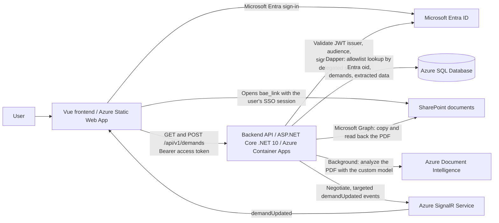
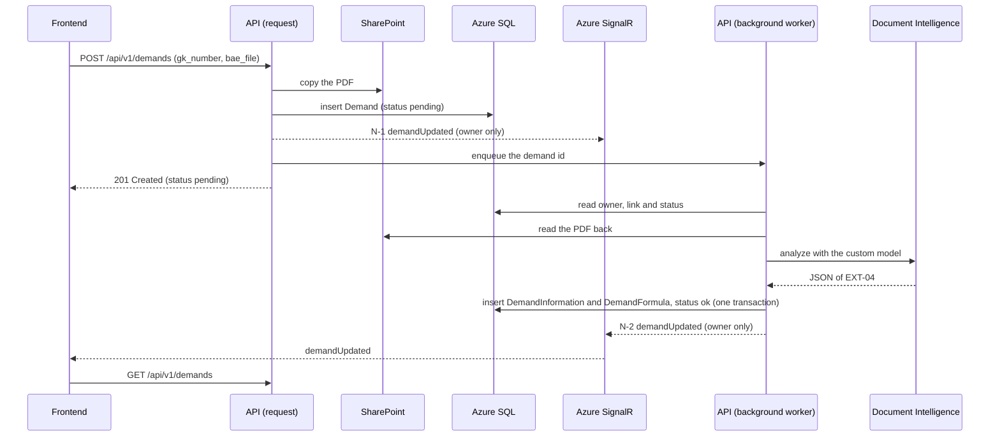

# KLESIA — Backend Functional & Technical Specification

**Document ID:** KLESIA-BE-SPEC  
**Version:** 2.1 (specification of the whole application: demand creation and extraction workflow, hosting Azure Container Apps DEC-15; database engine Azure SQL Database again, DEC-14 revised)  
**Date:** 2026-11-18  
**Status:** Implementation-ready  

**Language:** English  
**Primary audience:** Backend engineers, database engineers, AI coding agents, QA and infrastructure engineers

> **Purpose.** This document specifies the complete KLESIA backend: an authenticated, authorized API that lists the demands of a user, creates a demand from a BAE PDF, extracts the content of that PDF in the background with Azure Document Intelligence, and notifies the owner in real time through Azure SignalR. It is the single description of the application and carries no delivery phasing. The HTTP contract of every endpoint is stated here (§5, §7, §8); `contracts/openapi.yaml` is its machine-readable form (DEC-08) and MUST stay identical to this document on every HTTP detail. Change a contract here first, then in the OpenAPI file, and never silently.

## 1. Normative language and scope

- **MUST / SHALL**: mandatory.
- **SHOULD**: recommended unless there is a documented reason not to follow it.
- **MAY**: optional.
- An explicit **ASSUMPTION** is a proposed implementation choice, not an established client requirement. Agents may use it unless an existing repository convention or signed-off decision contradicts it.
- **OPEN** items are decisions still to be taken by the client or the DSI. Nothing that depends on them is hard-coded and anything that depends on them is reported as unverified.
- Changes to endpoint semantics, JSON field names, auth requirements, the SQL schema, or access rules MUST be deliberate and documented.

### 1.1 Functional scope (IN SCOPE)

| ID | Required outcome |
|---|---|
| SC-DB-01 | A buildable SQL database project under the already initialized `database/` directory with exactly the six business/security tables: `sec.Role`, `sec.User`, `ref.Status`, `dbo.Demand`, `dbo.DemandInformation`, `dbo.DemandFormula`. |
| SC-DB-02 | Database artifacts that build with `dotnet build` into `database/Klesia.Database/bin/Debug/Klesia.Database.dacpac` and can be published to Azure SQL Database through `SqlPackage`. |
| SC-DB-03 | Working post-deployment reference-data and user scripts (`Scripts/01_RefData.sql`, `Scripts/02_User.sql`), safe for repeated deployment. |
| SC-AUTH-01 | Entra ID JWT bearer access-token validation for the backend API. |
| SC-AUTH-02 | Database allowlist authorization: only existing, active users can access the protected data. |
| SC-API-01 | `GET /api/v1/demands` (§5.1), returning the signed-in user's identity details and only their demands, without extracted data. |
| SC-API-02 | Explicit, safe HTTP responses for authentication, authorization, database and other server errors. |
| SC-API-03 | `POST /api/v1/demands` (§7.2, workflow step 1): copy of the PDF into SharePoint, storage of the demand with status `pending`, notification N-1, answer `201`. |
| SC-EXT-01 | Background extraction (§7.3, workflow step 2): reading of the PDF, call to Azure Document Intelligence, validation of the answer, storage in `DemandInformation` and `DemandFormula`. |
| SC-EXT-02 | Completion (§7.4, workflow step 3): final status `ok` or `fail`, notification N-2. |
| SC-RT-01 | `POST /api/v1/notifications/negotiate` (§8.1): Entra-protected negotiation of the Azure SignalR connection (Serverless mode, hub `demands`, `userId` = `oid`). |
| SC-RT-02 | The notification publisher (§8.2): an `INotifier` port in `Application` and its Azure SignalR implementation in `Infrastructure`, sending `demandUpdated` to one user, for N-1 and N-2. |
| SC-OPS-01 | Configuration, allowed frontend origins, reproducible local run/build instructions and verification tests. |
| SC-OPS-02 | A production container image definition (`Dockerfile`, `.dockerignore`) for the API and committed deployment instructions and pipeline for Azure Container Apps (DEC-15, §6.3). The SQL database project is delivered separately (SC-DB-02) and is not part of the image. |

### 1.2 Explicitly OUT OF SCOPE

- Any HTTP route that reads the extracted data (`DemandInformation`, `DemandFormula`): the data is stored for later use and is not exposed (DEC-22).
- Any route that changes a status, retries or restarts an extraction, or edits extracted data. A `fail` demand is final; a new submission creates a new demand (INT-09).
- Demand update and delete, pagination, filtering or searching: the list is returned in full (§5.1).
- Provisioning new users via API; management of roles/users via API.
- Additional business entities beyond the six tables, audit-history tables, or user-role join tables.

### 1.3 Known gaps, decisions and conflict resolution

| ID | Observation / decision | Handling |
|---|---|---|
| OPEN-01 | **Resolved.** The API has **four HTTP routes**: `GET /api/v1/demands` (§5.1), `POST /api/v1/demands` (§7.2), `POST /api/v1/notifications/negotiate` (§8.1) and the anonymous `GET /health` (§5.3). The `demandUpdated` event is **not** HTTP. | Their contract is stated in this document and mirrored in `contracts/openapi.yaml` (DEC-08). Do not add any other route (status mutation, extraction trigger or retry, read of the extracted data). |
| OPEN-03 | The precise delegated API scope name, Entra tenant ID and API application ID are absent. | Supplied through configuration (§6.1: `AzureAd:*`); never hard-coded. The API refuses to start while they are missing or still placeholders. |
| OPEN-04 | **Resolved.** The only authorization rule for now is *own data only*: an authenticated, allowlisted, active user receives exclusively the demands whose `Demand.UserId` is their own `sec.User.Id`. | The role codes `admin`, `operational` and `guest` are confirmed as the real codes, but **no role grants or removes any access**. Do not infer cross-user, administrator or role-based behavior. |
| OPEN-05 | **Resolved.** The PDFs are stored in **SharePoint**. `Demand.BaeLink` holds the absolute HTTPS URL of the document in SharePoint. | The API returns that URL after validating that it is an absolute HTTPS URL. SharePoint permissions are the access gate: the browser opens the link with the user's own Entra single sign-on session, so no bearer header, no SAS-style signature and no anonymous link is involved. The links are **permanent** SharePoint URLs: no time-limited, signed or anonymous sharing links are used, and `IBaeLinkResolver` stays a pass-through. Changing this needs a separate decision (tenant sharing policy, Graph permissions). |
| INT-05 | `maxPdfSizeMb`: 10 MB is illustrative, not confirmed. | The limit is the backend setting `Upload:MaxPdfSizeMb`, provisionally 10 (1 MB = 1,048,576 bytes); it MUST equal the webapp's `public/config/app-config.json` value and be confirmed by the operator before production. |
| INT-08 | Exact error-body JSON structure. | **Resolved.** Every error response of an application route is RFC 9457 (7807) `application/problem+json` (§5.2). The HTTP status stays the primary signal; the frontend never renders server text. |
| DEC-01 | Backend target framework. | **.NET 10 (`net10.0`)** from the start (SDK pinned in `global.json`). |
| DEC-02 | Data access technology. | **Dapper** over `Microsoft.Data.SqlClient`. **Entity Framework Core, `DbContext` and EF migrations MUST NOT be used.** The SQL database project (`database/Klesia.Database`) is the single owner of the schema. |
| DEC-03 | Existing repository files take precedence over earlier draft DDL. | Primary keys are named `Id` (DEC-12, DB-03), constraint names follow the single scheme of DB-06, column sizes and defaults follow the files already present in `database/`, and the `ref` schema is kept. The draft DDL in earlier revisions of this document is superseded by §3.4. |
| DEC-04 | Where configuration values live. | Entra, CORS, SQL, SharePoint, Document Intelligence and extraction settings are configuration-file values (§6.1), never code constants. |
| DEC-05 | Seeded identity. | The seed script creates the project owner's account as an active `admin` user, as explicitly requested. Further identities are added by editing the same script. |
| DEC-06 | Local development against Azure SQL Database. | One connection string works on a developer PC and in Azure: `Authentication=Active Directory Default` (see §6.1). `DefaultAzureCredential` uses the developer's `az login` / Visual Studio account on a PC and, in Azure, the **user-assigned** managed identity of the container app selected by `AZURE_CLIENT_ID` (DEC-15). No password is ever stored in a tracked file. |
| DEC-07 | Hosting topology. | **Superseded by DEC-15** for the backend (it was Azure App Service). Unchanged: backend connected to **Azure SQL Database**; frontend on **Azure Static Web Apps**. |
| DEC-08 | Canonical HTTP contract. | This document is the authoritative description of routes, schemas, status codes, headers and CORS (change contracts here first). `contracts/openapi.yaml`, kept at the workspace root outside this repository, is its machine-readable form and MUST stay identical; any conflict is fixed in both files in the same change, starting here. |
| DEC-09 | JSON naming convention. | Business payloads (request parts and response bodies) use `snake_case`. The SignalR negotiation response (`url`, `accessToken`) is a protocol payload whose names are fixed by the SignalR client; it is, with `ProblemDetails` (RFC 9457 / ASP.NET Core standard names such as `traceId`), one of the **only two** camelCase exceptions; neither is renamed. |
| DEC-10 | Success status of `POST /api/v1/demands`. | `201 Created` with the created demand as body (same shape as a `demands[]` item). There is no single-demand route, so no `Location` header is sent. The frontend treats any 2xx as success and ignores the body. |
| DEC-11 | Delegated scope name. | The delegated scope is named `access_as_user` (fixed in the contract's OAuth2 security scheme and set in `AzureAd:RequiredScope`). The full scope requested by the SPA is `api://<API client id>/access_as_user`. |
| DEC-12 | Primary-key naming. | Every primary key is named `Id` (`sec.Role.Id`, `sec.User.Id`, `ref.Status.Id`, `Demand.Id`), as in the database project. Foreign keys keep the `{ReferencedTable}Id` form (`RoleId`, `UserId`, `StatusId`). Dapper queries alias keys to the domain names (`d.Id AS DemandId`); the JSON field `demand_id` is `Demand.Id`. This replaces the earlier `{Table}Id` rule. |
| DEC-13 | Copy of the uploaded PDF into SharePoint. | **Requirement:** the backend MUST copy the PDF received by `POST /api/v1/demands` into the SharePoint document library and MUST store the resulting permanent HTTPS link in `Demand.BaeLink`, so that the user can open the document later from the `bae_link` returned by `GET /api/v1/demands`. The browser never uploads to SharePoint; the database stores the link, never the file; the API server keeps no copy (the extraction reads the document back from SharePoint, EXT-02). All SharePoint access is isolated in `IBaeDocumentStore` (Infrastructure). The stored file name is generated by the backend (for example `{GKNumber}/{unique id}.pdf`) and never taken from the client, so repeated submissions of the same GK number cannot overwrite each other. **ASSUMPTION** (to confirm with the Microsoft 365 administrators OPEN-11): upload through Microsoft Graph as the container app's user-assigned managed identity with the least-privilege `Sites.Selected` permission on the one target site; site, library and base folder come from configuration (`SharePoint:*`, §6.1), never from code or from the client. Who may open a document stays a SharePoint matter (OPEN-05): the library permissions must let the intended users open it; the API does not manage per-document permissions. |
| OPEN-06 | **Resolved.** How the uploaded BAE PDF reaches SharePoint. | Stated as an explicit requirement in **DEC-13**: copy into SharePoint, store the link in `Demand.BaeLink`. Only deployment settings remain (site, library, folder, permission grant); they are configuration, not an open question about the HTTP contract. |
| DEC-14 | Database engine: **Azure SQL Database** (SQL Server). | The client's final decision is **Azure SQL Database**. It replaces an intermediate decision to use Azure SQL Database, which is withdrawn. Decided consequences: (1) the three schemas `sec`, `ref` and `dbo` hold the six tables (DB-02); (2) a **SQL database project** (`database/Klesia.Database`, `Microsoft.Build.Sql`) is built into a DACPAC and published with `SqlPackage` (§3.5); (3) **`Microsoft.Data.SqlClient`** is the ADO.NET provider; (4) **passwordless access with Microsoft Entra**: `Authentication=Active Directory Default` (DEC-06); (5) `UserUniqueId` is `UNIQUEIDENTIFIER` and `IsActive`/`IsInternal` are `BIT`; (6) all constraints are named, including primary keys and defaults (`PK_`, `DF_`, `AK_`, `FK_`, `CK_`, `IX_`, DB-06); (7) case-sensitive checks use a binary collation. The HTTP contract, JSON, authorization rules and API behavior are **unchanged**; the SQL of the repositories is T-SQL (`OUTPUT INSERTED.Id`, `UPDATE ... FROM`), an implementation detail of `Infrastructure`. |
| DEC-15 | Hosting: **Azure Container Apps** (replaces Azure App Service, DEC-07). | The customer's DSI requires that the API be deployed in **Azure Container Apps**. The frontend stays on Azure Static Web Apps and the database on Azure SQL Database (DEC-14). Decided consequences: (1) the API is delivered as a **container image** built from a `Dockerfile` at the repository root (§6.3, HOST-01); (2) the container listens on plain **HTTP port 8080** and runs as a non-root user: **TLS ends at the Container Apps ingress**, never in Kestrel (HOST-02, HOST-03); (3) the ingress is the only entry point, so the API reads `X-Forwarded-For` / `X-Forwarded-Proto` (HOST-04); (4) the Container Apps **probes** replace the App Service health check, `GET /health` is unchanged (§5.3, HOST-05); (5) the identity is a **user-assigned managed identity** attached to the container app and selected with the environment variable `AZURE_CLIENT_ID` (DEC-06, HOST-06); (6) configuration comes from **environment variables** (`Section__Key`) and, if ever needed, Container Apps secrets, never from the image (HOST-07); (7) the API is **stateless** and logs to the console only, collected by Log Analytics (HOST-08, HOST-10); (8) the SQL database project is **not** part of the API image: the GitHub Actions pipeline publishes the DACPAC with `SqlPackage` as a step before the new revision is deployed (HOST-12). The HTTP contract, JSON, authorization rules, database schema and the Clean Architecture of the code are **unchanged**. |
| DEC-16 | Real-time notifications. | The client decided (2026-11-12) that the backend notifies the owner through Azure SignalR **at two moments**: **N-1** when a new demand has been stored in the database and **N-2** when the extraction of the PDF is finished and the demand status has changed. Both use the same event `demandUpdated` with no payload and go to the owner only (§8.2); the frontend reloads its list with `GET /api/v1/demands` on each. N-2 is sent whether the extraction succeeded or failed (DEC-17, DEC-19). Azure SignalR Service is used in Serverless mode. |
| OPEN-07 | **Open: to confirm with the customer's DSI.** Azure SQL Database deployment settings. | (b) Server name, database name, service tier, region and network access (public access with firewall rules, or a private endpoint: the Container Apps environment must reach the server, see OPEN-08). (c) Entra authentication: an Entra administrator on the logical server, and the database users of the runtime and deployment principals (`CREATE USER [name] FROM EXTERNAL PROVIDER`). (d) Whether Microsoft Entra-only authentication is enabled. (e) TLS: `Encrypt=True` and `TrustServerCertificate=False` (the defaults used in §6.1). Until confirmed none of this is hard-coded: it is configuration (§6.1). |
| OPEN-08 | **Open: to confirm with the customer's DSI.** Azure Container Apps deployment settings. | (a) The Container Apps environment (type, region) and whether it is integrated in a virtual network. (b) The network path to Azure SQL Database (OPEN-07a): the outbound addresses of a Container Apps environment are not a stable firewall allowlist unless the environment sits in a virtual network with fixed egress, so private access is the preferred target. (c) Ingress exposure: external (the browser of the Static Web App calls the API) or behind another entry point, IP restrictions, custom domain and certificate. (d) The container registry (Azure Container Registry name; the managed identity pulls with `AcrPull`), image retention and tag policy. (e) Minimum and maximum replicas (a minimum of 0 means a cold start, whose first request also acquires the Entra token and opens the TLS connection to Azure SQL Database; the background extraction, EXT-01, also argues for a minimum of at least 1 so that a replica is not scaled in while a job runs, OPEN-10), CPU/memory size, the scaling rule and the probe thresholds. (f) The maximum request body size and the request timeout of the ingress (240 s documented) against `Upload:MaxPdfSizeMb`, before production. (g) Who owns the infrastructure code (Bicep): the DSI's infrastructure contract or this repository, and the role assignments (`AcrPull`, `Sites.Selected`, SignalR, Document Intelligence). (h) The Log Analytics workspace and the telemetry backend (§6.2). (i) GitHub Actions to Azure authentication: an OpenID Connect federated credential on a deployment principal (no stored secret), environments and approvals. Until confirmed none of this is hard-coded: it is configuration or infrastructure code. |
| INT-09 | Duplicate submissions. | Allowed: each `POST /api/v1/demands` creates a new demand and a new extraction. `Demand.GKNumber` is not unique (AT-16, AT-30) and the frontend never retries a submission automatically. |
| DEC-17 | Demand creation workflow. | Creating a demand is a three-step workflow `[1. Demand creation] → [2. Extraction] → [3. DONE]` (§7). Step 1 is the HTTP request: it answers `201` with the demand in status `pending`. Steps 2 and 3 run in the background, in the API process, after the response (EXT-01). The owner is told through SignalR at the end of step 1 (N-1) and at the end of step 3, whether it ended well or not (N-2). |
| DEC-18 | Document extraction engine. | **Azure AI Document Intelligence** with a custom model trained for the BAE form. Its endpoint and model id are configuration (`DocumentIntelligence:Endpoint`, `DocumentIntelligence:ModelId`, §6.1), never code. The service answers with the JSON of EXT-04, which the API validates and stores in `DemandInformation` and `DemandFormula`. **ASSUMPTION:** the API calls the service with the container app's user-assigned managed identity (role *Cognitive Services User*), no key. |
| DEC-19 | Status vocabulary. | Exactly three codes: `pending` (stored, extraction not finished), `ok` (the **DONE** status of the workflow: extraction stored; its `Name` is "Done"), `fail` (extraction failed). `ok` stays the code of the done status because it is the code already seeded in `ref.Status` and the one the frontend reads (§3.3, §5.1): renaming it to `done` would change the HTTP contract and the seeds for no benefit. A demand leaves `pending` exactly once; `ok` and `fail` are final. |
| DEC-20 | Owner of a new demand. | The owner is the user of the validated token. `POST /api/v1/demands` receives the GK number and the PDF only: **no user id is sent or read**, because an id supplied by the client would let a user create demands in someone else's name (AUTH-01 point 6). The "user ID" of the workflow description is the `oid` of the token, resolved to `sec.User.Id` by the allowlist check. |
| DEC-21 | Naming in the extraction tables. | One uniform naming in the database: `DemandInformation` and `DemandFormula` follow DB-03 and DB-04 like every other table, so their columns are PascalCase (`RiskType`, `EstablishmentSiret`, `Name`). The JSON of EXT-04 keeps its snake_case names (DEC-09). The mapping of each JSON field to its column (`risk_type` → `RiskType`) is written explicitly once, in the `Infrastructure` repository (Dapper parameters), never by a naming convention or a global Dapper setting. |
| DEC-22 | Extracted data stays internal. | `GET /api/v1/demands` does not expose it (§5.1) and no other route reads it. Exposing it later is a contract change made here first. |
| DEC-23 | Creation time of a demand. | `Demand.CreatedAt` (UTC, set by the database) is added to `dbo.Demand` by the SQL project so that the recovery sweep (EXT-09) can tell a stale `pending` demand from one being processed. It is not returned by the API. **ASSUMPTION** tied to OPEN-10: it is harmless and reusable if a message queue replaces the sweep. |
| OPEN-09 | **Open: to confirm with the Document Intelligence owners.** | (a) Model id, endpoint, region and API version (configuration, §6.1). (b) The exact response envelope: this document assumes the service hands the API the JSON of EXT-04 as is. If the real answer is the standard Document Intelligence `AnalyzeResult` (typed fields with confidences), the mapping to EXT-04 lives in the Infrastructure adapter only; EXT-04 stays the contract of `IDocumentExtractor`. (c) Which fields the model may leave empty: the *Required* column of EXT-04 is an ASSUMPTION. (d) The PDF limits of the model (size, pages) against `Upload:MaxPdfSizeMb`. (e) Throttling quota and call timeout. |
| OPEN-10 | **Open: durability of the background work.** | EXT-01 runs the extraction in the API process with an in-memory queue and a recovery sweep (EXT-09): a replica that stops mid-extraction leaves the demand `pending` until the sweep resubmits it after `Extraction:StaleAfterMinutes`. If the DSI needs a guaranteed hand-over, replace the in-memory queue with a message queue (Azure Service Bus) behind the same `IExtractionQueue` port; nothing else in this document changes. Not decided. |
| OPEN-11 | **Open: SharePoint identity.** | DEC-13 assumes the container app's managed identity with `Sites.Selected`. The client requires that the account, the site, the library and the folder be configuration (`SharePoint:*`, §6.1). If a dedicated account or app registration is imposed instead, only `SharePoint:ClientId` and the way the Graph token is obtained change, and no secret may be stored in configuration (Key Vault, HOST-07). |

## 2. System context and architectural boundaries



**Technology baseline:**

- Database: Microsoft SQL Server / Azure SQL Database, modeled through a `.sqlproj` SQL database project (`Microsoft.Build.Sql`). **The SQL project is the only owner of the schema.**
- Backend (**DEC-01**): ASP.NET Core Web API in C# on **.NET 10 (`net10.0`)**, following the existing Clean Architecture solution (`Domain`, `Application`, `Infrastructure`, `WebApi`; dependencies point inward only).
- Data access (**DEC-02**): **Dapper** with `Microsoft.Data.SqlClient`, implemented in `Infrastructure` behind repository interfaces declared in `Application`. **Entity Framework Core, `DbContext`, EF migrations and EF design-time tooling MUST NOT be used.** Every SQL statement is a parameterized, hand-written query.
- Authentication: Microsoft Entra ID, JWT bearer **access tokens intended for this API**, validated with the ASP.NET Core JWT bearer middleware.
- Authorization: explicit server-side SQL allowlist (`sec.User`) after JWT validation; the only access rule is *own demands only* (OPEN-04).
- Documents: PDFs live in SharePoint; `Demand.BaeLink` stores the document URL (OPEN-05). The API copies the PDF there (DEC-13) and reads it back for the extraction.
- Extraction (**DEC-18**): Azure AI Document Intelligence with a custom model, called from a background worker of the API (§7.3); its results are stored in `DemandInformation` and `DemandFormula`.
- Real time: Azure SignalR Service in Serverless mode, one event `demandUpdated` sent to the owner only (§8).
- Frontend: existing Vue application hosted in Azure Static Web Apps, with Vite local development at `http://localhost:5173`.
- Hosting (**DEC-15**, which supersedes DEC-07): this API runs as a container in **Azure Container Apps** (connected to Azure SQL Database), see §6.3; the frontend runs on **Azure Static Web Apps**.
- Configuration (**DEC-04**): environment-specific; tenant ID, API client ID, delegated scope, allowed origins, the SQL connection string, the SharePoint location and the Document Intelligence endpoint and model are configuration values, not source code (§6.1).
- Database connection: least-privilege runtime identity; the **user-assigned** managed identity in Azure and the developer's own Entra account on a PC, both through `Authentication=Active Directory Default` (DEC-06). The SQL credential used by `SqlPackage` is a **deployment** concern and must not be copied into frontend settings or application settings.

## 3. Database specification

### 3.1 Design requirements

| ID | Requirement |
|---|---|
| DB-01 | Use separate files for SQL schemas and every table definition. |
| DB-02 | Exactly six domain tables: `sec.Role`, `sec.User`, `ref.Status`, `dbo.Demand`, `dbo.DemandInformation`, `dbo.DemandFormula`. Schema usage: `sec` for security tables, `ref` for reference/lookup tables (the status lookup), `dbo` for business data, extraction tables included. |
| DB-03 | Every table has a primary key named `Id`: `Id INT IDENTITY(1,1)` (`sec.Role.Id`, `sec.User.Id`, `ref.Status.Id`, `dbo.Demand.Id`, `dbo.DemandInformation.Id`, `dbo.DemandFormula.Id`). Foreign-key columns are named `{ReferencedTable}Id` (`RoleId`, `UserId`, `StatusId`, `DemandId`, `DemandInformationId`), see DEC-12. |
| DB-04 | All schema, table and column identifiers use PascalCase, except the schema identifiers `sec`, `dbo` and `ref`. |
| DB-05 | Declare every foreign key explicitly and create an index with the foreign-key column as leading key. Do not create an index that duplicates the primary key or a unique constraint. |
| DB-06 | Name every constraint and index with the **single scheme** below. |
| DB-07 | Enforce all described mandatory fields through `NOT NULL`; apply only justified checks/uniqueness. |
| DB-08 | Use SQL Server-native types. Do not introduce `FLOAT` for future monetary or percentage data (use `DECIMAL`). No such field exists today. |
| DB-09 | Use `NO ACTION` behavior for deletes; do not add cascade deletes. |
| DB-10 | Maintain third-normal-form style associations; do not copy role, status or user names onto `Demand`. |
| DB-11 | A re-publish MUST preserve user-generated and existing business data; destructive schema changes require explicit review. |
| DB-12 | The runtime reads the database exclusively through Dapper with parameterized SQL (see §2). No ORM mapping drives the schema. |

**Naming scheme (DB-06)** — `{Table}` is the unqualified table name; the pattern is the same for every table:

| Object | Pattern | Examples |
|---|---|---|
| Primary key | `PK_{Table}` | `PK_Role`, `PK_Demand` |
| Foreign key | `FK_{Table}_{ReferencedTable}` (the table that holds the column first) | `FK_User_Role`, `FK_Demand_User`, `FK_Demand_Status` |
| Unique (alternate) key | `AK_{Table}_{Column}` | `AK_Role_Code`, `AK_User_UserUniqueId`, `AK_Status_Code` |
| Check | `CK_{Table}_{Column}` (or `{Rule}` when it spans columns) | `CK_Status_Code`, `CK_Demand_GKNumber`, `CK_Demand_BaeLink` |
| Default | `DF_{Table}_{Column}` | `DF_User_RoleId`, `DF_User_IsActive` |
| Non-unique index | `IX_{Table}_{Column}[_{Column}]` | `IX_User_RoleId`, `IX_Demand_UserId`, `IX_Demand_StatusId` |

#### 3.2 Schema and cardinality

```mermaid
erDiagram
    Role ||--o{ User : "RoleId"
    User ||--o{ Demand : "UserId"
    Status ||--o{ Demand : "StatusId"
    Demand ||--o| DemandInformation : "DemandId"
    DemandInformation ||--|{ DemandFormula : "DemandInformationId"
    Role {
      int Id PK
      nvarchar Name
      nvarchar Code UK
    }
    User {
      int Id PK
      uniqueidentifier UserUniqueId UK
      int RoleId FK
      nvarchar Name
      nvarchar Email
      bit IsInternal
      bit IsActive
    }
    Status {
      int Id PK
      nvarchar Name
      nvarchar DisplayName
      nvarchar Code UK
      nvarchar Description
    }
    Demand {
      int Id PK
      int UserId FK
      char GKNumber
      nvarchar BaeLink
      int StatusId FK
      datetime CreatedAt
    }
    DemandInformation {
      int Id PK
      int DemandId FK_UK
      varchar Brand
      char9 Siren
      char14 EstablishmentSiret
      varchar Social
      varchar OtherExtractedColumns
    }
    DemandFormula {
      int Id PK
      int DemandInformationId FK
      varchar Name
      varchar Detail
    }
```

The entity names above are the logical names. The physical tables are `sec.Role`, `sec.User`, `ref.Status`, `dbo.Demand`, `dbo.DemandInformation` and `dbo.DemandFormula`.

**Critical identity distinction:** `sec.User.Id` is the internal SQL identity (`INT`). `sec.User.UserUniqueId` is the Microsoft Entra user's `oid` (`UNIQUEIDENTIFIER`). The API's `user_id` response field refers to **`UserUniqueId`**, never the internal `Id`.


### 3.3 Canonical table contracts

#### `sec.Role`

| Column | SQL type | Null | Rules |
|---|---|---|---|
| `Id` | `INT IDENTITY(1,1)` | No | `PK_Role` |
| `Name` | `NVARCHAR(300)` | No | Display/human-readable role name |
| `Code` | `NVARCHAR(50)` | No | Unique stable role identifier: `AK_Role_Code`. Confirmed codes: `admin`, `operational`, `guest` |

A role can be associated with multiple users; each user has exactly one role. **No role grants any permission** (OPEN-04).

#### `sec.User`

| Column | SQL type | Null | Rules |
|---|---|---|---|
| `Id` | `INT IDENTITY(1,1)` | No | `PK_User` |
| `UserUniqueId` | `UNIQUEIDENTIFIER` | No | Entra `oid`; `AK_User_UserUniqueId` |
| `RoleId` | `INT` | No | `FK_User_Role` → `sec.Role(Id)`; indexed by `IX_User_RoleId`; default `1` (`DF_User_RoleId`) |
| `Name` | `NVARCHAR(300)` | No | Entire name, returned in API as `user_name` |
| `Email` | `NVARCHAR(300)` | No | Informational only; **never** use to identify/authorize users |
| `IsInternal` | `BIT` | No | Internal-company flag; default `1` (`DF_User_IsInternal`) |
| `IsActive` | `BIT` | No | Required for access; default `1` (`DF_User_IsActive`) |

> **Defaults note (DEC-03).** The three defaults above come from the table definitions already present in the repository and are kept on purpose. They are harmless because the API never inserts users and every seeded row states its values explicitly. They are **not** fail-closed (`IsActive` defaults to `1`, `RoleId` defaults to the first role): re-examine them before any user-provisioning feature exists.

The `UserUniqueId` uniqueness is based on the **ASSUMPTION** of a single configured Entra tenant. If multiple tenants are authorized later, the identity model must include a tenant identifier and use a tenant/oid composite authorization key (requires a reviewed schema change). Do not allow arbitrary tenants while keeping an `oid`-only lookup.

`Email` is **not** unique by default: email can change and is not the authoritative identity key.

#### `ref.Status`

| Column | SQL type | Null | Rules |
|---|---|---|---|
| `Id` | `INT IDENTITY(1,1)` | No | `PK_Status` |
| `Name` | `NVARCHAR(100)` | No | Internal name |
| `DisplayName` | `NVARCHAR(100)` | No | Human-readable label |
| `Code` | `NVARCHAR(20)` | No | Unique: `AK_Status_Code`; allowed `pending`, `ok`, `fail` (`CK_Status_Code`) |
| `Description` | `NVARCHAR(500)` | Yes | Explanatory text, optional |

Status `Code` is the source of the API `status` property; do not return the `Name` or `DisplayName` instead. `pending`: the demand is stored and its extraction is not finished. `ok`: the **done** status, the extraction is stored in `DemandInformation` and `DemandFormula` (DEC-19). `fail`: the extraction failed and nothing was stored. Adding more status values is an explicit API/schema evolution.

#### `dbo.Demand`

| Column | SQL type | Null | Rules |
|---|---|---|---|
| `Id` | `INT IDENTITY(1,1)` | No | `PK_Demand` |
| `UserId` | `INT` | No | `FK_Demand_User` → `sec.User(Id)`; indexed by `IX_Demand_UserId` |
| `GKNumber` | `CHAR(18)` | No | GK (Geode Klesia) number: `GK` + six digits (a `YYMMDD` date) + hyphen + nine digits, e.g. `GK260902-144743112` (`CK_Demand_GKNumber`) |
| `BaeLink` | `NVARCHAR(2048)` | No | Absolute HTTPS URL of the PDF in SharePoint; checked at least for the HTTPS prefix (`CK_Demand_BaeLink`) |
| `StatusId` | `INT` | No | `FK_Demand_Status` → `ref.Status(Id)`; indexed by `IX_Demand_StatusId` |
| `CreatedAt` | `DATETIME2(6)` | No | UTC creation time, set by the database (`DF_Demand_CreatedAt`, `DEFAULT SYSUTCDATETIME()`), never sent by the API and never returned by it (DEC-23). Used by the recovery sweep (EXT-09) |

**The GK number is a string.** It is stored as text (`CHAR(18)`), carried as a string in the domain (`GKNumber`), in the DTOs and in JSON, exactly as stored (no reformatting). Its format is `GK` + six digits (a date, `YYMMDD`) + a hyphen (`-`) + a number of nine digits, e.g. `GK260902-144743112` (regex `^GK[0-9]{6}-[0-9]{9}$`). The database check enforces this format with a literal pattern and a binary collation (so that the prefix is case-sensitive and a shorter value padded with spaces is rejected). Validating that the six digits form a real calendar date, or any checksum, is **not** required.

`Demand.GKNumber` MUST **NOT** be unique: several demands with the same GK number must remain possible.

`BaeLink` is an application-owned reference to a SharePoint document (OPEN-05). It is returned to the client unchanged once validated as an absolute HTTPS URL. The frontend must not construct document URLs itself.

#### `DemandInformation`

One row per demand whose extraction succeeded: the information read from the PDF by Document Intelligence (§7.3). Each extracted-data column is the PascalCase form of the JSON field of EXT-04 (`risk_type` becomes `RiskType`, DEC-21). The *Required* column is an ASSUMPTION (OPEN-09c): the columns the model must always find are `NOT NULL`, the others accept `NULL`, and an extraction that lacks a required value fails (EXT-05).

| Column | SQL Server type | Null | Rules |
|---|---|---|---|
| `Id` | `INT IDENTITY(1,1)` | No | Primary key (`PK_DemandInformation`) |
| `DemandId` | `INT` | No | `FK_DemandInformation_Demand` → `dbo.Demand(Id)`; unique: `AK_DemandInformation_DemandId` (at most one information record per demand; its unique index also serves the foreign key, DB-05) |
| `Brand` | `NVARCHAR(100)` | No | Type of form, e.g. `HCR Santé` |
| `Branch` | `NVARCHAR(200)` | No | Professional branch, e.g. `CCN de l'immobilier` |
| `RiskType` | `NVARCHAR(100)` | No | Risk type, e.g. `PRÉVOYANCE` |
| `Siren` | `CHAR(9)` | No | SIREN: nine digits, `CK_DemandInformation_Siren` |
| `ReferrerCode` | `INT` | Yes | Referrer code, e.g. `512`; `CK_DemandInformation_ReferrerCode` (≥ 0) |
| `ReferrerNetwork` | `NVARCHAR(100)` | Yes | e.g. `KLESIA` |
| `Social` | `NVARCHAR(300)` | No | Company name, e.g. `JA INVEST HOLDING 26` |
| `LegalStatus` | `NVARCHAR(200)` | No | e.g. `SOCIETE PAR ACTIONS SIMPLIFIEES` |
| `HeadquarterNic` | `CHAR(5)` | Yes | NIC of the headquarter: five digits, `CK_DemandInformation_HeadquarterNic` |
| `HeadquarterAddress` | `NVARCHAR(500)` | Yes | |
| `HeadquarterZip` | `CHAR(5)` | Yes | Five digits, `CK_DemandInformation_HeadquarterZip` |
| `HeadquarterCity` | `NVARCHAR(200)` | Yes | |
| `HeadquarterPhone` | `NVARCHAR(30)` | Yes | |
| `Email` | `NVARCHAR(320)` | Yes | |
| `NafCode` | `CHAR(5)` | No | NAF code, four digits and one upper-case letter, e.g. `5510Z`, `CK_DemandInformation_NafCode` |
| `Idcc` | `INT` | No | Collective agreement number, 0 to 9999, `CK_DemandInformation_Idcc` |
| `ReferrerIdentity` | `NVARCHAR(300)` | Yes | e.g. `Christine Paul` |
| `ReferrerEmail` | `NVARCHAR(320)` | Yes | |
| `EffectDateDesired` | `NVARCHAR(50)` | Yes | Free text for now: **a string, not a date** (no parsing, no format check) |
| `CoveredCategory` | `NVARCHAR(200)` | No | People category to cover, e.g. `Non cadres` |
| `CoveredAmount` | `INT` | No | Number of people to cover, at least 1, `CK_DemandInformation_CoveredAmount` |
| `EstablishmentSiret` | `CHAR(14)` | No | SIRET: fourteen digits starting with `Siren`, `CK_DemandInformation_Siret`, `CK_DemandInformation_SiretSiren` |
| `EstablishmentDesignation` | `NVARCHAR(300)` | Yes | |
| `EstablishmentZip` | `CHAR(5)` | Yes | Five digits, `CK_DemandInformation_EstablishmentZip` |
| `Contribution` | `NVARCHAR(200)` | No | Information about the contribution, e.g. `0,85% TA` |

The Luhn checksums of SIREN and SIRET are verified by the application (EXT-05), not by the database: the checks above are the second line of defence for format only. A `CHECK` on a nullable column passes when the value is `NULL`.

#### `DemandFormula`

One row per formula chosen in the PDF (`formulas` of EXT-04). A demand information record has one or many formulas; the formulas of a record keep the order of the JSON array (`Id` ascending).

| Column | SQL Server type | Null | Rules |
|---|---|---|---|
| `Id` | `INT IDENTITY(1,1)` | No | Primary key (`PK_DemandFormula`) |
| `DemandInformationId` | `INT` | No | `FK_DemandFormula_DemandInformation` → `dbo.DemandInformation(Id)`; indexed by `IX_DemandFormula_DemandInformationId` |
| `Name` | `NVARCHAR(300)` | No | Name of the chosen formula, e.g. `BASE CCN – Contrat conventionnel`; not blank, `CK_DemandFormula_Name` |
| `Detail` | `NVARCHAR(1000)` | Yes | Information about the formula, e.g. `Salarié seul / Famille / …` |

Neither table has `ON DELETE` actions (DB-09): nothing deletes demands, so nothing cascades.

### 3.4 Normative SQL DDL baseline

The SQL project MUST keep schemas and tables in separate files, as listed in §3.5. These definitions are the baseline that the files in `database/Klesia.Database/` implement; formatting may be adjusted without changing semantics.

**`Schemas/sec.sql`** and **`Schemas/ref.sql`**

```sql
CREATE SCHEMA [sec] AUTHORIZATION [dbo]
GO
```

```sql
CREATE SCHEMA [ref] AUTHORIZATION [dbo]
```

**`Tables/sec/Role.sql`**

```sql
CREATE TABLE [sec].[Role]
(
    [Id] INT IDENTITY(1,1) NOT NULL,
    [Name] NVARCHAR(300) NOT NULL,
    [Code] NVARCHAR(50) NOT NULL,
    CONSTRAINT [PK_Role] PRIMARY KEY CLUSTERED ([Id]),
    CONSTRAINT [AK_Role_Code] UNIQUE ([Code])
);
```

**`Tables/sec/User.sql`**

```sql
CREATE TABLE [sec].[User]
(
    [Id] INT IDENTITY(1,1) NOT NULL,
    [UserUniqueId] UNIQUEIDENTIFIER NOT NULL,
    [RoleId] INT NOT NULL CONSTRAINT [DF_User_RoleId] DEFAULT 1,
    [Name] NVARCHAR(300) NOT NULL,
    [Email] NVARCHAR(300) NOT NULL,
    [IsInternal] BIT NOT NULL CONSTRAINT [DF_User_IsInternal] DEFAULT 1,
    [IsActive] BIT NOT NULL CONSTRAINT [DF_User_IsActive] DEFAULT 1,
    CONSTRAINT [PK_User] PRIMARY KEY CLUSTERED ([Id]),
    CONSTRAINT [AK_User_UserUniqueId] UNIQUE ([UserUniqueId]),
    CONSTRAINT [FK_User_Role] FOREIGN KEY ([RoleId]) REFERENCES [sec].[Role] ([Id])
);
GO

CREATE NONCLUSTERED INDEX [IX_User_RoleId]
    ON [sec].[User] ([RoleId]);
GO
```

The index `IX_User` that existed on `Id` (the primary key) was removed as redundant and replaced by `IX_User_RoleId`, which supports the `FK_User_Role` foreign key (DB-05).

**`Tables/ref/Status.sql`**

```sql
CREATE TABLE [ref].[Status]
(
    [Id] INT IDENTITY(1,1) NOT NULL,
    [Name] NVARCHAR(100) NOT NULL,
    [DisplayName] NVARCHAR(100) NOT NULL,
    [Code] NVARCHAR(20) NOT NULL,
    [Description] NVARCHAR(500) NULL,
    CONSTRAINT [PK_Status] PRIMARY KEY CLUSTERED ([Id]),
    CONSTRAINT [AK_Status_Code] UNIQUE ([Code]),
    CONSTRAINT [CK_Status_Code] CHECK
        ([Code] COLLATE Latin1_General_100_BIN2 IN (N'pending', N'ok', N'fail'))
);
GO
```

**`Tables/dbo/Demand.sql`**

```sql
CREATE TABLE [dbo].[Demand]
(
    [Id] INT IDENTITY(1,1) NOT NULL,
    [UserId] INT NOT NULL,
    [GKNumber] CHAR(18) NOT NULL,
    [BaeLink] NVARCHAR(2048) NOT NULL,
    [StatusId] INT NOT NULL,
    [CreatedAt] DATETIME2(6) NOT NULL CONSTRAINT [DF_Demand_CreatedAt] DEFAULT SYSUTCDATETIME(),
    CONSTRAINT [PK_Demand] PRIMARY KEY CLUSTERED ([Id]),
    CONSTRAINT [FK_Demand_User] FOREIGN KEY ([UserId]) REFERENCES [sec].[User] ([Id]),
    CONSTRAINT [FK_Demand_Status] FOREIGN KEY ([StatusId]) REFERENCES [ref].[Status] ([Id]),
    CONSTRAINT [CK_Demand_GKNumber] CHECK
        ([GKNumber] COLLATE Latin1_General_100_BIN2 LIKE 'GK[0-9][0-9][0-9][0-9][0-9][0-9]-[0-9][0-9][0-9][0-9][0-9][0-9][0-9][0-9][0-9]'),
    CONSTRAINT [CK_Demand_BaeLink] CHECK ([BaeLink] LIKE N'https://%')
);
GO

CREATE NONCLUSTERED INDEX [IX_Demand_UserId]
    ON [dbo].[Demand] ([UserId], [Id] DESC);
GO

CREATE NONCLUSTERED INDEX [IX_Demand_StatusId]
    ON [dbo].[Demand] ([StatusId]);
GO
```

**Implementation notes:** `IX_Demand_UserId` leads with the foreign-key column (DB-05) and its descending `Id` serves the API ordering `Id DESC` without a sort. No `ON DELETE CASCADE` clause is permitted. The HTTPS `CHECK` is a simple guard only; code must separately parse and validate URLs. No speculative field or check is to be added beyond what this document states. `CreatedAt` (DEC-23) is filled by its default for new rows and, when the project is published over an existing table, for the rows that already exist (the time of the publish); a legacy `pending` row without extraction is picked up by the recovery sweep (EXT-09) and ends `ok` or `fail` like any other.

**`Tables/dbo/DemandInformation.sql`**

```sql
CREATE TABLE [dbo].[DemandInformation]
(
    [Id] INT IDENTITY(1,1) NOT NULL,
    [DemandId] INT NOT NULL,
    [Brand] NVARCHAR(100) NOT NULL,
    [Branch] NVARCHAR(200) NOT NULL,
    [RiskType] NVARCHAR(100) NOT NULL,
    [Siren] CHAR(9) NOT NULL,
    [ReferrerCode] INT NULL,
    [ReferrerNetwork] NVARCHAR(100) NULL,
    [Social] NVARCHAR(300) NOT NULL,
    [LegalStatus] NVARCHAR(200) NOT NULL,
    [HeadquarterNic] CHAR(5) NULL,
    [HeadquarterAddress] NVARCHAR(500) NULL,
    [HeadquarterZip] CHAR(5) NULL,
    [HeadquarterCity] NVARCHAR(200) NULL,
    [HeadquarterPhone] NVARCHAR(30) NULL,
    [Email] NVARCHAR(320) NULL,
    [NafCode] CHAR(5) NOT NULL,
    [Idcc] INT NOT NULL,
    [ReferrerIdentity] NVARCHAR(300) NULL,
    [ReferrerEmail] NVARCHAR(320) NULL,
    [EffectDateDesired] NVARCHAR(50) NULL,
    [CoveredCategory] NVARCHAR(200) NOT NULL,
    [CoveredAmount] INT NOT NULL,
    [EstablishmentSiret] CHAR(14) NOT NULL,
    [EstablishmentDesignation] NVARCHAR(300) NULL,
    [EstablishmentZip] CHAR(5) NULL,
    [Contribution] NVARCHAR(200) NOT NULL,
    CONSTRAINT [PK_DemandInformation] PRIMARY KEY CLUSTERED ([Id]),
    CONSTRAINT [AK_DemandInformation_DemandId] UNIQUE ([DemandId]),
    CONSTRAINT [FK_DemandInformation_Demand] FOREIGN KEY ([DemandId]) REFERENCES [dbo].[Demand] ([Id]),
    -- Fixed-length CHAR columns are space-padded: a shorter value contains a space and fails 'NOT LIKE %[^0-9]%'.
    CONSTRAINT [CK_DemandInformation_Siren] CHECK ([Siren] NOT LIKE '%[^0-9]%'),
    CONSTRAINT [CK_DemandInformation_Siret] CHECK ([EstablishmentSiret] NOT LIKE '%[^0-9]%'),
    CONSTRAINT [CK_DemandInformation_SiretSiren] CHECK (LEFT([EstablishmentSiret], 9) = [Siren]),
    CONSTRAINT [CK_DemandInformation_HeadquarterNic] CHECK ([HeadquarterNic] NOT LIKE '%[^0-9]%'),
    CONSTRAINT [CK_DemandInformation_HeadquarterZip] CHECK ([HeadquarterZip] NOT LIKE '%[^0-9]%'),
    CONSTRAINT [CK_DemandInformation_EstablishmentZip] CHECK ([EstablishmentZip] NOT LIKE '%[^0-9]%'),
    CONSTRAINT [CK_DemandInformation_NafCode] CHECK
        ([NafCode] COLLATE Latin1_General_100_BIN2 LIKE '[0-9][0-9][0-9][0-9][A-Z]'),
    CONSTRAINT [CK_DemandInformation_Idcc] CHECK ([Idcc] BETWEEN 0 AND 9999),
    CONSTRAINT [CK_DemandInformation_ReferrerCode] CHECK ([ReferrerCode] >= 0),
    CONSTRAINT [CK_DemandInformation_CoveredAmount] CHECK ([CoveredAmount] >= 1)
);
GO
```

The unique constraint `AK_DemandInformation_DemandId` also serves the foreign key `FK_DemandInformation_Demand` (DB-05), so no further index is declared.

**`Tables/dbo/DemandFormula.sql`**

```sql
CREATE TABLE [dbo].[DemandFormula]
(
    [Id] INT IDENTITY(1,1) NOT NULL,
    [DemandInformationId] INT NOT NULL,
    [Name] NVARCHAR(300) NOT NULL,
    [Detail] NVARCHAR(1000) NULL,
    CONSTRAINT [PK_DemandFormula] PRIMARY KEY CLUSTERED ([Id]),
    CONSTRAINT [FK_DemandFormula_DemandInformation] FOREIGN KEY ([DemandInformationId]) REFERENCES [dbo].[DemandInformation] ([Id]),
    CONSTRAINT [CK_DemandFormula_Name] CHECK (LEN(LTRIM(RTRIM([Name]))) > 0)
);
GO

CREATE NONCLUSTERED INDEX [IX_DemandFormula_DemandInformationId]
    ON [dbo].[DemandFormula] ([DemandInformationId], [Id]);
GO
```

Publishing the project over an existing database is backward compatible with the previous API revision (HOST-12): a column with a default and two new tables that the previous revision ignores.

### 3.5 Project layout, build and deployment

The existing `database/` folder and its conventions are preserved. Layout:

```text
database/
├── Directory.Build.props          # intentionally empty: isolates the SQL project from the .NET build settings
└── Klesia.Database/
    ├── Klesia.Database.sqlproj
    ├── PostDeployment.sql         # single aggregate post-deployment entry (project root)
    ├── Schemas/
    │   ├── sec.sql
    │   └── ref.sql
    ├── Tables/
    │   ├── sec/
    │   │   ├── Role.sql
    │   │   └── User.sql
    │   ├── ref/
    │   │   └── Status.sql
    │   └── dbo/
    │       ├── Demand.sql
    │       ├── DemandInformation.sql
    │       └── DemandFormula.sql
    ├── Scripts/
    │   ├── 01_RefData.sql
    │   └── 02_User.sql
    └── Properties/
        └── Azure.publish.xml
```

**Required `.sqlproj` capabilities:**

- Use an SDK-style project with a **pinned** `Microsoft.Build.Sql` version (currently `2.3.0`).
- Target Azure SQL Database explicitly through `Microsoft.Data.Tools.Schema.Sql.SqlAzureV12DatabaseSchemaProvider`.
- Build all table/schema definitions into the DACPAC as schema-model files.
- Include only one aggregate post-deployment entry, `PostDeployment.sql`, which references `01_RefData.sql` before `02_User.sql`.
- Exclude data scripts included by `:r` from the schema model (`Build Remove`) so they do not cause build errors or run twice.
- Do not put deployment credentials in `.sqlproj`, `.publish.xml`, source control or shell history.

```xml
<Project DefaultTargets="Build">
  <Sdk Name="Microsoft.Build.Sql" Version="2.3.0" />
  <PropertyGroup>
    <Name>Klesia.Database</Name>
    <DSP>Microsoft.Data.Tools.Schema.Sql.SqlAzureV12DatabaseSchemaProvider</DSP>
    <ModelCollation>1033, CI</ModelCollation>
  </PropertyGroup>
  <ItemGroup>
    <Build Remove="Scripts/**/*.sql" />
    <Build Remove="PostDeployment.sql" />
    <PostDeploy Include="PostDeployment.sql" />
  </ItemGroup>
</Project>
```

**`PostDeployment.sql`**

```sql
:r .\Scripts\01_RefData.sql
:r .\Scripts\02_User.sql
```

**Seed scripts (DEC-05).** Both scripts run after **every** successful publish, so they are idempotent:

- `01_RefData.sql` merges on the stable `Code`, never on an identity value. It guarantees the three status codes (`pending`, `ok`, `fail`) and the three confirmed roles (`admin`, `operational`, `guest`). Descriptive columns of reference rows are re-aligned by the deployment; nothing is deleted.
- `02_User.sql` is **insert-only**, matched on the Entra `oid` (`UserUniqueId`), with the role resolved by its code. An existing row is never updated, so a user deactivated by an administrator is not reactivated and administrator-edited fields are not overwritten; no user is deleted. It seeds the project owner's account as an active `admin` user. Further authorized identities are added by appending rows to that script, always with a valid, explicitly supplied Entra `oid`.

**Build:**

```powershell
dotnet build database/Klesia.Database/Klesia.Database.sqlproj -c Debug
```

**Publish (illustrative PowerShell; substitute a securely supplied connection string):**

```powershell
SqlPackage `
  /Action:Publish `
  /SourceFile:"database/Klesia.Database/bin/Debug/Klesia.Database.dacpac" `
  /Profile:"database/Klesia.Database/Properties/Azure.publish.xml" `
  /TargetConnectionString:$env:KLESIA_SQL_DEPLOY_CONNECTION
```

The target is Azure SQL Database, **not** SQL Server LocalDB. Real secrets remain outside tracked files. The publish profile keeps data-loss blocking enabled and never drops objects that are not in the source; review the generated script before applying it.

### 3.6 Database verification

The following checks are mandatory (the automated ones are in `tests/IntegrationTests/Database` and run when `KLESIA_TEST_SQL_CONNECTION` points to a disposable published database):

1. `dotnet build` produces the `.dacpac` at the documented path without unresolved references.
2. Publish to an **empty** Azure SQL dev/test database creates the `sec` and `ref` schemas and the six expected tables.
3. All `PK_*`, `FK_*`, `AK_*`, `CK_*`, `DF_*` and `IX_*` objects exist with the names defined by the DB-06 scheme.
4. Foreign keys reject orphan user-role, demand-user and demand-status references.
5. Duplicate `Role.Code`, `Status.Code` and `User.UserUniqueId` values fail; repeated `Demand.GKNumber` values **succeed**.
6. GK values that do not match the `GK######-#########` format (wrong prefix, letters, short, embedded space, missing hyphen), non-HTTPS `BaeLink` and unsupported status codes fail.
7. Re-running the publish and reference scripts does not create duplicate seed data, wipe business records or reactivate inactive users.
8. An inactive user and a user without any demands can exist without breaking referential integrity.
9. The extraction tables behave as specified (AT-49): a second `DemandInformation` for the same demand fails, several `DemandFormula` rows for one information succeed, orphan keys are rejected, and the SIREN, SIRET, NIC, zip, NAF, `idcc`, `referrer_code` and `covered_amount` checks reject bad values (constraint violation, error 547).
10. Publishing the project over a database that already holds demands adds `Demand.CreatedAt` and the two extraction tables without altering any existing row, and `Demand.CreatedAt` is filled by its database default.

## 4. Authentication and authorization

Evaluation order for every protected request: **authentication** (token validity, `401`) → **delegated scope** (`403`) → **database allowlist** (`403`) → business query. The two `403` outcomes use the same status and an identical body.

### 4.1 Authentication contract (AUTH-01)

All API routes MUST be protected by Microsoft Entra ID **access-token** authentication; the only anonymous routes are the health probe and, in Development, the OpenAPI document.

1. The frontend authenticates with Microsoft Entra ID and requests an **access token for the backend API** (not an ID token and not a Microsoft Graph access token).
2. The frontend sends `Authorization: Bearer <token>`.
3. The backend validates **signature**, **issuer**, **tenant**, **audience** and **lifetime** (`exp`, `nbf`). Any failure is `401`.
4. The backend then requires the configured **delegated scope** in the `scp` claim. A valid token that lacks it — including an application-only token, which has no `scp` — is `403`.
5. The backend reads the `oid` claim from the validated token and interprets it as the stable Entra user identifier. A missing or non-GUID `oid` is `401`.
6. The backend rejects tokens for other APIs or tenants, expired or unsigned tokens and ID tokens; it never trusts user IDs from query, body or arbitrary headers.
7. Use the established ASP.NET Core JWT bearer middleware; do not implement custom JWT decoding as authorization.

**Implementation decisions (AUTH-IMPL):**

- Package: `Microsoft.AspNetCore.Authentication.JwtBearer` with explicit `TokenValidationParameters`; claim-name mapping is disabled so `oid`, `scp` and `tid` keep their raw names.
- Authority and issuer: `{AzureAd:Instance}/{AzureAd:TenantId}/v2.0` (v2.0 tokens only). The API app registration MUST issue v2.0 access tokens (`requestedAccessTokenVersion = 2` in its manifest).
- Audience: `AzureAd:ClientId` and `api://{ClientId}` (overridable with `AzureAd:Audiences`).
- Tenant: besides the issuer, the `tid` claim MUST equal `AzureAd:TenantId`.
- ID tokens: a token carrying a `nonce` claim is rejected (`401`) even if its audience happened to match.
- Scope: an authorization policy (`DelegatedUser`) requires an authenticated user whose space-separated `scp` contains `AzureAd:RequiredScope`. The same policy is the **fallback policy**, so a new endpoint is protected unless it is explicitly marked anonymous.
- The allowlist check lives in the application layer (`DemandService`), not in the middleware, so token validation stays separate from business queries.

**ASSUMPTION:** single-tenant Entra application. The allowed tenant, authority, API audience and required delegated scope MUST come from configuration (§6.1). `oid` is unique **within** the validated tenant.

### 4.2 Database-based authorization (AUTH-02)

Only **after** successful token authentication and scope validation:

```text
validated access token (signature, iss, tid, aud, exp) ........ else 401
         |
required scope present in scp ................................. else 403
         |
         v
   extract token.oid ..... missing / not a GUID ............... 401
         |
         v
SELECT sec.User WHERE UserUniqueId = oid   (parameterized)
         |
         +-- not found ----------> 403 Forbidden
         +-- IsActive = 0 -------> 403 Forbidden   (identical response)
         +-- found + active -----> authorized user context
                                    (internal SQL User.Id)
```

- A row in `sec.User` is an **allowlist entry**, not a provisioning request.
- `IsActive = 0` means denied, even with a cryptographically valid Entra token.
- **The only authorization rule is *own data only*** (OPEN-04): the authorized user receives exclusively the demands whose `Demand.UserId` equals their own `sec.User.Id`.
- `IsInternal` is **not** an access gate; it is informational until business rules are defined.
- `RoleId` must reference an existing `sec.Role` but grants **no elevated access and removes none**.
- Do not create or update `sec.User` automatically during a request.
- Do not authorize using name, email, Entra group membership, frontend claims about roles or client-supplied user IDs.
- 403 responses MUST NOT disclose whether the account is unknown or disabled: same status, same title, same body shape.
- The background extraction (§7.3) has no caller and no token: it only acts on a demand created by an authorized request, takes its inputs from the database and SharePoint and never from a client. The owner of a demand is always the token's user (DEC-20).

### 4.3 HTTP status rules

This table is the single authority for authentication/authorization outcomes; §4.1, §4.2 and §10 follow it.

| Case | HTTP status | Reason |
|---|---:|---|
| Missing or malformed Authorization header | `401` | Not authenticated |
| Invalid signature, wrong issuer, wrong tenant (`iss` or `tid`), wrong audience, expired token, ID token | `401` | Authentication invalid |
| Valid token, `oid` claim missing or not a GUID | `401` | Identity cannot be established; fail closed |
| Valid token without the required delegated scope (including application-only tokens without `scp`) | `403` | Authentication valid, permission insufficient |
| Valid token and scope, user not present in `sec.User` | `403` | Not authorized |
| Valid token and scope, user present with `IsActive = 0` | `403` | Not authorized |
| Valid token and scope, active user present | Continue | Allowed to see **only own demands** |
| SQL dependency failure or other server fault | `5xx` | Service fault; never mislabel as `403` |

## 5. HTTP API

> **Canonical contract (DEC-08, DEC-09).** The exact routes, schemas, status codes, headers and CORS rules are stated in this document and mirrored in `contracts/openapi.yaml`. Business JSON is `snake_case`; the only camelCase payloads are the SignalR negotiation response (§8.1) and `ProblemDetails` (§5.2); the negotiation shape is fixed by the SignalR protocol.

### 5.1 `GET /api/v1/demands` (API-01)

**Purpose:** populate the initial dashboard screen with the authenticated user's display name/identifier and their demand list.

```http
GET /api/v1/demands HTTP/1.1
Authorization: Bearer <Entra access token>
Accept: application/json
```

**Parameters:** none. No user ID in path, query or request body. No role-specific or admin filters.

**Successful response:** `200 OK`, `Content-Type: application/json`

```json
{
  "user_id": "f47ac10b-58cc-4372-a567-0e02b2c3d479",
  "user_name": "John DOE",
  "demands": [
    {
      "demand_id": 1,
      "gk_number": "GK260902-144743112",
      "bae_link": "https://files.example.com/bae-1.pdf",
      "status": "pending"
    }
  ]
}
```

**Response schema:**

| JSON property | Type | Source / rule |
|---|---|---|
| `user_id` | string | Normalized GUID from validated Entra `oid` / matched `sec.User.UserUniqueId`. **Not** `sec.User.Id`. |
| `user_name` | string | `sec.User.Name` from matched active DB row. |
| `demands` | array | All demand rows whose `Demand.UserId` is the matched internal `sec.User.Id` (zero or more). |
| `demands[].demand_id` | integer | `Demand.Id`. |
| `demands[].gk_number` | string | `Demand.GKNumber`, returned unchanged (e.g. `GK260902-144743112`). No formatting is applied. |
| `demands[].bae_link` | string | `Demand.BaeLink`: the **HTTPS URL** of the corresponding PDF in SharePoint, validated by the backend. It opens in the browser with the user's own SharePoint/Entra session, without a frontend-provided bearer Authorization header. |
| `demands[].status` | string enum | `ref.Status.Code`, exclusively `pending`, `ok`, `fail` (DEC-19). |

**Empty list is valid** and still returns `200`:

```json
{
  "user_id": "f47ac10b-58cc-4372-a567-0e02b2c3d479",
  "user_name": "John DOE",
  "demands": []
}
```

**Backend processing rules:**

1. Authenticate bearer token and require the configured delegated scope.
2. Resolve an active `sec.User` using validated `oid`; otherwise return `403`.
3. Read demands only where `Demand.UserId = sec.User.Id`; join `ref.Status` by `StatusId`.
4. Map the response to exactly the specified snake_case field names and types; no database rows or domain objects serialized directly, and no extracted data (DEC-22).
5. Return the stored GK number unchanged (no formatting).
6. Return the stored status code verbatim (from the three allowed lowercase codes).
7. Resolve `BaeLink` through the link-resolver abstraction. The stored SharePoint URL is returned unchanged after verifying that it is an absolute HTTPS URL; a stored value that is not (data-integrity fault) produces a sanitized `5xx` and is never logged or returned. Never create anonymous links, never expose credentials, and never assume the frontend can attach the API bearer token when opening the PDF.
8. **ASSUMPTION:** order demands by `Demand.Id DESC` for deterministic display until a product ordering requirement is defined. The frontend MUST NOT treat this ordering as a permanent business contract.
9. The list is returned in full, without pagination or cap: this is the decision for this version of the API, and changing it is an explicit contract change. Flag performance concerns if volume makes this unsuitable.
10. Prevent cross-user data leakage, including in errors and logs.

**PDF access security note (OPEN-05, resolved):** the documents can contain sensitive personal data and live in SharePoint. The API is the gate to the *list* of links; SharePoint permissions are the gate to each *document*. Therefore the SharePoint library MUST NOT grant anonymous access, and users MUST hold SharePoint permission on the documents they are expected to open. Links are not bearer capabilities in this design, but they still identify documents and SHOULD be kept out of logs.

### 5.2 API errors and CORS (API-02)

- `400`: malformed or invalid request (missing, duplicated or unknown multipart part; invalid `gk_number`). `422`: well-formed request whose file content cannot be processed (the upload is not a valid PDF). Neither applies to the `GET`, which has no input.
- `401`: missing/invalid bearer authentication.
- `403`: valid but unauthorized caller, including unknown/inactive DB user or insufficient scope.
- `413`: uploaded PDF larger than `Upload:MaxPdfSizeMb` (§7.2); not applicable to the read-only route. `415`: `POST /api/v1/demands` request that is not `multipart/form-data`.
- `5xx`: service and dependency faults; no exception stack traces, SQL statements, token contents or connection strings in HTTP bodies.
- **Error body (INT-08, resolved).** Every non-2xx response from an application route (`400`, `401`, `403`, `413`, `415`, `422`, `5xx`) is `application/problem+json` (RFC 9457, ASP.NET Core `ProblemDetails`) with `type`, `title`, `status`, optional `detail` (safe, generic text only), `traceId` (equal to the `X-Correlation-Id` response header) and, for `400`/`422` only, optional `errors` (object keyed by request part name — `gk_number`, `bae_file` — with arrays of safe messages). The JWT bearer challenge (`401`) returns this body too, plus a `WWW-Authenticate: Bearer` header. Both `403` outcomes have an identical shape and text. No stack trace, SQL, token content, connection string, document URL or other user's data in any body. The frontend chooses its French wording from the HTTP status (and the `errors` keys); it never renders server `title`/`detail`.
- Configure CORS for **exact approved origins**: the deployed Azure Static Web Apps origin(s) and `http://localhost:5173`. The origins come from configuration (`Cors:AllowedOrigins`, §6.1) and are validated at startup; the API refuses to start if an origin is malformed or is `*`. Never use an unrestricted `*` policy.
- The CORS policy MUST permit, for every route including `POST /api/v1/notifications/negotiate`:
  - methods `GET`, `POST`, `OPTIONS`;
  - request headers `Authorization`, `Content-Type`, `X-Requested-With` and `X-SignalR-User-Agent` (the last two are sent by the official SignalR JavaScript client when it negotiates; omitting them makes the browser preflight fail);
  - exposed response header `X-Correlation-Id`;
  - a preflight cache of 600 seconds (`Access-Control-Max-Age`);
  - **no credentials**: `Access-Control-Allow-Credentials` is not sent. Authentication is the `Authorization` header only, and the frontend creates its SignalR connection with `withCredentials: false`.
- The negotiate request has an empty body and carries the query parameter `negotiateVersion=1` (added by the SignalR client; a query parameter, not a header); the route MUST accept it. The Azure SignalR Service resource has its own CORS settings with the same origins (§8.1).
- Enforce CORS **before** authentication failures prevent browser preflight processing. A successful OPTIONS preflight is not an authorization grant.
- HTTPS is mandatory outside localhost. Behind the Container Apps ingress, which ends TLS, the API trusts `X-Forwarded-*` headers only as specified in HOST-04 (§6.3).

### 5.3 `GET /health` (API-03)

Anonymous liveness/readiness probe, used by the Azure Container Apps startup and readiness probes (HOST-05, §6.3). It is **not** under `/api/v1`, needs no token, returns no user data and reveals no dependency details. No CORS rule applies (the browser never calls it).

- `200 OK`, `application/json`: `{ "status": "ok" }` when the process and its SQL dependency respond.
- `503 Service Unavailable`, `application/json`: `{ "status": "unavailable" }` otherwise.

## 6. Security, configuration, observability and operations

### 6.1 Environment configuration

Backend settings are bound as strongly typed options and validated at startup: the API refuses to start with missing or placeholder values (DEC-04).

| Area | Configuration key(s) and rules |
|---|---|
| Entra ID | `AzureAd:Instance` (default `https://login.microsoftonline.com/`), `AzureAd:TenantId`, `AzureAd:ClientId`, `AzureAd:RequiredScope` (scope name only; fixed to `access_as_user` by the contract, DEC-11), optional `AzureAd:Audiences`. All mandatory; placeholders are rejected at startup. |
| Database | `ConnectionStrings:KlesiaDb`. Use `Authentication=Active Directory Default;Encrypt=True` so no password is stored: on a developer PC it signs in with the Azure CLI (`az login`) or Visual Studio account, in Azure with the user-assigned managed identity (environment variable `AZURE_CLIENT_ID` of the container app, HOST-06). Prerequisites: the client IP is allowed in the Azure SQL firewall (or a private endpoint is configured), and the Entra identity is a database user created with `CREATE USER [name] FROM EXTERNAL PROVIDER` that holds the privileges of §6.2 on the six tables (see `docs/local-development.md`). |
| Frontend | `Cors:AllowedOrigins` — array of exact origins (`http://localhost:5173`, the deployed Static Web App URL). Validated at startup: no path, HTTPS required except loopback, `*` forbidden. Empty means no cross-origin access. |
| Configuration sources | Precedence, lowest to highest: `appsettings.json` (empty values, tracked) → `appsettings.{Environment}.json` (placeholders, tracked) → `appsettings.Local.json` (personal values, **git-ignored**) → environment variables (`AzureAd__TenantId`, `Cors__AllowedOrigins__0`, `ConnectionStrings__KlesiaDb`); in Azure they are set on the container app (HOST-07). |
| Logging | Log level, correlation id (`X-Correlation-Id`, generated when absent or unsafe), telemetry backend if already used. |
| SignalR (DEC-16) | `AzureSignalR:Endpoint` (the Azure SignalR Service resource endpoint), managed identity configuration and hub identifier `demands`; the Azure SignalR Service CORS origins equal `Cors:AllowedOrigins`. |
| PDF upload and SharePoint (DEC-13) | `Upload:MaxPdfSizeMb` — maximum PDF size in MB (1 MB = 1,048,576 bytes), provisionally `10`, identical to the webapp's `maxPdfSizeMb`; request-size limits (Kestrel, `FormOptions`) MUST be aligned to it. `SharePoint:SiteId`, `SharePoint:LibraryName`, `SharePoint:BaseFolder` and, when the account is not the container app's managed identity, `SharePoint:ClientId` (OPEN-11): the whole SharePoint location and account are configuration, never code or client input. The identity needs `Sites.Selected` (read and write) on that one site only. |
| Document Intelligence (DEC-18) | `DocumentIntelligence:Endpoint` and `DocumentIntelligence:ModelId` (both mandatory, placeholders rejected at startup), optional `DocumentIntelligence:TimeoutSeconds` (default `120`) and `DocumentIntelligence:ApiVersion`. Access with the managed identity (*Cognitive Services User* on the resource), no key. |
| Extraction (§7.3) | `Extraction:MaxConcurrency` (default `2`), `Extraction:QueueCapacity` (default `100`), `Extraction:StaleAfterMinutes` (default `15`, greater than the Document Intelligence timeout), `Extraction:SweepIntervalMinutes` (default `5`). Optional; invalid values are rejected at startup. |

Store credentials and connection secrets in environment-specific secret stores or managed identity configuration. Avoid checking credentials into `appsettings.json`, `.env` tracked files, Bicep parameter defaults, `Azure.publish.xml`, examples, log files or simulator artifacts.

### 6.2 Logs and operational behavior

- Structured request logs SHOULD include route, outcome/status, duration and correlation ID; do not log raw JWTs, authorization headers, document URLs, GK numbers, uploaded file names, email addresses, document contents, extracted content (company names, SIREN/SIRET, addresses, e-mails, phone numbers, formulas) or complete connection strings.
- Log exceptions on the server with appropriate access controls; provide generic client errors.
- Fail closed on authentication/authorization failures; fail with `5xx` on actual database outages.
- Parameterize every SQL query through Dapper parameters. Never interpolate or concatenate `oid` or any user input into SQL text.
- Backend SQL credentials/managed identity SHOULD have minimum runtime permissions: read access to the six tables (`db_datareader`), `INSERT` on `dbo.Demand`, `dbo.DemandInformation` and `dbo.DemandFormula`, and `UPDATE` on the single column `dbo.Demand.StatusId` (column-level grant). No `DELETE`, no other `UPDATE` and no DDL; database-schema deployment uses a distinct, more privileged principal.
- Test CORS behavior from the frontend origin, including `OPTIONS` preflight and rejected authentication.

### 6.3 Hosting on Azure Container Apps (DEC-15)

The API runs as one **container app** with HTTP ingress in an Azure Container Apps environment, next to Azure SQL Database (DEC-14); the frontend stays on Azure Static Web Apps. Items tagged *(OPEN-08)* are decisions of the customer's DSI and are never hard-coded.

| ID | Requirement |
|---|---|
| HOST-01 | **Image.** A multi-stage `Dockerfile` at the repository root: the .NET 10 SDK image restores and publishes `src/WebApi`; the final stage is the ASP.NET Core 10 runtime image. The image holds only the published API: never the SQL project, tests, `.claude/`, docs, `appsettings.Local.json`, `bin/`, `obj/` or `.git` (enforced by `.dockerignore`), and **no secret or tenant-specific value**. Base images are pinned to a major.minor tag verified at implementation time. Deployed images are tagged with the commit SHA (immutable); `latest` is never deployed. |
| HOST-02 | **Port and user.** The process listens on plain HTTP `8080` (`ASPNETCORE_HTTP_PORTS=8080`, the default of the ASP.NET Core 8+ images) and runs as a **non-root** user. The ingress target port is `8080`. No certificate, no `UseHttps` and no Kestrel TLS in the container. |
| HOST-03 | **Ingress and TLS.** TLS 1.2/1.3 ends at the Container Apps ingress, and port 80 is redirected to HTTPS by the ingress. Exposure (external or internal), IP restrictions and custom domain are *(OPEN-08c)*. The **ingress CORS policy stays disabled**: the only CORS policy is the API's (§5.2), so two policies can never disagree. |
| HOST-04 | **Forwarded headers.** `UseForwardedHeaders` is registered first in the pipeline with `ForwardedHeaders.XForwardedFor \| ForwardedHeaders.XForwardedProto`. Because the ingress is the only network entry point, `KnownNetworks` and `KnownProxies` are cleared (Microsoft's guidance for Container Apps); this is acceptable only while nothing else can reach port 8080. The client address is the **rightmost** `X-Forwarded-For` value, the others are not trusted. Any HTTPS-redirection or HSTS logic relies on the forwarded protocol, so it never loops. |
| HOST-05 | **Probes.** *Startup* and *readiness*: HTTP GET `/health` on port 8080 (§5.3). *Liveness*: **TCP** on port 8080, not `/health`: `/health` answers `503` when the database is down, and restarting a replica does not repair a database outage. Thresholds leave the first request time to acquire the Entra token and open the TLS connection to Azure SQL Database *(OPEN-08e)*. No route is added for probes. |
| HOST-06 | **Identity.** One **user-assigned managed identity** is attached to the container app. Its client id is the environment variable `AZURE_CLIENT_ID`, so `DefaultAzureCredential` selects it (DEC-06). The same identity is the Azure SQL database user (`docs/local-development.md`), the Graph identity for SharePoint (`Sites.Selected`, DEC-13), the Document Intelligence identity (DEC-18) and the SignalR identity (§8.1). A registry, if used, is pulled with `AcrPull` *(OPEN-08d)*. No client secret, certificate or database password exists anywhere. |
| HOST-07 | **Configuration and secrets.** Settings are environment variables of the container app in the `Section__Key` form of §6.1 (`AzureAd__TenantId`, `Cors__AllowedOrigins__0`, `ConnectionStrings__KlesiaDb`, ...). The API needs **no secret** (passwordless database access, public Entra metadata). Should one ever appear, it is a Container Apps secret (optionally a Key Vault reference resolved through the managed identity) exposed as an environment variable: never in the image, the repository, Bicep parameter defaults or logs. |
| HOST-08 | **Stateless replicas.** Any replica can serve any request: no in-memory session, no cache that affects correctness, no file written to the container disk (the PDF is streamed to SharePoint, DEC-13, and streamed back for the extraction, EXT-02). The background extraction runs in whichever replica accepted the request but holds no state that matters: the queue carries only a demand id, every result and every status is in the database, the recovery sweep re-queues anything left `pending` (EXT-09) and concurrent workers are reconciled by the database (EXT-06). The JWT bearer API uses no cookies, so no data-protection key ring and no sticky session is needed; SignalR runs on the Azure SignalR Service (§8.1), not inside the container. |
| HOST-09 | **Scaling and resources.** Replica bounds, the scaling rule (HTTP concurrency by default) and CPU/memory are infrastructure settings *(OPEN-08e)*. The API must work with 0 to N replicas and stop cleanly on SIGTERM (host shutdown) so that a revision change drains in-flight requests and cancels the extractions in progress (EXT-08). Requests stay well under the 240 s ingress timeout *(OPEN-08f)*. |
| HOST-10 | **Logs.** Console only, no file sink; Container Apps ships them to Log Analytics. The rules of §6.2 apply unchanged. |
| HOST-11 | **Network to Azure SQL Database.** The container app reaches the SQL server on port 1433 with TLS (OPEN-07a, OPEN-08b). The firewall-rule approach of local development does not carry over to Azure, because the outbound addresses of the environment are not a stable allowlist. |
| HOST-12 | **Delivery pipeline (GitHub Actions).** On the main branch: restore, build, test, then build the image, push it to the registry, **publish the SQL project as a pipeline step** (`SqlPackage /Action:Publish` of the DACPAC) with the deployment principal (`KLESIA_SQL_DEPLOY_CONNECTION`, Entra, no stored password), deploy a new revision with the SHA-tagged image, run a smoke test (`GET /health` answers `200`, AT-22) and keep the previous revision available for rollback. The pipeline signs in to Azure with an **OpenID Connect federated credential** *(OPEN-08i)*. The SQL project is never published at API startup and the runtime identity keeps only the data privileges of §6.2 (no DDL). Because the previous revision keeps serving during the publish and after a rollback, every schema change MUST be **backward compatible** with the previous API version (add first, remove in a later release). |

**Running the image on a PC.** `docker run` with the same environment variables starts the API and answers `/health`, but `DefaultAzureCredential` has no Azure CLI inside the container, so database calls fail (`503`) unless a credential is injected. Day-to-day development therefore stays on `dotnet run` (`docs/local-development.md`); the container is verified in CI and in the dev environment (AT-33 to AT-36).

## 7. Demand creation workflow

Creating a demand is a three-step workflow (DEC-17):

```text
[1. Demand creation] --> [2. Extraction] --> [3. DONE]
```

| Step | Runs | What happens | Status afterwards | Notification |
|---|---|---|---|---|
| 1. Demand creation (§7.2) | In the HTTP request `POST /api/v1/demands` | The PDF is copied into SharePoint and the demand is stored | `pending` | **N-1** *demand in DB* |
| 2. Extraction (§7.3) | In the background, after the response | The PDF is read back, analyzed by Document Intelligence, the answer is validated and stored | `pending` until the end of the step | none |
| 3. DONE (§7.4) | End of step 2 | The status takes its final value | `ok` (success) or `fail` (any failure) | **N-2** *extraction finished* |



On any failure of step 2 the worker stores nothing in `DemandInformation` / `DemandFormula`, sets the status `fail` and sends N-2 all the same (EXT-07).

**Status lifecycle (DEC-19).** `pending` → `ok` or `pending` → `fail`. Nothing else: both final statuses are terminal, there is no retry route and no status-changing route.

### 7.1 Where the code lives

The use cases are in `Application` (`DemandService` for step 1, `DemandExtractionService` for steps 2 and 3, §9), behind the ports `IBaeDocumentStore`, `IDocumentExtractor`, `IExtractionQueue`, `INotifier` and the repositories. SharePoint, Document Intelligence, the in-process queue, the hosted services and SignalR are `Infrastructure` adapters. Controllers only translate HTTP.

### 7.2 Step 1 — `POST /api/v1/demands`: create a demand with its BAE PDF

```http
POST /api/v1/demands HTTP/1.1
Authorization: Bearer <Entra access token>
Content-Type: multipart/form-data; boundary=<generated by the client>
```

**Request parts** (exactly these two; the part names are the contract):

| Part | Type | Rule |
|---|---|---|
| `gk_number` | text | GK number matching `^GK[0-9]{6}-[0-9]{9}$` (e.g. `GK260902-144743112`): `GK`, six digits, a hyphen, nine digits. No surrounding or embedded spaces. No date-validity or checksum rule. |
| `bae_file` | file | Exactly one PDF (`application/pdf`), at most `Upload:MaxPdfSizeMb` MB. |

There is **no `user_id` part** and none is read: the owner is always the user of the validated token (DEC-20).

**Processing rules:**

1. Same evaluation order as §4 (token → scope → active allowlisted user); failures give the same `401`/`403` as the `GET` and store nothing.
2. Reject a non-multipart request (`415`); a missing, duplicated or unknown part or an invalid GK number (`400`); an oversized file (`413`); a file that is not a real PDF (`422`: the content starts with `%PDF-` and the declared type is `application/pdf`; the file extension and the client MIME type are never trusted alone).
3. **Copy the PDF into SharePoint (DEC-13).** The backend uploads the received file into the configured SharePoint document library through `IBaeDocumentStore` and obtains the permanent HTTPS link of that stored copy. The file is not kept on the API server and never stored in the database. If SharePoint is unavailable, answer `503` and store nothing.
4. **Store the demand.** Insert one `Demand` row: `UserId` = the matched user, `GKNumber` = the submitted GK number, `BaeLink` = the SharePoint link obtained in step 3, `StatusId` = the status whose code is `pending` (`CreatedAt` is set by the database). This link is what `GET /api/v1/demands` later returns as `bae_link`. If the insert fails after the copy, remove the SharePoint copy on a best-effort basis and return `5xx`.
5. **After the commit**, in this order: publish **N-1** to the owner (`INotifier`, §8.2; best effort), then put the demand id on the extraction queue (EXT-01; never blocking, never failing the request).
6. Respond `201 Created` (DEC-10) with the created demand as JSON, shaped like a `demands[]` item of §5.1 (`demand_id`, `gk_number`, `bae_link`, `status: "pending"`). No `Location` header (no single-demand route exists). The answer does **not** wait for the extraction.
7. **Read-after-write:** the row is committed before `201` is sent, so the next `GET /api/v1/demands` already contains the demand.
8. **Duplicates allowed (INT-09):** the same GK number or document may be submitted again; each call creates a new demand and a new extraction. The operation is not idempotent and the frontend never retries it automatically.
9. Never log the file name, file content, GK number or document URL.
10. Request-size limits (Kestrel, the Container Apps ingress with its 240 s request timeout and its body-size limit to confirm in OPEN-08f, `FormOptions.MultipartBodyLengthLimit`) MUST be aligned with `Upload:MaxPdfSizeMb` plus multipart overhead, so that an oversized file yields `413` and not a transport error.

**Status codes:** `201`, `400`, `401`, `403`, `413`, `415`, `422`, `500`, `503`; error bodies per §5.2.

### 7.3 Step 2 — Extraction

The API sends the PDF to an Azure Document Intelligence instance whose custom model extracts the information of the form and answers with a structured JSON. The API validates that answer and stores it.

| ID | Requirement |
|---|---|
| EXT-01 | **Hand-over and execution.** After the commit of step 1 the API puts the demand id on an in-process bounded queue (`IExtractionQueue` in `Application`, implemented in `Infrastructure` with `System.Threading.Channels`, capacity `Extraction:QueueCapacity`). A hosted service (`ExtractionWorker`) takes ids from the queue and runs at most `Extraction:MaxConcurrency` extractions at a time. The queue carries **only the demand id**, never the PDF or extracted data. Enqueuing never blocks and never fails the HTTP request: a full queue is logged and the recovery sweep (EXT-09) picks the demand up later. No correctness depends on what a replica holds in memory (HOST-08). |
| EXT-02 | **Load and guard.** The worker reads by id the demand's status, its `BaeLink` and the owner's `oid` (`sec.User.UserUniqueId`). It proceeds only if the status is `pending` **and** no `DemandInformation` exists for the demand; otherwise it stops silently (another replica or the sweep already handled it). It then opens the PDF from SharePoint through `IBaeDocumentStore` as a stream (read access with the same identity as the copy, DEC-13). Nothing is written to the container disk. |
| EXT-03 | **Call.** `IDocumentExtractor.ExtractAsync(Stream pdf, CancellationToken)` returns the parsed answer. Its `Infrastructure` implementation calls Azure Document Intelligence with the endpoint and the model id of the configuration (`DocumentIntelligence:Endpoint`, `DocumentIntelligence:ModelId`), waits for the analysis to complete within `DocumentIntelligence:TimeoutSeconds` and passes the cancellation token. Only the Azure SDK's built-in retry policy for transient faults applies: the application adds no retry of its own. |
| EXT-04 | **Answer contract.** The service answers with the JSON below (field meanings in the comments). Parsing is strict about types: a value of the wrong JSON type, an unreadable body or an empty body is a failure (EXT-07). Unknown properties are ignored. A `null`, a missing property or a blank string is an *absent* value; strings are trimmed before use. See the table after the block. |

```json
{
  "brand": "string",                      // The type of form. Example: "HCR Santé"
  "branch": "string",                     // The professional branch. Example: "CCN de l'immobilier"
  "risk_type": "string",                  // The risk type. Example: "PRÉVOYANCE"
  "siren": "string",                      // The SIREN number. Example: "910386598"
  "referrer_code": 512,                   // int. Example: 512
  "referrer_network": "string",           // Example: "KLESIA"
  "social": "string",                     // Example: "JA INVEST HOLDING 26"
  "legal_status": "string",               // Example: "SOCIETE PAR ACTIONS SIMPLIFIEES"
  "headquarter_nic": "string",            // Headquarter's NIC. Example: "00015"
  "headquarter_address": "string",        // Headquarter's address
  "headquarter_zip": "string",            // Headquarter's postal code. Example: "06400"
  "headquarter_city": "string",           // Headquarter's city. Example: "Cannes"
  "headquarter_phone": "string",          // Headquarter's phone
  "email": "string",
  "naf_code": "string",                   // Example: "5510Z"
  "idcc": 1979,                           // int. Example: 1979
  "referrer_identity": "string",          // Example: "Christine Paul"
  "referrer_email": "string",
  "effect_date_desired": "string",        // A string for now
  "covered_category": "string",           // People category to cover with the contract. Example: "Non cadres"
  "covered_amount": 14,                   // int. Number of people to cover. Example: 14
  "establishment_siret": "string",        // SIRET number. Example: "91038659800023"
  "establishment_designation": "string",  // Example: "JA INVEST HOLDING 26"
  "establishment_zip": "string",          // Example: "06400"
  "formulas": [
    {
      "name": "string",                   // Name of the chosen formula. Example: "BASE CCN – Contrat conventionnel"
      "detail": "string"                  // Information about the formula. Example: "Salarié seul / Famille / …"
    }
  ],
  "contribution": "string"                // Information about the contribution. Example: "0,85% TA"
}
```

(The comments are documentation: the service sends plain JSON.) Every field maps to the PascalCase column of `DemandInformation` (`risk_type` → `RiskType`, `establishment_siret` → `EstablishmentSiret`, DEC-21); each element of `formulas` becomes one `DemandFormula` row (`name` → `Name`, `detail` → `Detail`).

| ID | Requirement |
|---|---|
| EXT-05 | **Validation.** The answer is validated by `ExtractionResultValidator` (`Application`) **before** anything is stored; the database checks of §3.3 are only a second line. The first rule that fails fails the extraction (EXT-07). The rules: *Required* (absent value ⇒ failure): `brand`, `branch`, `risk_type`, `siren`, `social`, `legal_status`, `naf_code`, `idcc`, `covered_category`, `covered_amount`, `establishment_siret`, `contribution` and at least one formula whose `name` is present (ASSUMPTION, OPEN-09c). Every string must fit its column (a too long value is a failure, never truncated). The formats are in the table below. |

| Field | Rule |
|---|---|
| `siren` | Exactly nine digits and a valid **Luhn** checksum |
| `establishment_siret` | Exactly fourteen digits, a valid **Luhn** checksum, and its first nine digits equal `siren`. Exception to the checksum: for SIREN `356000000` (La Poste) the sum of the fourteen digits must be a multiple of 5 |
| `headquarter_nic` | When present: exactly five digits, and `siren` + `headquarter_nic` is itself a valid SIRET (same rule as above) |
| `naf_code` | Four digits and one upper-case letter (`^[0-9]{4}[A-Z]$`) |
| `idcc` | Integer from 0 to 9999 |
| `headquarter_zip`, `establishment_zip` | When present: exactly five digits |
| `referrer_code` | When present: integer, 0 or more |
| `covered_amount` | Integer, 1 or more |
| `email`, `referrer_email` | When present: one `@`, no space, a dot in the domain part, 320 characters at most |
| `headquarter_phone` | When present: `^\+?[0-9 .()\-]{6,30}$` |
| `effect_date_desired` | When present: at most 50 characters; **no date parsing** (a string for now) |
| `formulas[].name` | Not blank, 300 characters at most |
| `formulas[].detail` | When present: 1000 characters at most |

| ID | Requirement |
|---|---|
| EXT-06 | **Success.** In **one database transaction** (`IDemandExtractionRepository`, Dapper): insert the `DemandInformation` row, insert its `DemandFormula` rows in array order, then change the demand status to `ok` with a guarded update (`UPDATE Demand SET StatusId = <ok> WHERE Id = @id AND StatusId = <pending>`). If the guarded update changes no row, or the unique key `AK_DemandInformation_DemandId` is violated, the transaction is rolled back and the worker stops silently (another worker finished first: concurrency is resolved by the database, not by a lock). After the commit it goes to step 3 (§7.4). |
| EXT-07 | **Failure.** Any of these ends the extraction as a failure: the demand or its owner cannot be read, the PDF cannot be read from SharePoint, Document Intelligence refuses, fails or exceeds `DocumentIntelligence:TimeoutSeconds`, the answer cannot be parsed (EXT-04), the validation fails (EXT-05), or the transaction of EXT-06 fails for another reason than the concurrency case. Nothing is stored in `DemandInformation` or `DemandFormula`; the status is changed to `fail` with the same guarded update (from `pending` only) and the worker goes to step 3. The log line carries the demand id and an error category (`document_unreadable`, `service_error`, `timeout`, `malformed_answer`, `validation`, `storage`), never the extracted values nor the validation messages that echo them. There is no automatic retry: the user submits a new demand. If even the update to `fail` cannot be written, the demand stays `pending` and the recovery sweep (EXT-09) tries again. |
| EXT-08 | **Shutdown and cancellation.** On host shutdown (SIGTERM, HOST-09) the worker stops taking ids and cancels the extractions in progress through their cancellation token. A cancelled extraction is **not** a failure: no status changes, the demand stays `pending` and the sweep recovers it. |
| EXT-09 | **Recovery sweep (ASSUMPTION, OPEN-10).** `ExtractionSweepWorker` runs at startup and then every `Extraction:SweepIntervalMinutes`. It selects, in a bounded batch, the demands whose status is `pending` and whose `CreatedAt` is older than `Extraction:StaleAfterMinutes` (greater than the Document Intelligence timeout), and puts their ids on the queue. Several replicas may select the same demand: EXT-02 and EXT-06 make the duplicate harmless (one stored result, at most one extra service call). |
| EXT-10 | **Logs and data.** The extracted values are company and personal data (names, SIREN/SIRET, addresses, e-mails, phones): they are never logged and never put in an exception message, a `ProblemDetails` or a SignalR message (§6.2, NOT-04). |

### 7.4 Step 3 — DONE

The final status is the one written by EXT-06 (`ok`) or EXT-07 (`fail`). Once it is committed the worker publishes **N-2** to the owner (`INotifier`, §8.2) using the `oid` read in EXT-02; the frontend then reloads the list with `GET /api/v1/demands` and reads the new `status`. N-2 is the same event as N-1, with no payload, and is sent for `ok` **and** for `fail`. A failure to publish is logged without user data and changes nothing (NOT-03); the frontend reloads at every (re)connection.

The extracted data is stored and **not** exposed: `GET /api/v1/demands` returns exactly the fields of §5.1 (DEC-22).

## 8. Real-time notifications

The backend tells the owner of a demand through Azure SignalR whenever the demand changes: when it is stored (N-1) and when its extraction is finished (N-2), see §8.2. The frontend negotiates its connection with §8.1. These are protocol contracts, not extra business endpoints.

### 8.1 `POST /api/v1/notifications/negotiate`

```http
POST /api/v1/notifications/negotiate HTTP/1.1
Authorization: Bearer <Entra access token>
```

Success: `200 OK`:

```json
{
  "url": "<Azure SignalR client endpoint>",
  "accessToken": "<short-lived connection token>"
}
```

- Apply **the same Entra token validation and database allowlist checks** as `GET /api/v1/demands`. A recognized but inactive user cannot negotiate a connection.
- Set the resulting SignalR `userId` to the validated Entra **`oid`**, not the SQL integer primary key, an email address or a frontend-supplied value.
- Use the Azure SignalR Service's `demands` hub.
- Base URL expected by the frontend: `VITE_SIGNALR_HUB_URL=<backend-base>/api/v1/notifications`. The standard SignalR JavaScript client appends `/negotiate` when connecting; **do not** put `/negotiate` inside that variable.
- The returned response is the **SignalR redirect negotiation** shape, not an ordinary arbitrary application JWT. Clients must not skip the negotiation step.
- Use backend managed identity to access Azure SignalR. The supplied infrastructure contract assigns **SignalR Service Owner** in Bicep, which matches a serverless negotiate + REST-publish use case; verify that resource mode and role assignments are consistent at implementation time. Never return the service access key to the browser.
- Explicitly configure API and Azure SignalR allowed frontend origins (Azure resource/Bicep where relevant).
- Do not add a separately exposed, unprotected `/negotiate` endpoint.
- **Response shape (DEC-09).** `200 OK`, `application/json`, exactly `{ "url", "accessToken" }`. These two camelCase names are fixed by the SignalR protocol and are an exception to the `snake_case` rule (the other is `ProblemDetails`, §5.2). Errors: `401`/`403` as for `GET /api/v1/demands`, safe `5xx`; all as `application/problem+json`.
- The request has no body. The SignalR client appends `?negotiateVersion=1` and sends, besides `Authorization`, the headers `X-Requested-With` and `X-SignalR-User-Agent`; the CORS policy (§5.2) MUST allow them. The frontend creates the connection without credentials (`withCredentials: false`).

### 8.2 `demandUpdated` event and the notification publisher

| Property | Contract |
|---|---|
| SignalR hub | `demands` |
| Client method name | `demandUpdated` (case-sensitive) |
| Payload | **No arguments**; any unexpected payload is ignored by the frontend |
| Recipient | Owning user only, selected by stable Entra `oid` |
| Trigger | Two notifications, same event: **N-1 *demand in DB*** and **N-2 *extraction finished***. See the catalogue below |
| Delivery | At-most-once, best effort; no replay or durable event history |
| Client recovery | Reload `GET /api/v1/demands` after (re)connection or receiving the event |

| Id | Notification | When | Sent by |
|---|---|---|---|
| N-1 | *demand in DB* | After the commit of the `Demand` insert with status `pending` (§7.2 rule 5) | `DemandService` (`POST /api/v1/demands`) |
| N-2 | *extraction finished* | After the final status, `ok` **or** `fail`, is committed (§7.4) | `DemandExtractionService` (background worker) |

Both send the same event with the same empty payload: the frontend reloads `GET /api/v1/demands` on every event, never reads the payload, and learns the outcome from the `status` of the demand (BE-02, RT-03 of the webapp specification). A distinct event name or a payload would be a contract change.

- **NOT-01 Publisher port.** `Application` declares `INotifier` (one operation: tell the user identified by an Entra `oid` that their demands changed). `Infrastructure` implements it with the Azure SignalR Service REST API in Serverless mode (hub `demands`, user-targeted message, managed identity, no access key). Callers never see SignalR types.
- **NOT-02 Recipient.** The `oid` given to the notifier is the one of the validated token (N-1) or the `sec.User.UserUniqueId` of the demand's owner read from the database (N-2), never client input. The message goes to that user only; demand activity is **never broadcast**.
- **NOT-03 Best effort, after the commit.** The notifier is called only after the database change is committed. A failure (SignalR unavailable, timeout) is logged without user data and **never** changes the HTTP result, the status of the demand or the extraction outcome; the frontend recovers by reloading on every (re)connection. The call has a short timeout.
- **NOT-04 No data.** No GK number, status, link or extracted value is sent. Logs never contain an `oid` together with a GK number or a link.
- **NOT-05 Callers.** N-1 and N-2 have exactly the two callers above. No route triggers a notification.

### 8.3 Local simulator

The frontend repository provides the dev-only simulator (`klesia_webapp/tools/dev-simulator/`, webapp specification §2.2) that mimics these routes. This repository does not need one, and the simulator is never proof that the real backend conforms: conformity is checked against `contracts/openapi.yaml`.

## 9. Implementation structure

The SQL database project location is required. The backend follows the Clean Architecture solution already in the repository (`Klesia.sln`); dependencies point inward only (`WebApi → Infrastructure → Application → Domain`).

```text
src/
  Domain/            Users/ApplicationUser, Demands/Demand, Demands/GKNumber, Demands/DemandStatus,
                     Demands/DemandInformation, Demands/DemandFormula
  Application/       Abstractions/ (IUserRepository, IDemandRepository, IDemandExtractionRepository,
                                    IBaeDocumentStore, IBaeLinkResolver, IDocumentExtractor,
                                    IExtractionQueue, INotifier)
                     Demands/ (DemandService: list and creation, DemandDto, UserDemandsDto)
                     Extraction/ (DemandExtractionService, ExtractionSweepService, ExtractionResult,
                                  ExtractionResultValidator)
                     Common/Exceptions/ (ForbiddenException, NotFoundException)
  Infrastructure/    Persistence/ (ISqlConnectionFactory, repositories written with Dapper)
                     Documents/ (SharePointBaeDocumentStore over Microsoft Graph, HttpsBaeLinkResolver)
                     Extraction/ (AzureDocumentIntelligenceExtractor, ChannelExtractionQueue,
                                  ExtractionWorker, ExtractionSweepWorker)
                     Notifications/ (AzureSignalRNotifier)   Options/   DependencyInjection.cs
  WebApi/            Authentication/ (Entra options, validation, scope policy)
                     Cors/   Logging/   Contracts/ (snake_case request and response records)
                     Controllers/DemandsController (GET, POST), NotificationsController
                     Infrastructure/GlobalExceptionHandler   Program.cs
tests/
  UnitTests/         domain and application behavior (NSubstitute): service, validator, worker logic
  IntegrationTests/  real HTTP pipeline with signed test tokens, in-memory repositories and test doubles
                     for SharePoint, Document Intelligence and SignalR;
                     opt-in SQL constraint tests (Database/)

database/
  Klesia.Database/   authoritative SQL project
```

`IDemandExtractionRepository` (Dapper) owns the extraction persistence: read a demand for extraction (status, link, owner `oid`, existence of information), save an extraction and set `ok` in one transaction (EXT-06), set `fail` (EXT-07) and list the stale `pending` demands (EXT-09). Each write returns whether it changed anything, so that a lost race is not an error. The validator and the SIREN/SIRET checks are `Application` code, not `Infrastructure` and not SQL.

**Container and delivery files (DEC-15)**, at the repository root: `Dockerfile`, `.dockerignore` and the GitHub Actions workflow under `.github/workflows/` (SC-OPS-02, HOST-01, HOST-12). The deployment guide is `docs/deployment-container-apps.md`. They add no code to the four projects.

Keep token validation separate from business query logic. Avoid introducing unrequested frameworks, microservices, event buses or CQRS infrastructure (a message queue only if OPEN-10 is decided that way). Keep DTO naming/JSON serialization independent from SQL table/column casing: JSON names are declared explicitly on the `WebApi` contract records and on the extraction answer record.

## 10. Acceptance scenarios / test matrix

| ID | Given | When | Expected |
|---|---|---|---|
| AT-01 | No bearer token | GET `/api/v1/demands` | `401` |
| AT-02 | Expired, forged or wrong-audience token | GET | `401` |
| AT-03 | Token for Microsoft Graph or ID token instead of backend API access token | GET | `401` |
| AT-04 | Valid user access token missing required API scope | GET | `403` |
| AT-05 | Valid scoped token from unsupported Entra tenant | GET | Rejected (`401`) |
| AT-06 | Valid scoped token, `oid` not in `sec.User` | GET | `403` |
| AT-07 | Valid scoped token, matching `sec.User.IsActive = 0` | GET | `403` |
| AT-08 | Valid scoped token, active row, no demands | GET | `200`, correct `user_id` / `user_name`, `demands: []` |
| AT-09 | Valid scoped token, active row, multiple demands | GET | `200`; correct snake_case JSON, integer `demand_id`, GK number, HTTPS PDF link, allowed status code |
| AT-10 | Two authorized users with separate demands | Each GET | Each user receives only their own records; no cross-user leakage |
| AT-11 | Attacker sends `user_id` query/header matching another user | GET | Ignored for filtering; identity always from validated token |
| AT-12 | SQL database is unavailable | GET | `5xx`, sanitized response, logged server fault |
| AT-13 | Browser preflight from approved Vite/SWA origin | OPTIONS | Allowed CORS origin, methods and requested headers |
| AT-14 | Browser preflight from unapproved origin | OPTIONS | No permissive CORS authorization |
| AT-15 | Invalid SQL foreign key or invalid status/GK number/link value | INSERT in test DB | Constraint rejection |
| AT-16 | Same GK number on distinct demands | INSERT | Allowed; no uniqueness on `Demand.GKNumber` |
| AT-17 | SQL project republished with existing records | `SqlPackage /Action:Publish` | No unintended records deleted; idempotent seeds |
| AT-18 | Unauthorized user requests the negotiation route | POST | Same `401`/`403` policy |
| AT-19 | Valid scoped token, active user, a stored `BaeLink` that is not an absolute HTTPS URL | GET | `5xx`, sanitized body; the stored value is not disclosed |
| AT-20 | Valid access token without an `oid` claim | GET | `401` |
| AT-21 | Any `401`, `403` or `5xx` from an application route | GET | `application/problem+json` body with `title`, `status`, `traceId`; no internal detail; `X-Correlation-Id` header present |
| AT-22 | `GET /health` without a token | GET | `200` `{"status":"ok"}`; `503` `{"status":"unavailable"}` when the database is unreachable |
| AT-23 | Active user, valid `gk_number` and PDF `bae_file` | POST `/api/v1/demands` | `201`; body is the demand with `status: pending` and the GK number; the next GET lists it first; `bae_link` is HTTPS |
| AT-24 | `gk_number` not matching `GK######-#########` (wrong prefix, letters, missing hyphen, too short) | POST `/api/v1/demands` | `400` problem+json with `errors.gk_number`; nothing stored |
| AT-25 | Missing or duplicated `bae_file`, or an extra part such as `user_id` | POST `/api/v1/demands` | `400`; nothing stored |
| AT-26 | File that is not a PDF (wrong magic bytes or declared type) | POST `/api/v1/demands` | `422`; nothing stored |
| AT-27 | PDF larger than `Upload:MaxPdfSizeMb` | POST `/api/v1/demands` | `413`; nothing stored |
| AT-28 | Body is not `multipart/form-data` | POST `/api/v1/demands` | `415` |
| AT-29 | No token, missing scope, unknown or inactive user | POST `/api/v1/demands` | Same `401`/`403` policy as GET; nothing stored |
| AT-30 | Same GK number submitted twice | POST `/api/v1/demands` | Both `201`; two distinct demands |
| AT-31 | Active user, valid token | POST `/api/v1/notifications/negotiate` | `200` `{url, accessToken}`; SignalR `userId` = `oid` |
| AT-32 | Preflight from an approved origin asking for `Authorization`, `X-Requested-With`, `X-SignalR-User-Agent` | OPTIONS negotiate | Allowed; no `Access-Control-Allow-Credentials`; unapproved origin gets no CORS grant |
| AT-33 | `docker build` from the repository root | build | Succeeds; the image runs as a non-root user and listens on `8080`; it holds no `appsettings.Local.json`, SQL project, tests or secret (HOST-01, HOST-02) |
| AT-34 | Container started with valid settings but Azure SQL unreachable | GET `/health` | `503` `{"status":"unavailable"}`; the process stays up and the TCP liveness check still succeeds (HOST-05) |
| AT-35 | Request over plain HTTP carrying `X-Forwarded-Proto: https` and `X-Forwarded-For` (as the ingress sends it) | GET | No redirect loop; the request is treated as HTTPS and the client address is the rightmost forwarded value (HOST-04); integration test on the test host |
| AT-36 | Deployed revision in the dev environment, user-assigned managed identity | GET `/health`, then `GET /api/v1/demands` with a valid token | `200` and `200`; the database is reached with the Entra token and no password (DEC-06, HOST-06); the pipeline published the SQL project with `SqlPackage` before the revision was activated (HOST-12) |
| AT-37 | Notifier called for an owner `oid` (SignalR REST client replaced by a test double) | `INotifier`, N-1 | One message: hub `demands`, method `demandUpdated`, no arguments, addressed to that `oid` only; no broadcast (NOT-01, NOT-02) |
| AT-38 | SignalR REST client times out or answers `5xx` | `INotifier`, N-1 | The call returns to its caller without throwing, the failure is logged without user data, and the caller is not blocked beyond the short timeout (NOT-03) |
| AT-39 | Active user, valid `gk_number` and PDF; the Document Intelligence double blocks | POST `/api/v1/demands` | `201` is returned **without waiting** for the extraction, with `status: pending`; exactly one N-1 is sent, after the commit (§7.2) |
| AT-40 | A pending demand and a Document Intelligence double returning a valid EXT-04 answer with two formulas | Extraction worker | One `DemandInformation` row with every field, two `DemandFormula` rows in array order, status `ok`, one N-2 to the owner only (oid read from the database); the next `GET` shows `status: ok` and **no extracted field** (EXT-06, §7.4, DEC-22) |
| AT-41 | Document Intelligence fails, answers `5xx`, or exceeds the timeout | Extraction worker | Status `fail`; no `DemandInformation` or `DemandFormula` row; one N-2 sent (EXT-07) |
| AT-42 | Document Intelligence answers an empty body, malformed JSON, or a wrong type (`referrer_code: "abc"`, `formulas` not an array) | Extraction worker | Status `fail`; nothing stored; N-2 sent |
| AT-43 | Answers violating a rule of EXT-05 (one case each): SIREN with a wrong checksum or eight digits, SIRET not starting with the SIREN or with a wrong checksum, NIC with four digits, NAF `5510z` or `551Z`, `idcc` 10000, 4-digit zip, `covered_amount` 0, blank required field, no formula, invalid e-mail, value longer than its column | Extraction worker | Status `fail`; nothing stored; no value is echoed in the logs (EXT-10). The La Poste SIRET exception and an answer with only the required fields are accepted (status `ok`) |
| AT-44 | The PDF cannot be read back from SharePoint | Extraction worker | Status `fail`; Document Intelligence is not called; N-2 sent |
| AT-45 | Two workers process the same pending demand at the same time | Extraction worker | One `DemandInformation` row, status `ok` once; the loser rolls back silently and sends no N-2 (EXT-06) |
| AT-46 | Pending demands: one fresh, one older than `Extraction:StaleAfterMinutes`, one already `ok`; a replica starts | Recovery sweep | Only the stale `pending` demand is queued and then processed (EXT-09) |
| AT-47 | Host shutdown while an extraction is in progress | Extraction worker | The demand stays `pending` (no `fail`), and a later sweep processes it (EXT-08) |
| AT-48 | SharePoint unavailable, then a failing insert after a successful copy | POST `/api/v1/demands` | `503` with nothing stored; then `5xx` and a best-effort removal of the SharePoint copy (§7.2 rules 3 and 4) |
| AT-49 | Disposable published Azure SQL database | Constraint tests | A second `DemandInformation` for the same demand, an orphan `DemandId` or `DemandInformationId`, a SIREN of eight digits, a SIRET not starting with the SIREN, an `idcc` of 10000 and a blank formula name all fail (constraint violation, error 547, or unique key error 2627); several formulas for one information succeed |
| AT-50 | Any client-supplied `user_id` part in the creation request | POST `/api/v1/demands` | `400` (unknown part); the owner is never taken from the client (DEC-20) |

**Definition of Done**

- [ ] Six-table SQL project compiles to the specified `.dacpac`.
- [ ] Azure SQL publish procedure and repeat publish are verified in a safe dev/test environment.
- [ ] All declared relationships, checks, named constraints and FK indexes are in place.
- [ ] Reference-data scripts are idempotent and respect inactive accounts.
- [ ] Entra authentication rejects missing, malformed, expired, wrong-tenant, wrong-audience, and wrong-type tokens.
- [ ] The required delegated API scope is validated and the DB allowlist/active gate is enforced.
- [ ] `GET /api/v1/demands` matches the exact response JSON, does not leak other users' records and exposes no extracted data.
- [ ] `POST /api/v1/demands` copies the PDF to SharePoint, stores the demand as `pending`, sends N-1, answers `201` without waiting for the extraction.
- [ ] The extraction runs in the background: Document Intelligence call, strict parsing, the validation of EXT-05, one-transaction storage, status `ok` or `fail`, N-2 on both outcomes; the recovery sweep and the clean shutdown behave as EXT-08 and EXT-09.
- [ ] `POST /api/v1/notifications/negotiate` and the `INotifier` publisher are implemented, and the Azure SignalR resource, role assignment and CORS origins are configured or reported as unverified (DEC-16).
- [ ] SharePoint (`SharePoint:*`) and Document Intelligence (`DocumentIntelligence:*`) settings are configuration only; the identity grants (`Sites.Selected`, *Cognitive Services User*) and OPEN-09, OPEN-10, OPEN-11 are answered or reported as unverified.
- [ ] Local Vite and deployed SWA CORS are configured with explicit allowed origins.
- [ ] Safe errors, structured logs and no-credential-in-source checks are verified; no extracted value appears in a log.
- [ ] Automated coverage exists for the acceptance matrix; instructions to run/build/test/deploy are committed to the repository.
- [ ] Data access uses Dapper only: no Entity Framework Core package, `DbContext` or migration exists in the solution.
- [ ] The solution targets `net10.0`; AT-15, AT-16, AT-17 and AT-49 are runnable against a disposable Azure SQL database (`KLESIA_TEST_SQL_CONNECTION`).
- [ ] The API image builds from the root `Dockerfile`, runs non-root on port 8080, honours `X-Forwarded-*`, and AT-33, AT-34 and AT-35 pass (DEC-15).
- [ ] Deployment to Azure Container Apps is documented (`docs/deployment-container-apps.md`), the GitHub Actions pipeline (`SqlPackage` publish step, SHA-tagged image, health smoke test) is committed and AT-36 is run; the DSI items of OPEN-08 are answered or reported as unverified.

## 11. Implementation instructions for coding agents

1. **Inspect before changing:** inspect the existing repository tree, the SQL project, `01_RefData.sql`, `02_User.sql`, `.publish.xml`, current frontend integration contracts and infrastructure conventions. Do not overwrite initialized files unnecessarily.
2. **Implement the whole application as described:** the database, `GET /api/v1/demands` and `POST /api/v1/demands` (Entra access-token authentication and SQL allowlist authorization), the background extraction (§7.3), `POST /api/v1/notifications/negotiate`, the notifier (§8) and `GET /health`. Keep `contracts/openapi.yaml` identical to this document.
3. **Avoid speculative features:** do not add any route beyond `GET /api/v1/demands`, `POST /api/v1/demands`, `POST /api/v1/notifications/negotiate` and `/health`; no status mutation or retry API, no route reading extracted data, no user-admin CRUD, role hierarchies, additional tables or SignalR stubs that return fake production data.
4. **Follow contracts verbatim:** preserve table names, schema names, the constraint-naming scheme of DB-06, JSON field names, HTTP statuses, status codes (`pending`, `ok`, `fail`) and identity mapping. JSON is snake_case and every database identifier is PascalCase (DEC-09, DEC-21).
5. **Dapper only (DEC-02):** do not add Entity Framework Core packages, a `DbContext`, entity configurations or migrations. Write parameterized SQL in `Infrastructure` repositories; schema changes go through the SQL project.
6. **Keep credentials external:** do not use illustrative server names/passwords as executable defaults, and do not include real Entra access tokens, real document URLs or real extracted data in tests/logs. SharePoint location, Document Intelligence endpoint and model id are configuration (§6.1). Personal configuration goes into the git-ignored `appsettings.Local.json` or environment variables.
7. **Keep the extraction safe:** the queue carries ids only, the PDF is streamed and never written to disk, every status change is a guarded update, the validator runs before any write, and no extracted value is logged (EXT-01 to EXT-10).
8. **Validate correctness:** run builds/tests, and publish the SQL project twice against a disposable/dev Azure SQL database when access is available. If Azure access (SharePoint, Document Intelligence, SignalR, Container Apps) is unavailable, report the unverified step explicitly rather than claiming completion.
9. **Report changes:** at the end, provide changed-file list, build/test results, configuration values required from the client, unresolved decisions and any deviations from this specification.
10. **Container-ready (DEC-15):** write nothing to the container file system, add no Kestrel HTTPS or certificate, put no secret or tenant value in the image, keep `UseForwardedHeaders` first in the pipeline (HOST-04), log to the console only, add no route for probes and never publish the SQL project from the API.

## 12. External technical references

These are implementation references, not new business requirements:

- SQL database projects and `Microsoft.Build.Sql`: https://learn.microsoft.com/en-us/sql/tools/sql-database-projects/sql-database-projects
- SQL-project Azure SQL target platform (`DSP`): https://learn.microsoft.com/en-us/sql/tools/sql-database-projects/concepts/target-platform
- SQL pre/post-deployment script handling: https://learn.microsoft.com/en-us/sql/tools/sql-database-projects/concepts/pre-post-deployment-scripts
- Entra access token validation: https://learn.microsoft.com/en-us/entra/identity-platform/access-tokens
- Entra claim validation / tenant-scoped identity: https://learn.microsoft.com/en-us/entra/identity-platform/claims-validation
- API scope authorization (`Microsoft.Identity.Web`): https://learn.microsoft.com/en-us/entra/msidweb/authentication/authorization
- Azure SignalR negotiate: https://learn.microsoft.com/en-us/azure/azure-signalr/signalr-concept-client-negotiation
- Azure SignalR managed identity and RBAC: https://learn.microsoft.com/en-us/azure/azure-signalr/signalr-howto-authorize-managed-identity
- Azure Container Apps ingress (TLS termination, `X-Forwarded-*`, 240 s timeout, target port): https://learn.microsoft.com/azure/container-apps/ingress-overview
- ASP.NET Core on Azure Container Apps (port 8080, forwarded headers, scaling and state): https://learn.microsoft.com/azure/container-apps/dotnet-overview
- Azure Container Apps health probes: https://learn.microsoft.com/azure/container-apps/health-probes
- Azure Container Apps managed identity: https://learn.microsoft.com/azure/container-apps/managed-identity
- ASP.NET Core behind proxies and load balancers: https://learn.microsoft.com/aspnet/core/host-and-deploy/proxy-load-balancer
- Azure AI Document Intelligence custom models: https://learn.microsoft.com/azure/ai-services/document-intelligence/train/custom-model
- Microsoft Graph, upload a file to a drive item: https://learn.microsoft.com/graph/api/driveitem-put-content
- Microsoft Graph `Sites.Selected` permissions: https://learn.microsoft.com/graph/permissions-selected-overview

---

**Change policy:** Modify this document before the code. Change an existing contract only through an explicit compatibility/versioning decision and record it in §1.3. Keep README, `contracts/openapi.yaml` and the agent instruction files in sync with it.
